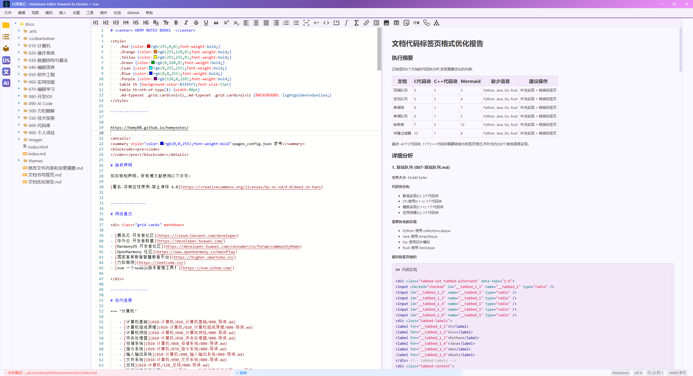
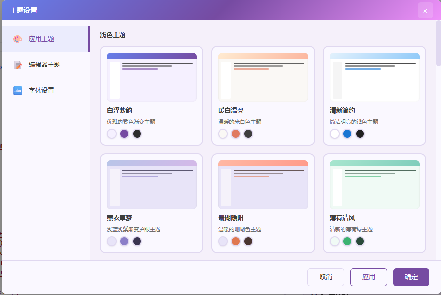

# 白泽笔记 (BaiZeNotes)

<div align="center">


**一款功能丰富、界面美观的跨平台 Markdown 桌面编辑器**

[快速开始](#-快速开始) · [功能特性](#-功能特性) · [下载安装](#-下载安装) · [开发文档](#-开发文档)

</div>


---

## 📖 项目简介

白泽笔记是一款基于 **Electron + Vue 3 + TypeScript** 构建的现代化 Markdown 桌面编辑器，采用 **Monaco Editor**（VS Code 同款编辑器）作为核心编辑组件，支持实时预览、多格式导入导出、丰富的主题系统和强大的工具集成。

### 🎯 设计理念

- **简洁优雅**：现代化的 UI 设计，28种精美主题任你选择
- **功能强大**：Monaco Editor + 实时预览 + 多格式支持
- **性能优异**：大文件加载速度提升50%+，内存使用减少40%
- **跨平台**：支持 Windows 平台
- **类型安全**：完整的 TypeScript 类型支持

### ✨ 核心亮点

- 🚀 **Monaco Editor**：VS Code 同款编辑器，智能补全、多光标编辑
- 🎨 **28种主题**：精心设计的应用主题，支持实时切换
- 📝 **实时预览**：Markdown 实时渲染，支持数学公式、流程图；预览在渲染进程本地单跳完成（零主进程渲染 IPC）
- 🌐 **国际化（i18n）**：内置简体中文 / English 双语，系统设置中实时切换，主进程与渲染层共用一套词典
- 🔒 **安全加固**：导航边界拦截、shell 协议白名单、preload 通道白名单、CSP、DOMPurify 消毒、iframe sandbox 收窄
- 📦 **多格式支持**：导入导出 Word、HTML、JSON、YAML、PDF 等
- 🛠️ **工具集成**：转换工具、加密工具、开发工具一应俱全
- ⚡ **性能优化**：大文件加载快50%，内存占用少40%；PlantUML 本地离线渲染，无需联网

---

## ✨ 功能特性

### 📝 编辑器核心

#### Monaco Editor 集成

- **智能补全**：Markdown 语法智能补全
- **多光标编辑**：支持多光标同时编辑
- **代码折叠**：支持代码块折叠
- **语法高亮**：完整的 Markdown 语法高亮
- **快捷键支持**：丰富的快捷键支持

#### 实时预览

- **Markdown 渲染**：实时 Markdown 渲染
- **本地单跳渲染**：预览渲染全部在渲染进程完成（PF-02），主进程渲染 IPC 由 4 跳降为 0 跳
- **代码高亮**：支持 100+ 编程语言高亮
- **数学公式**：KaTeX 数学公式渲染（已迁移至渲染层，不再阻塞主进程）
- **流程图**：Mermaid 流程图、时序图、甘特图等（渲染层本地渲染 + 内容 hash 缓存）
- **PlantUML**：基于内置 teaVM 的本地离线渲染（`resources/plantuml`），弱网/离线可用，失败时降级
- **图表支持**：饼图、柱状图、折线图等

#### 快速访问

- **符号插入**：快速插入常用符号
- **表情插入**：快速插入常用表情
- **自定义快捷键**：支持自定义快捷键绑定

#### 多格式支持

- **导入格式**：Word、HTML、JSON、YAML、XML、TXT、CSV
- **导出格式**：Word、JSON、XML、YAML、HTML、PDF
- **编码检测**：自动检测文件编码（UTF-8、GBK、GB2312等）
- **编码转换**：支持多种编码格式转换

### 🎨 主题系统

#### 应用主题（28种）

- **经典主题**：白泽紫韵、暖白温馨、清新简约
- **护眼主题**：护眼绿洲、护眼米黄、护眼淡蓝、护眼樱粉、护眼琥珀、护眼青瓷、护眼丁香
- **特色主题**：薰衣草梦、珊瑚暖阳、薄荷清风、日落余晖、玫瑰花园
- **深色主题**：深邃夜空、极简深黑
- **自然主题**：深海蔚蓝、森林秘境
- **白泽专属**：白泽图标、白泽文字、白泽星空、白泽神兽、白泽数据、白泽镜像（浅色/深色）

#### 编辑器主题（55种）

- Monaco Editor 主题同步
- 支持自定义主题
- 主题实时切换，无需重启

### 🛠️ 工具集成

#### 转换工具

- **格式转换**：JSON/CSV/YAML/TOML 互转
- **大小写转换**：驼峰、下划线、短横线等
- **颜色转换**：HEX、RGB、HSL 互转
- **日期转换**：时间戳、日期格式转换

#### 加密工具

- **加密解密**：AES、DES、RSA 等多种加密算法
- **哈希计算**：MD5、SHA-1、SHA-256、SHA-512
- **Base64**：Base64 编码解码

#### 开发工具

- **正则表达式**：正则表达式测试工具
- **HTTP 请求**：HTTP 请求测试工具
- **时间戳转换**：Unix 时间戳转换
- **UUID 生成**：UUID/GUID 生成工具
- **二维码生成**：二维码生成工具

#### 在线资源导航

- **AI 导航**：ChatGPT / DeepSeek / Claude / Midjourney / Suno 等 9 组 70 个主流 AI 工具官方入口，菜单一键直达（2026-11 新增）

### ℹ️ 帮助系统

#### 版本信息

- **版本发布说明**：查看各版本（v1.0.0 ~ v1.4.0）的发布说明
- **更新日志**：展示依赖升级详情和代码适配修复
- **技术栈信息**：显示项目技术栈详细信息
- **关于页面**：显示应用版本、开发框架、系统环境信息

### 🌐 国际化（i18n）

#### 中英双语

- **语言切换**：系统设置中选择「简体中文 / English」，切换后界面即时刷新，无需重启
- **词条统一**：主进程与渲染层共用 `src/shared/i18n` 词典（zh-CN / en-US 各 12 个命名空间），避免两套文案漂移
- **主进程文案**：对话框、消息框等 JSDOM/原生提示经 `tMain()` 输出；渲染层组件统一使用 `t()`
- **范围覆盖**：菜单、状态栏、设置、对话框、编辑器 UI、转换/网络工具、主题名称等

### 🔒 安全与隐私

#### 进程与交互安全

- **导航边界**：主窗口拦截 `will-navigate` / `will-redirect`，仅允许开发服务器与打包后的本地 renderer 页面
- **协议白名单**：`shell.openExternal` 统一走安全封装，仅放行 http/https，拒绝 `file:` / `javascript:` / `data:` 等协议
- **新窗口策略**：`setWindowOpenHandler` 一律不新建窗口，外部链接只交给系统浏览器
- **拖拽防护**：渲染层全局拦截 `dragover` / `drop`，阻止拖入远程链接或本地 HTML 触发导航
- **preload 白名单**：对话框 preload 的 `send` 仅放行 2 个回车通道；在线网页窗口不加载任何 preload
- **CSP**：渲染页配置 Content-Security-Policy；渲染输出统一经 DOMPurify 消毒后再 `v-html`
- **iframe 收窄**：HTML 查看器 sandbox 移除脚本/表单/弹窗权限，仅保留同源静态展示

### 📂 文件管理

#### 文件操作

- **智能编码检测**：自动检测文件编码
- **自动保存**：默认关闭（需在系统设置中自行开启），可配置保存间隔（默认 60 秒）；关闭应用时若文件有未保存修改会提示「保存并关闭 / 不保存 / 取消」
- **文件状态持久化**：应用重启后自动恢复工作状态
- **崩溃恢复**：支持崩溃恢复

#### 资源管理器

- **文件树展示**：树形结构展示文件和文件夹
- **Markdown 目录大纲**：自动生成 Markdown 目录大纲
- **拖拽支持**：支持文件拖拽操作
- **右键菜单**：丰富的右键菜单操作

### ⚡ 性能优化

#### 编辑器性能

- **大文件优化**：大文件加载速度提升 50%+
- **内存优化**：内存使用减少 40%
- **Monaco Editor 实例管理**：防止内存泄漏
- **LRU 缓存算法**：文件内容智能缓存

#### Mermaid 渲染优化

- **并行渲染**：多图表并行渲染，速度提升 3倍
- **渲染缓存**：图表渲染结果缓存
- **按需渲染**：只渲染可见区域图表

#### EventBus 优化

- **自动清理机制**：组件卸载时自动清理事件监听器
- **内存泄漏修复**：修复事件监听器残留问题

#### 包体积与死代码治理

- **死代码清理**：删除 36 个零引用文件 / 10,403 行死代码，主进程产物 `out/main/index.js` 体积下降 44.97%
- **死通道清理**：IPC 通道常量 123 → 86；通道命名统一为 `baize:<domain>:<name>`，并在测试中强制校验格式、域名白名单与零死常量
- **打包体积治理**：渲染层依赖（mermaid / monaco-editor / vue / katex / highlight.js 等 14 个已由 Vite 打入 renderer 的包）移入 devDependencies，并排除 node_modules 内 source map；app.asar 361.59 MiB → 66.65 MiB（-81.6%），NSIS 安装包 161.2 MiB → 111.8 MiB（-30.6%），便携包 131.0 MiB → 100.0 MiB（-23.7%）

#### 状态管理优化

- **electron-store 持久化**：使用 electron-store 进行状态持久化
- **状态分离**：分离持久化状态和运行时状态
- **类型安全 API**：提供完整的 TypeScript 类型支持

---

## 📸 应用截图

<div align="center">

|                  主界面                   |                  主题设置                   |
| :---------------------------------------: | :-----------------------------------------: |
|  |  |

</div>

---

## 🚀 快速开始

### 环境要求

- **Node.js**: >= 22.0.0（与 package.json `engines` 一致）
- **npm**: >= 10.0.0
- **Git**: 最新版本

### 安装依赖

```bash
# 克隆项目
git clone https://github.com/hemy08/BaiZeNotesByVue.git

# 进入项目目录
cd BaiZeNotesByVue

# 安装依赖
npm install
```

### 开发运行

```bash
# 启动开发模式
npm run dev
```

### 构建打包

```bash
# 构建 Windows 版本（NSIS安装包 + 便携版）
npm run build:win:all

# 构建 Windows NSIS 安装包
npm run build:win:nsis

# 构建 Windows 便携版
npm run build:win:portable

# 构建 macOS 版本
npm run build:mac

# 构建 Linux 版本
npm run build:linux
```

---

## 📦 下载安装

### Windows 平台

目前仅支持 Windows 平台，提供两个下载渠道：

#### 方式一：GitHub Releases（推荐）

[](https://github.com/hemy08/BaiZeNotesByVue/releases)

|  版本  |              说明               |                          下载链接                          |
| :----: | :-----------------------------: | :--------------------------------------------------------: |
| 安装版 | NSIS 安装包，支持自定义安装路径 | [下载](https://github.com/hemy08/BaiZeNotesByVue/releases) |
| 便携版 |        免安装，解压即用         | [下载](https://github.com/hemy08/BaiZeNotesByVue/releases) |

#### 方式二：华为云 DevCloud

[](https://devcloud.cn-north-4.huaweicloud.com/cloudartifact/project/13dd100011dc4f88ad60768fb5b4b7db/private/repoView/detail?repoId=13dd100011dc4f88ad60768fb5b4b7db&path=BaiZeNotes)

|  版本  |    说明     |                                                                                          下载链接                                                                                          |
| :----: | :---------: | :----------------------------------------------------------------------------------------------------------------------------------------------------------------------------------------: |
| 安装版 | NSIS 安装包 | [下载](https://devcloud.cn-north-4.huaweicloud.com/cloudartifact/project/13dd100011dc4f88ad60768fb5b4b7db/private/repoView/detail?repoId=13dd100011dc4f88ad60768fb5b4b7db&path=BaiZeNotes) |
| 便携版 | 免安装版本  | [下载](https://devcloud.cn-north-4.huaweicloud.com/cloudartifact/project/13dd100011dc4f88ad60768fb5b4b7db/private/repoView/detail?repoId=13dd100011dc4f88ad60768fb5b4b7db&path=BaiZeNotes) |

### 安装说明

#### 安装版

1. 下载 `BaiZeNotes_Setup_x.x.x_windows_x64.exe`
2. 双击运行安装程序
3. 选择安装路径（支持自定义）
4. 完成安装后，桌面会自动创建快捷方式

#### 便携版

1. 下载 `BaiZeNotes_x.x.x_windows_x64.exe`
2. 双击运行即可，无需安装
3. 可放置在任意目录使用

---

## 🏗️ 项目结构

```
BaiZeNotesByVue/
├── src/                                  # 源代码目录（300 个源码文件：206 ts / 81 vue / 13 css）
│   ├── main/                             # 主进程（70 个 .ts）
│   │   ├── index.ts                      # 主进程入口（窗口、生命周期、导航边界）
│   │   ├── config/                       # 配置管理（12 个模块）
│   │   │   ├── config-manager.ts         # 配置读写单真源（STORE_BACKED_CONFIGS）
│   │   │   ├── theme-config.ts           # 应用主题配置（28 种）
│   │   │   ├── theme-registry.ts         # Monaco 主题注册表
│   │   │   ├── editor-setting.ts         # 编辑器设置
│   │   │   ├── system-setting.ts         # 系统设置（含语言）
│   │   │   ├── quick-link-config.ts      # 快速链接配置
│   │   │   ├── window-manager.ts         # 窗口管理
│   │   │   └── short-key-register.ts     # 快捷键注册
│   │   ├── constants/                    # 共享常量（urls.ts）
│   │   ├── dialogs/                      # 主进程 JSDOM 对话框（10 个文件）
│   │   ├── ipc/                          # IPC 注册与菜单动作（11 个文件）
│   │   │   ├── handlers.ts               # IPC 处理器
│   │   │   ├── index.ts                  # IPC 注册入口
│   │   │   ├── ipc-listener-manager.ts   # IPC 监听器管理
│   │   │   └── menu-*.ts                 # 菜单动作（file/edit/view/help/tools/handle）
│   │   ├── renders/                      # 主进程渲染器
│   │   │   └── plantuml-local.ts         # PlantUML 本地 teaVM 离线渲染
│   │   └── utils/                        # 工具函数（33 个文件）
│   │       ├── file-utils/               # 文件操作（12 个：读写/导入导出/自动保存/剪贴板/图片）
│   │       ├── security.ts               # 导航边界与 shell 协议白名单
│   │       ├── i18n.ts                   # 主进程 tMain() 翻译
│   │       ├── baize-store.ts / store-factory.ts / file-state-store.ts
│   │       ├── app-paths.ts / app-state.ts / global.ts / utils.ts
│   │       ├── logger.ts / auto-updater.ts
│   │       └── encrypt-decrypt.ts        # 加解密工具
│   ├── preload/                          # 预加载脚本（3 个文件）
│   │   ├── index.ts                      # 主窗口 API 暴露
│   │   ├── dialog.ts                     # 对话框 preload（send 通道白名单）
│   │   └── index.d.ts                    # 类型声明
│   ├── shared/                           # 主进程 / 渲染层共享代码（39 个 .ts）
│   │   ├── ipc-channels.ts               # IPC 通道常量唯一真源（92 个通道 / 17 组）
│   │   ├── i18n/                         # 中英词典（12 个命名空间 + translate 函数）
│   │   ├── types/                        # 共享类型定义（10 个模块）
│   │   └── constants/                    # 共享常量
│   └── renderer/                         # 渲染进程代码
│       ├── index.html                    # 渲染页（含 CSP）
│       └── src/
│           ├── App.vue / main.ts / env.d.ts
│           ├── components/               # Vue 组件（80 个 .vue + 77 个 ts/css）
│           │   ├── BaiZeNotes.vue / MenuBar.vue / StatusBar.vue / WelcomeScreen.vue
│           │   ├── Markdown/             # 编辑器与预览（38 个文件，含 preview-local-render.ts）
│           │   ├── dialogs/              # 渲染层对话框（18 个 .vue + 1 个 ts 索引：simple/medium/complex/help）
│           │   ├── PluginTools/          # 插件工具（84 个文件：Convert/Encryption/Informations/NetWork/Tools）
│           │   ├── MenuBar/              # 菜单逻辑（menu-config / menu-actions / menu-consts）
│           │   ├── ResourceManager/      # 资源管理器
│           │   ├── WorkSpaceArea/        # 工作区（NaviTab / WorkSpace）
│           │   └── HemyTools/            # 辅助工具（HTML 查看 / PDF 预览）
│           ├── composables/              # 组合式函数（4 个：对话框拖拽/缩放、EventBus、窗口管理）
│           ├── common/                   # 公共模块（useConfigStore、i18n、event-bus、templates、escape-html）
│           ├── styles/                   # 样式文件（9 个）
│           └── assets/                   # 静态资源（图标/图片等 63 个文件）
├── resources/                            # 应用资源
│   ├── themes/                           # 主题配置
│   │   └── monaco-themes/themes/         # Monaco 编辑器主题（55 个主题 json + themelist 索引）
│   ├── plantuml/                         # PlantUML 本地 teaVM 渲染资源（6 个文件）
│   ├── icon/                             # 应用图标（ico/svg）
│   └── config/                           # 配置文件（version.json 构建时生成）
├── tests/                                # 单元测试（171 个 .test.ts / 3,265 个用例）
├── docs/                                 # 项目文档
│   ├── wiki/                             # 知识库文档（分类结构）
│   │   ├── README.md                     # 文档索引
│   │   ├── 01-项目分析报告/               # 项目分析（9 篇）
│   │   ├── 02-设计与架构/                 # 架构文档、设计文档、规格文档、项目详细文档
│   │   ├── 03-功能说明/                   # 导入/导出/菜单配置等功能说明（5 篇）
│   │   └── 04-优化与专项报告/             # 优化专项报告（7 篇）
│   ├── reports/                          # 报告归档（Markdown 版 + 独立 HTML Wiki）
│   │   ├── README.md                     # 报告总索引（含口径说明与合并记录）
│   │   ├── md/                           # Markdown 报告（26 篇，按三类分类）
│   │   └── html/                         # HTML 报告 Wiki（README+_sidebar 导航 + 25 份带悬浮目录页面）
│   ├── images/                           # 文档配图
│   ├── 历史归档/                          # 历史文档归档（非当前实现，见「文档导航」说明）
│   │   └── 架构文档.html                  # 历史版架构文档合辑（非当前；最新见 docs/wiki/02-设计与架构/架构文档.md）
│   └── md/                               # 其他 Markdown 文档
├── build/                                # 构建脚本（generate-version-config.js、prepare-build-dirs.js、报告工具 generate-report-wiki.js 等）
├── dist/                                 # 打包输出（已忽略）
├── out/                                  # 编译输出（已忽略）
├── electron.vite.config.ts               # Electron-Vite 配置
├── electron-builder.yml                  # Electron-Builder 配置
├── eslint.config.js                      # ESLint 配置（flat config）
├── package.json                          # 项目依赖配置
├── tsconfig*.json                        # TypeScript 配置
├── vitest.config.ts                      # 测试配置
├── .prettierrc.yaml                      # Prettier 配置
├── CHANGELOG.md                          # 更新日志
└── RELEASE-NOTES.md                      # 发布说明
```

---

## 🛠️ 技术栈

### 核心框架

|    技术    |  版本   | 说明                   | 官网                                    |
| :--------: | :-----: | :--------------------- | :-------------------------------------- |
|  Electron  | 43.8.10 | 跨平台桌面应用框架     | [官网](https://www.electronjs.org/)     |
|    Vue     | 3.5.45  | 渐进式 JavaScript 框架 | [官网](https://vuejs.org/)              |
| TypeScript |  6.0.3  | JavaScript 的类型超集  | [官网](https://www.typescriptlang.org/) |
|    Vite    |  8.3.8  | 下一代前端构建工具     | [官网](https://vitejs.dev/)             |

### 编辑器核心

|       技术        |  版本   | 说明                                           | 官网                                               |
| :---------------: | :-----: | :--------------------------------------------- | :------------------------------------------------- |
|   Monaco Editor   | 0.57.0  | VS Code 同款代码编辑器                         | [官网](https://microsoft.github.io/monaco-editor/) |
|    markdown-it    | 15.0.3  | Markdown 解析器，支持插件扩展                  | [官网](https://markdown-it.github.io/)             |
|   highlight.js    | 11.12.0 | 代码语法高亮，支持 100+ 语言                   | [官网](https://highlightjs.org/)                   |
|       KaTeX       | 0.18.4  | 快速数学公式渲染（渲染层本地渲染）             | [官网](https://katex.org/)                         |
|      Mermaid      | 12.3.0  | 流程图、时序图、甘特图等                       | [官网](https://mermaid-js.github.io/)              |
| PlantUML（teaVM） |    -    | 本地离线渲染（内置 `resources/plantuml` 资源） | [官网](https://plantuml.com/)                      |

### 状态管理与数据

|      技术       |  版本  | 说明                                              | 官网                                                     |
| :-------------: | :----: | :------------------------------------------------ | :------------------------------------------------------- |
| Vue Composables |   -    | Vue 3 组合式函数状态管理（渲染层 useConfigStore） | [官网](https://vuejs.org/)                               |
| electron-store  | 11.0.2 | Electron 持久化存储（主进程配置单真源）           | [GitHub](https://github.com/sindresorhus/electron-store) |
|    fs-extra     | 11.4.0 | 文件系统增强，Promise 支持                        | [GitHub](https://github.com/jprichardson/node-fs-extra)  |

### 工具库

|    技术    |  版本  | 说明                  | 官网                                               |
| :--------: | :----: | :-------------------- | :------------------------------------------------- |
| crypto-js  | 4.2.0  | JavaScript 加密库     | [文档](https://cryptojs.gitbook.io/)               |
| DOMPurify  | 3.4.17 | HTML/SVG 消毒，防 XSS | [GitHub](https://github.com/cure53/DOMPurify)      |
|    uuid    | 14.0.2 | UUID 生成工具         | [GitHub](https://github.com/uuidjs/uuid)           |
|    ulid    | 3.0.2  | ULID 生成工具         | [GitHub](https://github.com/ulid/javascript)       |
| iconv-lite | 0.7.3  | 文件编码转换          | [GitHub](https://github.com/ashtuchkin/iconv-lite) |
| jschardet  | 3.1.4  | 文件编码探测          | [GitHub](https://github.com/aadsm/jschardet)       |

### UI 组件

|            技术            | 版本  | 说明              | 官网                                                   |
| :------------------------: | :---: | :---------------- | :----------------------------------------------------- |
| @imengyu/vue3-context-menu | 1.5.6 | Vue3 右键菜单组件 | [GitHub](https://github.com/imengyu/vue3-context-menu) |

### 开发工具

|                技术                |  版本   | 说明                                        | 官网                                                   |
| :--------------------------------: | :-----: | :------------------------------------------ | :----------------------------------------------------- |
|           electron-vite            |  6.0.0  | Electron + Vite 集成                        | [官网](https://electron-vite.org/)                     |
|          electron-builder          | 26.18.0 | Electron 应用打包工具                       | [官网](https://www.electron.build/)                    |
|               Vitest               | 4.1.12  | 单元测试框架（171 个测试文件 / 3,265 用例） | [官网](https://vitest.dev/)                            |
|               ESLint               | 9.39.4  | JavaScript 代码检查工具                     | [官网](https://eslint.org/)                            |
|              Prettier              |  3.9.6  | 代码格式化工具                              | [官网](https://prettier.io/)                           |
|  @electron-toolkit/eslint-config   |  2.1.0  | Electron ESLint 配置                        | [GitHub](https://github.com/alex8088/electron-toolkit) |
| @electron-toolkit/eslint-config-ts |  3.1.0  | Electron TypeScript ESLint 配置             | [GitHub](https://github.com/alex8088/electron-toolkit) |

### 构建工具

| 技术  |  版本   | 说明                     |
| :---: | :-----: | :----------------------- |
| NSIS  | 3.0.4.1 | Windows 安装程序制作工具 |
| 7-Zip |    -    | 文件压缩工具             |

---

## 📊 项目统计

> 以下数据为 2026-11-19 实测（v1.3.9 基线；口径说明见 [报告总索引](docs/reports/README.md)）。

|     指标     |                   数量                   | 说明                                                                                                                                                                                                 |
| :----------: | :--------------------------------------: | :--------------------------------------------------------------------------------------------------------------------------------------------------------------------------------------------------- |
|  源码文件数  |                  300 个                  | `src/` 下 .ts / .vue / .css 文件（206 ts / 81 vue / 13 css；其中 .ts/.vue 287 个）                                                                                                                   |
|   代码行数   |                94,406 行                 | 上述 300 个文件总行数（含空行；其中 .ts/.vue 91,783 行）                                                                                                                                             |
|  Vue 组件数  |                  81 个                   | `src/` 下 .vue 文件（components 目录 80 个 + 根组件 App.vue）                                                                                                                                        |
| 渲染层对话框 |                  18 个                   | src/renderer/src/components/dialogs（.vue 对话框组件，另 1 个 ts 索引）                                                                                                                              |
| 主进程对话框 |                10 个文件                 | src/main/dialogs（JSDOM 对话框 + 共享样式）                                                                                                                                                          |
|   应用主题   |                  28 种                   | src/main/config/theme-config.ts（编译进主进程，无资源 JSON；旧 app_themes 已删除）                                                                                                                   |
|  编辑器主题  |                  57 种                   | Monaco 主题（内置 3 + 磁盘 54；themes 目录含 54 个主题 json + themelist 索引）                                                                                                                       |
|   IPC 通道   |                  91 个                   | `baize:<domain>:<name>`（91 个 / 17 组常量），唯一真源 `src/shared/ipc-channels.ts`                                                                                                                  |
|   插件工具   |                  38 个                   | src/renderer/src/components/PluginTools/plugin-tools-const.ts（异步按需加载）                                                                                                                        |
|   单元测试   |               3,201 个用例               | 172 个测试文件（vitest，全通过）                                                                                                                                                                     |
|   声明依赖   |                  50 个                   | 生产依赖 11 + 开发依赖 39（package.json 实测）                                                                                                                                                       |
|   依赖审计   |                  0 漏洞                  | 生产与全量依赖均为 0 漏洞（2026-11-19 依赖安全治理实测，官方 registry，828 依赖；electron 43.8.12 + electron-builder 26.18.1 + minimatch override 11.0.9；Dependabot 254 条告警全量分类 0 条可复现） |
|  安装包体积  |                ≈110.0 MiB                | NSIS 安装包 109.98 MiB / 便携版 99.83 MiB（app.asar 39.31 MiB；2026-11-19 P0 构建实测；十进制 115.32 MB / 104.68 MB）                                                                                |
|  主进程产物  |                ≈0.60 MiB                 | `out/build/main/index.js`（634,114 B；2026-11-19 P0 构建实测；另有 auto-updater 分块 10,558 B）                                                                                                      |
| 主渲染 chunk | 123.4 KiB（入口）+ 321.8 KiB（主界面壳） | 入口 `index-*.js`（126,396 B）；主界面壳 `BaiZeNotes-*.js`（329,538 B）；Monaco 异步 `editor.api-*.js` 4.82 MiB / `MarkdownMonacoEditor-*.js` 2.10 MiB（按需加载；2026-11-19 P0 实测）               |

### 代码规模分布（实测）

|         类型         | 文件数  |    行数    |
| :------------------: | :-----: | :--------: |
|   TypeScript (.ts)   |   229   |   63,311   |
|    Vue SFC (.vue)    |   84    |   20,393   |
|         CSS          |   14    |   2,348    |
|     **源码合计**     | **327** | **86,052** |
| 单元测试（.test.ts） |   171   |   51,646   |
|   静态资源（.svg）   |   60    |    504     |

### 关键源码文件行数（实测）

|           文件           | 行数  | 说明                                      |
| :----------------------: | :---: | :---------------------------------------- |
| preview-local-render.ts  |  903  | 预览本地单跳渲染（PF-02）                 |
|  ThemeSettingDialog.vue  | 1,060 | 主题设置对话框                            |
|    file-operations.ts    |  932  | 文件读写与文件树操作                      |
| plantuml.ts（templates） |  737  | PlantUML 代码模板                         |
| MarkdownMonacoEditor.vue |  763  | Monaco 编辑器组件                         |
|     theme-config.ts      |  730  | 应用主题配置（28 种）                     |
|    plantuml-local.ts     |  608  | PlantUML 本地 teaVM 渲染                  |
|     ipc-channels.ts      |  213  | IPC 通道常量唯一真源（92 个通道 / 17 组） |

---

## 📚 开发文档

项目文档分三类：**知识库文档**（[docs/wiki](docs/wiki/README.md)）、**报告归档**（[docs/reports](docs/reports/README.md)）与**报告 HTML Wiki**（[docs/reports/html](docs/reports/html/README.md)）。

### 文档索引

- [知识库文档索引](docs/wiki/README.md) - docs/wiki 全部文档导航（4 类 25 篇）
- [报告总索引](docs/reports/README.md) - 检查/修复/专项报告（26 篇，已去日期并按主题合并，含口径说明）
- [当前遗留问题清单](docs/reports/md/03-专项治理/当前遗留问题清单.md) - **问题跟踪台账**（21 项，17 ✅ / 3 🟡 / 1 ⏸️；修复后更新状态）
- [报告 HTML Wiki](docs/reports/html/README.html) - HTML 版报告（首页 + 侧边栏 + 每页顶部整体导航 + 20 份带悬浮目录页面）
- [IPC 通信矩阵](docs/reports/md/03-专项治理/IPC通信矩阵.md) - **当前 IPC 口径**（91 通道 / 17 组 + 窗口/preload 结构）
- [IPC 通信治理报告](docs/reports/md/03-专项治理/IPC通信治理报告.md) - 通信检查 + 修复计划 + 命名方案（历史）

### 项目分析与架构

- [项目综合分析报告](docs/wiki/01-项目分析报告/项目综合分析报告.md) - 项目整体分析
- [性能与优化综合报告](docs/wiki/01-项目分析报告/性能与优化综合报告.md) - 性能优化详细报告
- [架构文档](docs/wiki/02-设计与架构/架构文档.md) - 系统架构说明
- [设计文档](docs/wiki/02-设计与架构/设计文档.md) - UI 设计规范
- [规格文档](docs/wiki/02-设计与架构/规格文档.md) - 需求与规格

### 功能文档

- [文件导入功能说明](docs/wiki/03-功能说明/文件导入功能说明.md) - 文件导入功能详细说明
- [文件导出功能说明](docs/wiki/03-功能说明/文件导出功能说明.md) - 文件导出功能详细说明
- [菜单配置详细文档](docs/wiki/03-功能说明/菜单配置详细文档.md) - 菜单系统文档
- [编辑器设置功能说明](docs/wiki/03-功能说明/编辑器设置功能说明.md) - 编辑器设置说明

### 优化与专项报告

- [事件监听器内存泄漏分析报告](docs/wiki/04-优化与专项报告/事件监听器内存泄漏分析报告.md) - 内存管理报告
- [事件监听器优化总结](docs/wiki/04-优化与专项报告/事件监听器优化总结.md) - 监听器治理总结
- [依赖包清理报告](docs/wiki/04-优化与专项报告/依赖包清理报告.md) - 依赖治理报告
- [状态管理与Store优化报告](docs/wiki/04-优化与专项报告/状态管理与Store优化报告.md) - 状态管理优化
- [主题优化方案](docs/wiki/04-优化与专项报告/主题优化方案.md) - 主题系统优化方案

### 2026-11 架构治理报告

- [国际化（i18n）实施报告](docs/reports/md/02-修复与实施/国际化实施报告.md) - 中英双语词典与 t()/tMain() 架构
- [预览单跳重构报告](docs/reports/md/02-修复与实施/预览单跳重构报告.md) - PF-02：预览本地渲染，IPC 4 跳 → 0 跳
- [IPC 通道命名统一方案](docs/reports/md/03-专项治理/IPC通信治理报告.md) - `baize:<domain>:<name>` 命名规范（历史 123 通道清单，已并入治理报告）
- [依赖安全治理报告](docs/reports/md/03-专项治理/依赖安全治理报告.md) - Dependabot 254 条告警全量分类（0 条可复现）、npm audit 差异归因、修复批与 Dependabot 配置
- [架构文档（最新）](docs/wiki/02-设计与架构/架构文档.md) - v1.3.9 当前架构（含 i18n / PF-02 / PlantUML 本地渲染 / 配置单真源 / 安全边界）
- 说明：`docs/历史归档/架构文档.html` 为 **历史版本合辑（非当前实现）**，仅保留旧版版式与 ADR，最新架构以 wiki Markdown 为准

### 更新记录

- [更新日志](./CHANGELOG.md) - 版本更新历史
- [发布说明](./RELEASE-NOTES.md) - 版本发布说明

### 开发指南

```bash
# 代码检查
npm run lint

# 代码格式化
npm run format

# 代码格式检查（仅检查，不自动修改；CI 中以信息性步骤运行）
npm run format:check

# 类型检查（主进程 + 渲染层）
npm run typecheck

# 运行单元测试（171 个测试文件 / 3,265 个用例）
npm run test

# 运行单元测试并生成覆盖率报告
npm run test:coverage

# 清理构建产物
npm run clean
```

---

## 🤝 贡献指南

欢迎提交 Issue 和 Pull Request！

### 贡献流程

1. **Fork 本仓库**

    ```bash
    git clone https://github.com/your-username/BaiZeNotesByVue.git
    ```

2. **创建特性分支**

    ```bash
    git checkout -b feature/AmazingFeature
    ```

3. **提交更改**

    ```bash
    git commit -m 'Add some AmazingFeature'
    ```

4. **推送到分支**

    ```bash
    git push origin feature/AmazingFeature
    ```

5. **提交 Pull Request**

### 代码规范

- ✅ 遵循 ESLint 和 Prettier 配置
- ✅ 使用 TypeScript 类型注解
- ✅ 编写清晰的提交信息
- ✅ 添加必要的测试用例
- ✅ 更新相关文档

### 分支说明

- `main` - 主分支，稳定版本
- `develop` - 开发分支，新功能开发
- `feature/*` - 特性分支
- `bugfix/*` - Bug 修复分支
- `release/*` - 发布分支

---

## 🐛 问题反馈

如果您遇到任何问题或有功能建议，请：

1. 查看 [Issues](https://github.com/hemy08/BaiZeNotesByVue/issues) 是否已有相关问题
2. 如果没有，请创建新的 Issue，并详细描述：
    - 问题描述
    - 复现步骤
    - 期望结果
    - 实际结果
    - 系统环境（OS、版本等）
    - 截图（如有必要）

---

## 🗺️ 开发路线图

### v1.4.0 (当前版本)

- [x] 新版本基线：全仓版本号 1.3.9 → 1.4.0；自本版本起所有修改归入 1.4.0
- [x] 1.3.9 已发布 GitHub Release（tag `release-1.3.9`；NSIS 109.98 MB / portable 99.84 MB / latest.yml），包含 tag release-1.3.8 之后全部修改
- [x] 主题设置首次打开列表为空修复（visible watch immediate）；同步修复 Editor/新建/重命名对话框首开初始化
- [ ] 长期计划：macOS 和 Linux 版本支持、协作编辑、插件系统、云同步

### v1.3.9

- [x] 结构治理与工程优化：P0 安装包瘦身（Setup 109.98 MiB / portable 99.83 MiB）+ CI 体积预算、E2E 补启动恢复/设置持久化/打包启动
- [x] P1 性能基线（开发/打包版冷启动）、预览 renderSequence TDZ / 设置首开回填修复、存量清理与 docs 链接检查
- [x] P2 i18n 一致性 + BaseDialog 可访问性；P3 prettier 3.10.1、vue-tsc 3.3.14；P4 E2E preload 根因修复
- [x] HTML 查看器顶部导航修复；自动保存默认关闭；未保存关闭确认

### v1.3.8

- 公共接口归位第 0~4 批：shared 三层单真源（types 14 / utils 11 / constants 10 模块）、60+ 文件迁移、18/18 对话框 BaseDialog 组件化

- [x] 主界面异步分块：入口 chunk 10,096KB → 114KB（-98.9%），初始加载 -94.3%
- [x] 安全加固：PDF 预览 pdf.js、CSP 收紧、preload 受限白名单、IPC 分组 17 组、PlantUML 空闲销毁
- [x] E2E 纳入 CI、死通道清理、欢迎页窗口控制修复、报告 HTML Wiki 重构（25 页）+ 结构分析报告（5 张 SVG）

### v1.3.6

- [x] 2026-11-15 全面治理与迭代：安全加固（P0 攻击链闭环）、国际化（i18n）、预览本地单跳渲染、IPC 架构收口
- [x] 127 项检查清单 105 项完全修复、22 项部分修复；新增内容审查 32 项问题修复 25 项
- [x] 系统设置 9 项禁用项全部补充实现（启动恢复/自启动/托盘/窗口记忆/跟随系统主题/自动备份等）
- [x] 菜鸟工具插件集成（18 个离线工具，插件总数 38）；mkdocs-material 扩展语法 15 项
- [x] 正则工具 Worker 化、自动备份异步化等审查修复批次

### v1.2.2

- [x] Electron 43 重大升级（38 → 43）
- [x] 40+ 依赖包全量升级
- [x] 78 个 TypeScript 类型错误修复
- [x] 3 个 XSS 安全风险修复
- [x] 版本发布说明页面（11 个版本）
- [x] 更新日志对话框
- [x] 关于页面新增 Monaco Editor 和 markdown-it 版本显示
- [x] 国际化（i18n）：中英双语切换，主进程/渲染层共用词典
- [x] PF-02 预览本地单跳渲染（主进程渲染 IPC 4 跳 → 0 跳）
- [x] PlantUML 本地离线渲染（teaVM，弱网/离线可用）
- [x] IPC 通道命名统一（`baize:<domain>:<name>`）与死通道清理（123 → 86）
- [x] P0 安全加固（导航拦截 / 协议白名单 / preload 白名单 / 拖拽拦截）与 P1 XSS 加固
- [x] 死代码清理（36 个零引用文件 / 10,403 行，主进程产物 -44.97%）

### v1.2.1

- [x] 全量代码扫描与优化
- [x] 架构优化
- [x] Bug 修复

### v1.2.0

- [x] 对话框架构重大更新（JSDOM → Vue）
- [x] 新增四个主题
- [x] 主题设置即时更新
- [x] 进程残留修复

### v1.1.5

- [x] 配置文件管理系统
- [x] 卸载体验优化
- [x] 性能优化（加载速度提升50%+）
- [x] 内存泄漏修复
- [x] 55种编辑器主题

---

## 📄 许可证

本项目基于 [MIT](./LICENSE) 许可证开源，许可证全文如下：

```
MIT License

Copyright (c) 2026 hemy08

Permission is hereby granted, free of charge, to any person obtaining a copy
of this software and associated documentation files (the "Software"), to deal
in the Software without restriction, including without limitation the rights
to use, copy, modify, merge, publish, distribute, sublicense, and/or sell
copies of the Software, and to permit persons to whom the Software is
furnished to do so, subject to the following conditions:

The above copyright notice and this permission notice shall be included in all
copies or substantial portions of the Software.

THE SOFTWARE IS PROVIDED "AS IS", WITHOUT WARRANTY OF ANY KIND, EXPRESS OR
IMPLIED, INCLUDING BUT NOT LIMITED TO THE WARRANTIES OF MERCHANTABILITY,
FITNESS FOR A PARTICULAR PURPOSE AND NONINFRINGEMENT. IN NO EVENT SHALL THE
AUTHORS OR COPYRIGHT HOLDERS BE LIABLE FOR ANY CLAIM, DAMAGES OR OTHER
LIABILITY, WHETHER IN AN ACTION OF CONTRACT, TORT OR OTHERWISE, ARISING FROM,
OUT OF OR IN CONNECTION WITH THE SOFTWARE OR THE USE OR OTHER DEALINGS IN THE
SOFTWARE.
```

---

## 👨‍💻 作者

**hemy08**

- 📧 Email: zhaojunwei008@yeah.net
- 🐙 GitHub: [@hemy08](https://github.com/hemy08)
- 🌐 Website: [白泽笔记](https://github.com/hemy08/BaiZeNotesByVue)

---

## 🙏 致谢

感谢以下开源项目的支持：

### 核心框架

- [Electron](https://www.electronjs.org/) - 构建跨平台桌面应用
- [Vue.js](https://vuejs.org/) - 渐进式 JavaScript 框架
- [TypeScript](https://www.typescriptlang.org/) - JavaScript 的类型超集
- [Vite](https://vitejs.dev/) - 下一代前端构建工具

### 编辑器

- [Monaco Editor](https://microsoft.github.io/monaco-editor/) - 强大的代码编辑器
- [Mermaid](https://mermaid-js.github.io/) - 流程图和图表渲染
- [KaTeX](https://katex.org/) - 数学公式渲染
- [markdown-it](https://markdown-it.github.io/) - Markdown 解析器
- [highlight.js](https://highlightjs.org/) - 代码语法高亮

### 工具库

- [electron-store](https://github.com/sindresorhus/electron-store) - Electron 持久化存储
- [crypto-js](https://cryptojs.gitbook.io/) - JavaScript 加密库
- [DOMPurify](https://github.com/cure53/DOMPurify) - HTML/SVG 消毒

---

<div align="center">

**⭐ 如果这个项目对你有帮助，请给一个 Star ⭐**

Made with ❤️ by hemy08

**[⬆ 返回顶部](#白泽笔记-baizenotes)**

</div>
