# 白泽笔记使用指导

> 平台：Windows x64
> 在线文档：[hemy08.github.io](https://hemy08.github.io)

本指南不只说明“某个按钮在哪里”，还说明功能之间如何配合、配置项如何影响行为，以及从捕获、整理到回顾的完整工作流。帮助 → 使用指导提供 HTML 版与 PDF 版，内容一致；HTML 带侧边栏导航，PDF 带目录页与可点击章节链接。

文档按「能力域 + 使用流程」组织，不绑定具体版本号；各节正文以「版本说明」标注能力的起始支持版本，未特别标注的能力在当前版本均可用。

## 1. 快速开始

### 1.1 打开工作区

1. 启动应用，在欢迎页选择「打开文件夹」，或使用「文件 → 打开文件夹」。
2. 左侧资源管理器显示工作区内的 Markdown、TXT、图片、PDF、HTML 等文件。
3. 点击 Markdown/TXT 进入编辑器；点击 PDF/HTML 进入对应预览器。

知识库、标签、反链、链接检查、附件管理都依赖工作区根目录。建议先打开文件夹，而不是只打开单个文件。

### 1.2 新建、保存与恢复

- 新建文件/文件夹：文件菜单或资源管理器右键。
- 保存：`Ctrl + S`；另存为：文件菜单。
- 未保存关闭会弹出保存确认（保存并关闭 / 不保存 / 取消）。
- 「文件」菜单可查看最近文件和最近文件夹。
- 开启「文档历史」后，可查看快照、diff 并回滚；关闭时可编辑链路零变化。

### 1.3 推荐目录结构

```text
我的笔记/
├── diary/                 # 今日日记（E6，开启后自动创建）
├── inbox/                 # 快速收件箱/剪藏（E6/E1，开启后自动创建）
├── images/                # 图片附件
├── files/                 # PDF/文档附件
├── 项目计划.md
└── 读书笔记.md
```

目录约定不是强制的，但统一后标签、附件引用、Wiki 链接和重命名更新更稳定。

### 1.4 功能入口总览（截图指示）

本节先回答“功能在哪里”，第 12 节再给出每个开关的开启/关闭差异。截图中的红框与编号为入口标注，实际界面会随主题、界面风格和密度变化。

<figure class="shot">
  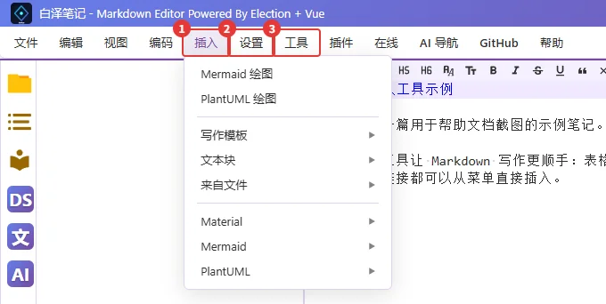
  <figcaption>图 1-1 顶层菜单入口：①插入 ②设置 ③工具；常用内容工具集中在插入/工具，配置集中在设置。</figcaption>
</figure>

<figure class="shot">
  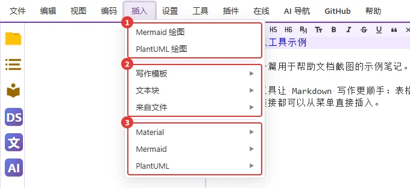
  <figcaption>图 1-2 插入菜单分组：①绘图入口 ②写作模板/文本块/来自文件 ③Material/Mermaid/PlantUML 模板。</figcaption>
</figure>

<figure class="shot">
  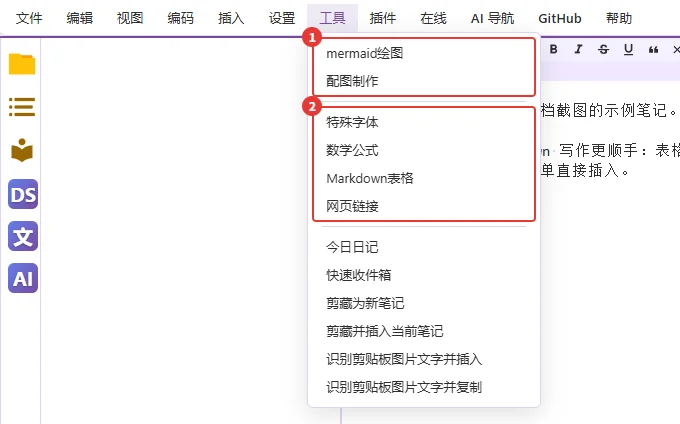
  <figcaption>图 1-3 工具菜单：①mermaid绘图/配图制作 ②特殊字体/数学公式/Markdown 表格/网页链接。</figcaption>
</figure>

<figure class="shot">
  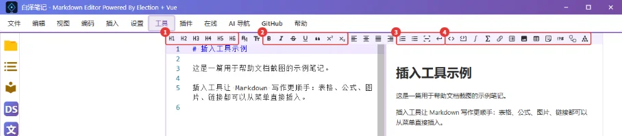
  <figcaption>图 1-4 编辑器工具栏：①标题 ②行内格式 ③列表/引用 ④代码块/公式/表格/图片/链接等插入按钮。</figcaption>
</figure>

#### 1.4.1 常用功能入口与操作步骤

| 功能                      | 入口                                               | 操作步骤                                                                            | 依赖/结果                                        |
| ------------------------- | -------------------------------------------------- | ----------------------------------------------------------------------------------- | ------------------------------------------------ |
| 打开工作区                | 欢迎页「打开文件夹」；文件 → 打开文件夹            | 选择目录 → 左侧资源管理器出现文件树                                                 | 工作区是标签、附件、PDF、搜索的基础              |
| 新建/保存文件             | 文件 → 新建/保存/另存为；`Ctrl+S`                  | 新建后先保存；编辑后保存；关闭前按提示保存                                          | 未保存内容不会自动覆盖其他文件                   |
| 打开文件                  | 资源管理器单击；文件 → 最近文件；`Ctrl+P` 快速打开 | 单击 Markdown/TXT 打开编辑器；PDF/HTML 打开查看器                                   | 未命名草稿会先询问保存/不保存                    |
| 格式工具栏                | 编辑器顶部工具栏；`Ctrl+B`/`Ctrl+I`                | 选中文本或把光标放在词内 → 点按钮 → 再点取消                                        | 粗体+斜体可组合；按钮随选区高亮                  |
| 特殊文字                  | 工具 → 特殊字体                                    | 选字体/字号/对齐/颜色 → 输入文字 → 预览 → 插入                                      | 插入光标处，不覆盖全文                           |
| 数学公式                  | 工具 → 数学公式                                    | 在源码区输入 KaTeX → 看预览 → 插入                                                  | 支持行内/块级公式                                |
| Markdown 表格             | 工具 → Markdown表格                                | 设行列/对齐 → 编辑单元格 → 插入表格或应用修改                                       | 表格内打开为编辑，否则为插入；支持导入 Excel/CSV |
| 插入图片                  | 工具 → 配图制作                                    | 选本地/网络图片 → 填 Alt/标题/宽度/对齐/图注 → 插入                                 | 本地图片复制到 `images/`；远程图片受隐私开关限制 |
| 网页链接                  | 工具 → 网页链接                                    | 填链接文本与 URL → 插入                                                             | 生成 Markdown 链接，不访问网络                   |
| Admonition                | 插入 → Material → Admonition                       | 选类型 → 填标题/内容 → 插入                                                         | 生成提示块语法                                   |
| Material 语法             | 插入 → Material → 选择子项                         | 选择任务列表/脚注/定义列表等 → 按提示插入                                           | 15 项 mkdocs-material 扩展语法                   |
| Mermaid/PlantUML 基础框架 | 插入 → Mermaid 绘图/PlantUML 绘图                  | 选入口 → 在光标处插入基础模板                                                       | 随后在代码块内编辑；预览自动渲染                 |
| Mermaid/PlantUML 模板     | 插入 → Mermaid/PlantUML → 第一部分/第二部分        | 悬停分组 → 选具体模板 → 插入                                                        | 适合快速创建常见图结构                           |
| Mermaid 图表编辑器        | 工具 → mermaid绘图                                 | 左侧写定义 → 右侧实时 SVG 预览 → 插入图表                                           | 语法错误在预览区提示；非模态窗口可继续编辑背景   |
| 写作模板                  | 插入 → 写作模板                                    | 选择模板 → 在光标处插入                                                             | 不会替换全文                                     |
| 来自文件                  | 插入 → 来自文件                                    | 选择文件 → 选择插入方式（按界面提示）                                               | 适合导入外部文本片段                             |
| 文档属性                  | 编辑 → 文档属性（Front matter）                    | 填写标题/标签/日期等 → 保存                                                         | 写入文首 front matter；无属性时自动创建          |
| 标签                      | 知识管理面板/文档属性 tags；正文 `#标签`           | 在属性或正文添加标签 → 标签面板筛选                                                 | 需要工作区；标签可点击过滤                       |
| Wiki 双链                 | 正文输入 `[[笔记名]]`                              | 输入双链 → 点击跳转；反链面板查看来源                                               | 重命名文件会同步更新 Wiki 链接                   |
| 附件管理                  | 编辑 → 附件管理                                    | 查看引用/孤儿附件 → 重命名/移入回收站                                               | 与 Markdown 图片/附件引用联动                    |
| 全工作区搜索              | `Ctrl+Shift+F`；编辑 → 全工作区搜索                | 输入关键词 → 筛选文件/结果 → 点击定位                                               | 可选替换；见第 4 节                              |
| 命令面板                  | `Ctrl+Shift+P`；编辑 → 命令面板                    | 输入命令名 → 上下选择 → Enter 执行                                                  | 已开启的可选能力才会出现命令                     |
| 插件搜索                  | 插件 → 插件搜索                                    | 点开后工作区显示搜索框（自动聚焦）→ 输入名称/分类/关键词 → Enter 或点击打开对应工具 | 空白时显示最近使用的 20 个插件与全部工具         |
| 打印/导出                 | 文件 → 打印/导出                                   | 选择格式 → 选择路径 → 导出                                                          | 只读取当前活动文件；导出前先保存                 |
| 系统设置                  | 设置 → 系统设置                                    | 左侧页签 → 修改 → 应用/确定                                                         | 保存后即时生效；部分能力需重启终端/应用          |
| 主题/编辑器设置           | 设置 → 主题设置/编辑器设置                         | 选择主题或编辑选项 → 应用                                                           | 主题只管颜色；界面风格/密度见外观设置            |
| 日记/快速收件箱           | 工具 → 今日日记/快速收件箱；命令面板               | 先开启功能开关 → 点击 → 自动创建/打开约定文件                                       | 依赖工作区；已存在文件不覆盖                     |
| 剪藏                      | 工具 → 剪藏；命令面板                              | 复制网页内容 → 选择剪藏到新笔记/插入当前                                            | 需开启剪藏开关；读取剪贴板需手动触发             |
| PDF 标注                  | 打开 PDF → 文本层选择                              | 选中文字 → 添加标注/高亮 → 摘录到笔记                                               | 需开启 PDF 标注开关；扫描版无文本层              |
| 图片 OCR                  | 工具 → 图片文字识别；命令面板                      | 复制含文字截图 → 识别并插入/复制                                                    | 需开启 OCR；首次下载英文语言包                   |
| 插件工具                  | 插件菜单                                           | 选择分类 → 选择工具 → 按对话框提示操作                                              | 38 项工具；详见第 17 节                          |

#### 1.4.2 找不到入口时怎么排查

1. 先确认功能是否属于**可选能力**：系统设置 → 功能，开关关闭时菜单/命令不会注册。
2. 再确认当前上下文：表格编辑需要先打开 Markdown 文件，标签/附件需要工作区，PDF 标注需要打开 PDF。
3. 最后看菜单位置是否随版本调整：插入/工具的归属可能变化，但均可从命令面板按名称搜索。

## 2. 文件管理

### 2.1 支持的文件

- 编辑与预览：Markdown（`.md` / `.markdown`）、纯文本（`.txt`）。
- 查看：PDF（应用内 pdf.js 预览）、HTML（应用内 HTML 查看器）。
- 图片：粘贴/插入时写入当前文件目录下的 `images/`（以实际提示为准）。
- 导入：Word、HTML、JSON、YAML、XML、TXT、CSV。
- 导出：Word、JSON、XML、YAML、HTML（自包含）、PDF、EPUB 电子书、幻灯片 HTML。
- 打印：文件 → 打印（`Ctrl+Alt+P`）；文件 → 打印预览（生成临时 PDF 交给系统阅读器）。

### 2.2 打印与自包含 HTML

> 版本说明：打印、打印预览与自包含 HTML 导出自 **1.5.2** 起支持。

- **打印**：按当前主题/正文生成打印页，打开系统打印对话框；打印样式与 PDF 导出一致。
- **打印预览**：生成临时 PDF 预览分页，不修改原文件。
- **导出为 HTML（自包含）**：单文件离线可看，内联主题 CSS、目录、本地图片 Base64；
  远程图片不做网络读取，工作区外图片不会被导出。
- 打印/导出都只读取当前活动文件；未打开文件时提示无可导出内容。

### 2.2.1 EPUB 与幻灯片导出

> 版本说明：EPUB 与幻灯片 HTML 导出自 **1.5.2** 起支持；仅导出当前活动文件。

- **导出为 EPUB**：把当前 Markdown 打包为 EPUB3 电子书（章节正文、目录、样式、工作区内本地图片）；适合长文/电子书阅读器。
- **导出为幻灯片（HTML）**：按独立 `---` 行分页，生成单文件 HTML 幻灯片；键盘 `←/→/PageUp/PageDown/空格` 翻页，支持打印或另存 PDF；代码围栏内的 `---` 不会拆页。
- 两者都只读取当前活动文件；本地图片遵守工作区路径与单张/整篇体积上限。

### 2.2.2 文件关联与双击打开

> 版本说明：Windows 文件关联与单实例打开自 **1.5.2** 起支持；独立多窗口尚未支持。

- Windows 安装包注册 `.md` / `.markdown` / `.txt` 文件关联；
- 双击关联文件启动应用时，在最近项恢复完成后打开该文件；
- 应用已运行时再次双击，由单实例 `second-instance` 交给现有窗口打开，不会启动第二个实例。
- 当前 D2 只覆盖“文件关联 + 单实例打开文件”；真正独立多窗口仍需按窗口隔离应用状态，属于后续架构批次。

### 2.3 编码与换行

- 自动探测 UTF-8、GBK、GB2312 等编码。
- 文件菜单可按指定编码重新打开或转码保存。
- 状态栏显示当前文件编码；转码前确认目标编码，避免中文乱码。
- Wiki 链接/附件重命名的自动更新会沿用原文件编码与 BOM，不会把 GBK 文件写成 UTF-8。

### 2.4 自动保存、备份与历史

- 系统设置 → 文件：可开启自动保存并设置间隔。
- 自动备份由主进程管理；异常退出后可检查备份目录。
- 关闭窗口/退出前会等待编辑器内容落盘，避免丢失最后输入。
- 未打开文件时输入的内容只写入本地草稿缓存，不会覆盖任何目标文件；点击文件时会提示「保存并打开 / 不保存 / 取消」，保存走系统「另存为」。
- 「文档历史」是可选能力：按文件保存快照，支持 diff 与恢复；默认关闭。

### 2.5 与知识库的联动

- 新文件创建后，下一次知识库查询/刷新即可进入索引。
- 重命名 Markdown 文件会自动更新其他文档的 Wiki 链接；普通 Markdown 链接/图片链接不在该链路中更新。
- 附件重命名走附件管理器，会同步更新 Markdown 图片/附件引用。

## 3. 编辑与预览

### 3.1 编辑器

- Monaco：语法高亮、多光标、查找替换、代码折叠、跳转行。
- Markdown 语法：标题、列表、任务列表、引用、表格、代码块、脚注、定义列表、上下标、Emoji。
- 工具栏/快捷键可插入常用符号、表情、表格、代码块、链接、图片。
- 支持 Markdown lint（可选）、格式化（可选）、拼写检查（可选）。
- 多标签/会话恢复（可选）开启后，可同时编辑多篇笔记并恢复上次打开状态。

- **表格、图片与格式**：工具栏「表格」打开统一表格编辑器（表格内为编辑、否则插入）。顶部“表格设置”可直接指定行列数、统一所有列对齐，并导入 Excel(.xlsx)/CSV；支持拖动列宽、行列重排、任意位置增删、按列排序、行列互换；每列对齐用下拉框；单元格支持多行 Markdown 与 - [ ] 任务；右下角可拖拽调整窗口。插入图片可设宽度、对齐、图注；格式按钮高亮当前光标格式，粗体+斜体可组合。

#### 3.1.1 插入工具界面参考

> 版本说明：以下插入工具窗自 **1.5.3** 起统一为非模态窗口；更早版本中部分对话框为模态。

以下截图均来自真实应用窗口，用于快速定位菜单入口与工具窗结构。菜单路径在不同版本中可能微调，但工具窗的字段与操作方式一致。

<figure class="shot">
  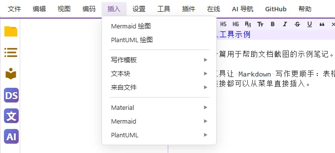
  <figcaption>图 3-1 插入菜单：最上方是 Mermaid 绘图、PlantUML 绘图入口，下方为写作模板、Material 与各模板分组。</figcaption>
</figure>

<figure class="shot">
  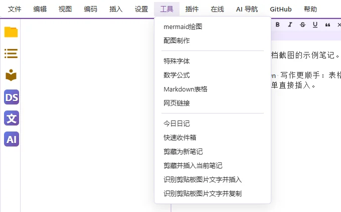
  <figcaption>图 3-2 工具菜单：特殊字体、数学公式、Markdown 表格、网页链接集中在菜单上半区。</figcaption>
</figure>

<figure class="shot">
  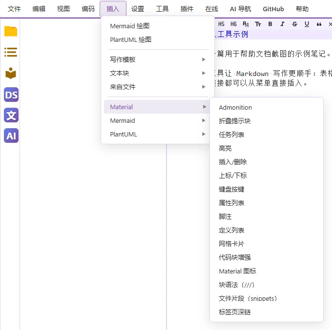
  <figcaption>图 3-3 Material 子菜单：Admonition 与 15 项 Material 语法入口，随菜单逐级展开。</figcaption>
</figure>

<figure class="shot">
  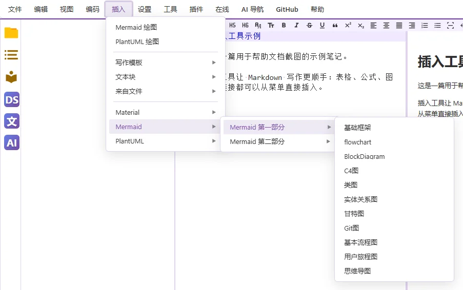
  <figcaption>图 3-4 Mermaid 模板：按第一部分/第二部分分组，继续展开可选择具体模板。</figcaption>
</figure>

<figure class="shot">
  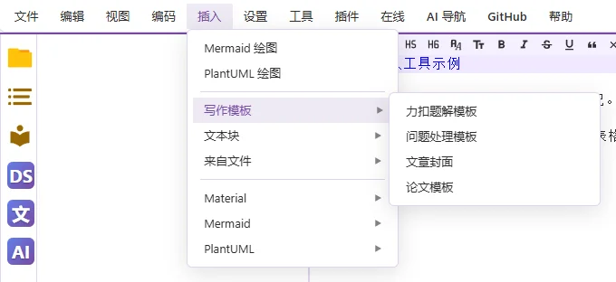
  <figcaption>图 3-5 写作模板：在光标处插入模板，不覆盖全文。</figcaption>
</figure>

<figure class="shot">
  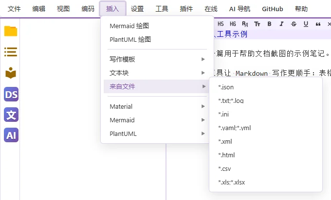
  <figcaption>图 3-6 来自文件：从文件系统导入内容并插入当前笔记。</figcaption>
</figure>

<figure class="shot">
  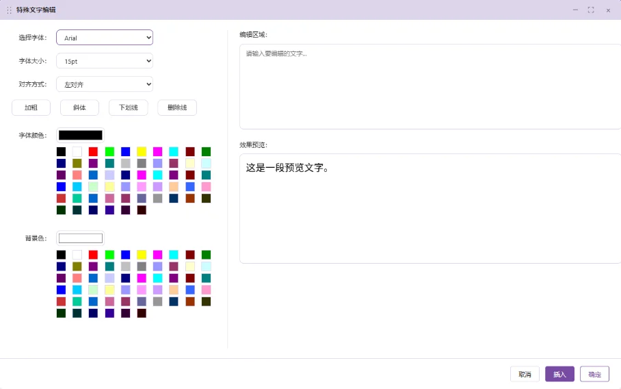
  <figcaption>图 3-7 特殊文字编辑：选择字体/字号/对齐与颜色后，右侧实时预览并插入光标处。</figcaption>
</figure>

<figure class="shot">
  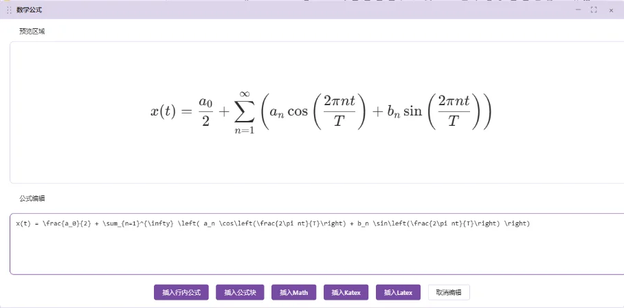
  <figcaption>图 3-8 数学公式：上方为 KaTeX 实时预览，下方为公式源码编辑区。</figcaption>
</figure>

<figure class="shot">
  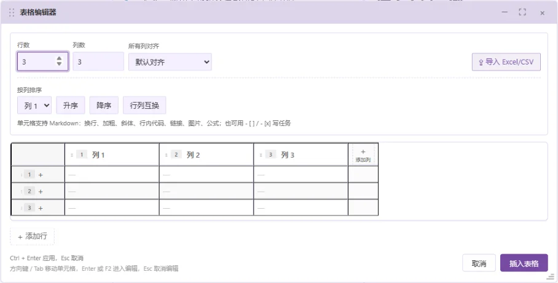
  <figcaption>图 3-9 Markdown 表格编辑器：顶部设置行列与对齐，中部按列排序，底部为表格画布。</figcaption>
</figure>

<figure class="shot">
  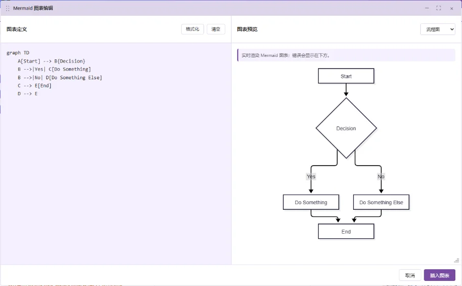
  <figcaption>图 3-10 Mermaid 图表编辑：左侧定义图表源码，右侧实时渲染 SVG 预览。</figcaption>
</figure>

<figure class="shot">
  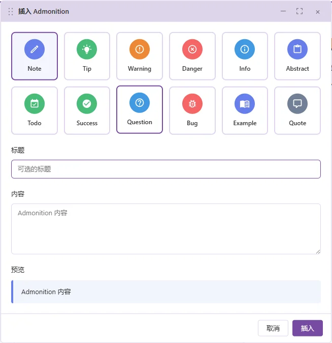
  <figcaption>图 3-11 Admonition：选择提示类型、标题与内容，底部提供插入预览。</figcaption>
</figure>

<figure class="shot">
  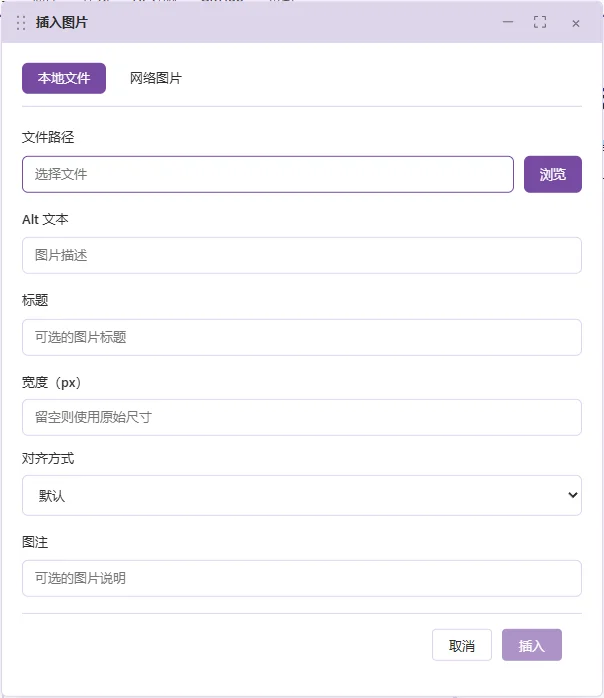
  <figcaption>图 3-12 插入图片：可填写文件路径/Alt/标题，并设置宽度、对齐方式与图注。</figcaption>
</figure>

<figure class="shot">
  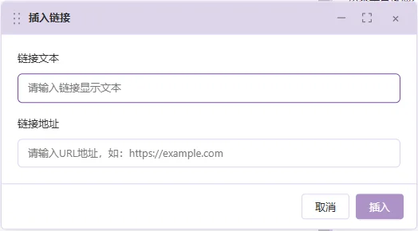
  <figcaption>图 3-13 插入链接：分别填写链接文本与 URL 地址，确认后插入当前光标处。</figcaption>
</figure>

### 3.2 智能输入

系统设置 →「功能」→ Markdown 智能输入（唯一开关，默认关闭）：

- 有序列表回车自动递增，并重编号后续同缩进列表项；
- 引用块、嵌套列表、任务列表续行；
- 空列表项回车退出；退格删除标记退出；
- 标题后自动补空行；
- 中文输入法组合期不干预 Enter/Backspace；
- 自动修改合并为一次撤销。

智能输入在普通模式与写作模式通用；打开写作模式不会自动打开智能输入，需要单独开启。

### 3.3 预览

- 编辑/预览/分屏；编辑↔预览滚动同步。
- 数学公式 KaTeX、流程图 Mermaid、PlantUML 本地渲染。
- 工具 → Mermaid 图表编辑提供实时 SVG 预览；语法错误会显示在预览区。
- 代码块语法高亮，支持常见语言按需加载。
- 大文档自动降级：超阈值时跳过 KaTeX/图表/冷门语言，分块净化，仍经 DOMPurify。
- 预览顶部/侧边可查看标题大纲（大纲增强为可选能力）。

### 3.4 推荐组合

- 长文写作：写作模式 + 打字机 + 段落聚焦 + 写作统计；
- 代码/配置笔记：Markdown lint + 智能输入 + 代码高亮；
- 校对：拼写检查 + 风格检查 + 搜索/替换；
- 多文档：多标签 + 文档历史 + 自动保存。

## 4. 搜索、替换与命令面板

| 功能              | 快捷键                  | 说明                                             |
| ----------------- | ----------------------- | ------------------------------------------------ |
| 全工作区搜索/替换 | `Ctrl + Shift + F`      | 跨文件搜索，大小写/整词/正则，结果跳转与批量替换 |
| 命令面板          | `Ctrl + Shift + P`      | 搜索并执行命令（含捕获/知识库入口）              |
| 快速打开文件      | `Ctrl + P`              | 按文件名快速切换                                 |
| 当前文件查找/替换 | `Ctrl + F` / `Ctrl + H` | Monaco 查找/替换                                 |
| 跳转到行          | `Ctrl + G`              | 输入行号跳转                                     |

### 4.1 搜索配置与联动

- 大小写、整词、正则可组合；正则非法时返回错误，不执行替换。
- 搜索只扫当前工作区根内 `.md`/`.markdown`/`.txt`，跳过忽略目录/符号链接。
- 受文件数、单文件 2 MiB、结果上限约束；截断时结果面板有提示。
- 批量替换由主进程重新读取文件并写盘，会保留原编码/换行；替换前建议先保存或开启文档历史。
- 搜索结果可跳到来源行；与标签/反链配合：先搜关键词，再用标签/反链确认上下文。

### 4.2 命令面板与搜索协作

- 命令面板可执行「今日日记」「快速收件箱」「剪藏」「识别图片文字」等捕获命令（对应能力开启后）。
- `Ctrl+P` 适合已知文件名；`Ctrl+Shift+F` 适合不知道文件名、只记得内容的情况。
- 命令面板的分类按功能域组织；输入关键词（中/英文均可）过滤。

## 5. 文档属性（Front matter）

入口：**编辑 → 文档属性…** 或命令面板「编辑文档属性」。

### 5.1 可编辑字段

- 标题、日期、标签、状态、摘要、别名；
- 已有自定义属性可编辑/删除；新增自定义键需直接手写 YAML。

### 5.2 行为与联动

- 没有 front matter 时，保存会在正文前插入；
- 已有 front matter 时，只修改头部，正文、BOM、CRLF 保持不变；
- 保存写回编辑器，再按 `Ctrl + S` 保存到磁盘；
- 标签会进入标签索引；标题会用于 Wiki 链接的展示名/解析；
- 摘要会用于 E10 悬浮预览；
- 属性面板不改变正文，适合与已有模板/历史功能组合使用。

示例：

```yaml
---
title: 项目计划
date: 2026-11-22
tags:
    - 项目
    - 计划
status: 进行中
summary: 本周项目推进安排
aliases:
    - 计划书
---
```

### 5.3 与捕获功能的联动

- 「今日日记/快速收件箱」创建的笔记自带 front matter（日期/标题/来源等），可再用文档属性补标签、摘要、别名；
- 剪藏笔记会带来源 `source`/标题/捕获时间，建议不要覆盖来源字段，便于回溯；
- PDF 摘录插入当前笔记时，可在摘录段落旁补 `[[相关笔记]]`，形成引用关系。

## 6. 知识管理功能（可选）

以下能力属于附加知识管理，不是 Markdown 编辑器主线；需要时可在工作区使用：

- **标签**：`#标签` 或 Front matter `tags`；标签面板可筛选，支持主题/计数配置。
- **Wiki 双链与反向链接**：`[[笔记名]]` / `[[笔记名|显示文本]]`；点击跳转，反向链接面板显示引用来源。
- **链接检查与重命名**：重命名文件时自动更新引用；链接检查可定位失效目标。
- **附件管理**：附件面板查看引用审计、孤儿附件与重命名。
- **悬浮预览**：悬停 Wiki 链接可预览目标笔记摘要。

## 7. 界面风格与密度

> 版本说明：界面风格（4 种）、界面密度（3 档）与「减少透明效果」自 **1.5.5** 起支持；更早版本只提供主题切换。

入口：**设置 → 系统设置 → 左侧「外观设置」→「界面风格与密度」**。三项配置分别是「界面风格」（4 种）、「界面密度」（3 档）与「减少透明效果」（开关）；改完点对话框底部「应用」（保存但不关闭）或「确定」（保存并关闭）立即生效，无需重启；点「取消」丢弃本次修改。

三项配置与「主题」正交：**主题只决定颜色，风格只决定材质**（透明度、模糊、阴影、边框、圆角），**密度只决定尺寸节奏**（行高、控件高、内边距、UI 字号）。因此 28 套应用主题 × 4 种风格 × 3 档密度可以自由组合，不会互相覆盖；编辑器主题（57 套 Monaco 主题）始终独立，不受风格/密度影响。

### 7.1 界面风格（4 种）

| 风格        | 名称                 | 视觉特征                                                                                                                                                            | 适用场景                                        |
| ----------- | -------------------- | ------------------------------------------------------------------------------------------------------------------------------------------------------------------- | ----------------------------------------------- |
| `paper`     | 静默纸感             | 不透明表面、极弱阴影、中等圆角（4/6/8），无背景模糊与高光边；内容区为柔和纸感表面，压低装饰感                                                                       | 长文写作、阅读、需要安静低干扰                  |
| `glass`     | 轻玻璃（实验性）     | 壳层与悬浮层半透明（约 86%，可透出主题渐层光斑）+ 高光边 + 大圆角（9~12）、柔和悬浮阴影；背景模糊仅用于下拉/对话框/命令面板/工具窗等浮层（8px，不做整窗大面积模糊） | 浅色中性主题下希望有层次感、现代桌面工具感      |
| `workbench` | 高密度工作台（默认） | 不透明、紧凑圆角（2/4/6）、克制阴影；观感与视觉升级前一致                                                                                                           | 知识管理、表格与工具密集操作、习惯旧观感        |
| `hybrid`    | 混合（正文纸感）     | 外壳（标题栏/菜单栏/侧栏/状态栏/工具窗/对话框/命令面板）用工作台材质，内容区（编辑器容器/Markdown 预览）用纸感材质                                                  | 既要正文舒适、又要工具区紧凑的写作 + 知识库并重 |

- 默认值为「高密度工作台」：不改设置时观感与升级前完全一致，只有主动切换才会改变材质。
- **材质来源**：静默纸感/轻玻璃的表面**不是固定颜色**，而是由当前主题强调色派生的低饱和薄雾（静默纸感约 4%、轻玻璃约 12% 的轻微叠加，数值很轻），色相随 28 套主题一起变化；主题本身的色板、菜单与文字颜色不受影响。
- **主窗口可见变化**（切换风格后最直观的几处）：
    - **静默纸感**：标题栏由主题渐变改为纸感面（窗口按钮/图标按表面亮度自动调整深浅，保证对比度）；状态栏、侧栏、左右导航条变为纸感底并带圆角与 1px 细分隔线；编辑区与预览区容器出现 1px 描边 + 4px 圆角 + 弱阴影；预览区与编辑器工具栏条转为纸感底；编辑区上方 2px 主题色分隔条收为细分隔线颜色。
    - **轻玻璃**：上述壳层表面改为半透明（可透出窗口主题色的渐层光斑）、圆角更大（约 9~12px）、顶部出现白色高光边、悬浮阴影更明显；预览区与工具栏条为半透明面（只做小面积模糊，不做整窗背景模糊）。
    - **混合**：标题栏、菜单区、侧栏、状态栏、导航条与「高密度工作台」完全一致，只把编辑/预览内容区换成纸感材质（圆角 + 描边 + 弱阴影 + 纸感预览底），即「外壳工作台 + 内容一张纸」。
    - **高密度工作台（默认）**：与当前版本观感一致，无新增材质效果。
- 玻璃为实验性材质：深色、高饱和/渐变、护眼主题会自动降级，详见 7.4；开启「减少透明效果」时玻璃自动回退纸感。

### 7.2 界面密度（3 档）

| 密度            | 行高 | 控件高 | 内边距 | 工具窗/对话框标题栏高 | UI 字号 | 适用场景                      |
| --------------- | ---- | ------ | ------ | --------------------- | ------- | ----------------------------- |
| 紧凑 `compact`  | 24   | 28     | 8      | 36                    | 12      | 小屏/高缩放比、信息密度优先   |
| 默认 `default`  | 28   | 32     | 12     | 40                    | 13      | 升级前现状尺寸，推荐默认      |
| 宽松 `spacious` | 32   | 36     | 16     | 44                    | 13      | 大屏阅读、触控/演示、不喜拥挤 |

- 影响范围：菜单栏与菜单/下拉项行高、命令面板行高/字号/内边距、对话框与非模态工具窗的标题栏/按钮/内边距、表格编辑器行高与控件高、空态按钮。
- 不受影响：编辑器正文字号与行高（由「编辑器设置」与写作排版控制，见 12.4、11）；密度主要作用于上述控件类区域，不改变正文排版。
- 默认值 `default`，即升级前尺寸节奏；「宽松」只放宽行高与间距，UI 字号仍为 13px。

### 7.3 减少透明效果（开关，默认关）

- 关闭（默认）：玻璃风格按 7.1 呈现半透明与模糊。
- 开启：玻璃风格不使用半透明与背景模糊，回退为不透明纸感材质（性能与可读性优先）。
- 对纸感、工作台、混合三种风格无可见影响（它们本身不透明）。
- 系统级「减少透明」偏好会被自动识别（Windows 设置 → 辅助功能 → 视觉效果 → 透明效果关闭），效果与本开关相同：玻璃自动回退纸感。
- 建议在远程桌面/虚拟机/低配设备、或觉得半透明影响阅读时开启。

### 7.4 玻璃风格的自动降级

| 条件                                                                  | 玻璃的实际表现                                                                     |
| --------------------------------------------------------------------- | ---------------------------------------------------------------------------------- |
| 浅色中性主题 + 未开启「减少透明效果」                                 | 常规玻璃：约 86% 不透明 + 8px 小面积模糊 + 高光边                                  |
| 深色主题                                                              | 稳健模式：不透明度提高到约 94%、关闭模糊（避免深底叠色发灰），保留玻璃圆角与高光边 |
| 高饱和/渐变主题（如珊瑚暖阳、日落余晖、玫瑰花园、薄荷清风、森林秘境） | 自动回退为静默纸感材质                                                             |
| 护眼主题（7 套护眼系主题）                                            | 自动回退为静默纸感材质                                                             |
| 开启「减少透明效果」或系统偏好「减少透明」                            | 自动回退为静默纸感材质                                                             |

- 降级只影响外观、**不会改写你的设置**：设置里仍显示「轻玻璃」，切回合适的主题或关闭「减少透明效果」后自动恢复玻璃，无需重新选择。
- 切换主题或修改外观设置后会重新计算降级结果。

### 7.5 推荐组合与排障

| 场景                   | 界面风格     | 界面密度   | 说明                                     |
| ---------------------- | ------------ | ---------- | ---------------------------------------- |
| 长篇写作               | 静默纸感     | 默认或宽松 | 配合写作模式与纸感版式（见第 10 节）     |
| 知识管理/研究          | 高密度工作台 | 紧凑       | 一屏显示更多条目与表格行                 |
| 写作 + 知识库并重      | 混合         | 默认       | 外壳紧凑、正文纸感                       |
| 追求现代感（浅色主题） | 轻玻璃       | 默认       | 性能较弱或远程桌面时开启「减少透明效果」 |
| 保持旧观感             | 高密度工作台 | 默认       | 即默认值，无需任何设置                   |

排障要点：

- 切换后看起来没变化：先点「应用」或「确定」；再确认是否因深色/高饱和/护眼主题或「减少透明效果」触发了玻璃降级。
- 设置会写入本机系统配置，重启后保持；「取消」不会保存本次修改。
- 想恢复默认：风格选「高密度工作台」、密度选「默认」、关闭「减少透明效果」。

## 8. 菜单栏键盘操作

> 版本说明：完整菜单栏键盘操作、可见焦点与三级子菜单导航自 **1.5.5** 起支持；顶层菜单 `Alt + 字母` 助记符自 **1.5.6** 起支持。

应用菜单栏（文件、编辑、视图、编码、插入、设置、工具、插件、在线、AI 导航、GitHub、帮助）支持完整键盘操作与可见焦点，并带有 `menubar` / `menu` / `menuitem` 无障碍角色，读屏软件可识别菜单名与展开状态。

### 8.1 进入菜单栏

- 按一下 `Alt` 即可激活菜单栏（Windows 惯例）：焦点落到第一个顶层菜单，之后用方向键、`Enter` 操作；按 `Esc` 或再次按 `Alt` 退出激活，焦点交回激活前的控件。
- 也可以直接按 `Alt + 字母` 打开指定顶层菜单（如 `Alt + F` 打开「文件」、`Alt + E` 打开「编辑」，完整字母表见 8.2）：若菜单栏尚未激活，会先激活并展开对应下拉；若已激活或已有下拉展开，则直接切换过去。
- 也可以把焦点移到菜单栏：不在编辑区时按 `Tab` / `Shift + Tab` 即可；焦点在 Monaco 编辑区内时，`Tab` 默认用于缩进，可先按 `Ctrl + M` 切到「Tab 移动焦点」模式，或先用鼠标点击一次菜单栏，再继续用键盘。
- 整条菜单栏只占一个 Tab 停靠位，焦点落在第一个（或上次停留的）顶层菜单项。
- 键盘焦点有可见焦点环（主题强调色 3px 软环 + 高亮底），不会只靠颜色变化。
- 鼠标点击顶层菜单同样会聚焦并展开，鼠标与键盘可以混用。

### 8.2 顶层菜单（菜单栏这一行）

| 按键                   | 作用                                                             |
| ---------------------- | ---------------------------------------------------------------- |
| `←` / `→`              | 在顶层菜单间循环移动；菜单已展开时同时切换展开的菜单内容         |
| `Home` / `End`         | 跳到第一个 / 最后一个顶层菜单                                    |
| `↓` / `Enter` / `空格` | 打开当前菜单，焦点进入下拉第一项（自动跳过禁用项）               |
| `Esc`                  | 收起已展开的菜单，焦点留在当前顶层菜单项（未展开时不消费该按键） |
| `Tab` / `Shift + Tab`  | 收起菜单并把焦点移出菜单栏                                       |

顶层菜单助记符（`Alt + 字母`，1.5.6 起）：

| 顶层菜单 | 助记符    | 字母来源（英文语义） |
| -------- | --------- | -------------------- |
| 文件     | `Alt + F` | File                 |
| 编辑     | `Alt + E` | Edit                 |
| 视图     | `Alt + V` | View                 |
| 编码     | `Alt + C` | Coding               |
| 插入     | `Alt + I` | Insert               |
| 设置     | `Alt + S` | Settings             |
| 工具     | `Alt + T` | Tools                |
| 插件     | `Alt + P` | Plugins              |
| 在线     | `Alt + O` | Online               |
| AI 导航  | `Alt + A` | AI                   |
| GitHub   | `Alt + G` | GitHub               |
| 帮助     | `Alt + H` | Help                 |

使用说明：

- 未激活菜单栏时按 `Alt + 字母`：先激活菜单栏并展开对应下拉，焦点落在下拉第一项，后续方向键、`Enter`、`Esc` 与 8.3 的规则完全一致。
- 已激活或已有下拉展开时按 `Alt + 字母`：直接切换到目标菜单（下拉内容随焦点同步切换），无需先按 `Esc` 回到菜单栏。
- 只认 `Alt + 单个字母`：`Alt + Shift + 字母`、`Ctrl + Alt + 字母`（含 AltGr）、`Alt + F4`、`Alt + Tab` 以及未映射的字母都不会被菜单栏拦截，仍按系统/原有快捷键处理。
- 按 `Alt` 激活后，菜单标签末尾会显示助记符字母下划线（Windows 菜单惯例）；按 `Esc`、再次 `Alt` 或关闭菜单后提示隐藏。
- 输入法组字期间、焦点在对话框/工具窗内、菜单栏被隐藏（系统设置为 Windows 原生菜单）时，`Alt + 字母` 不响应。

### 8.3 下拉菜单内

| 按键                  | 作用                                                                                     |
| --------------------- | ---------------------------------------------------------------------------------------- |
| `↑` / `↓`             | 在本级菜单项间循环移动，自动跳过分隔线与禁用项                                           |
| `Home` / `End`        | 跳到本级首项 / 末项                                                                      |
| `Enter` / `空格`      | 执行叶子命令（执行后菜单关闭、焦点回到对应顶层菜单项）；有子菜单的分组则展开并进入下一级 |
| `→`                   | 有子菜单：展开并进入下一级；无子菜单：在顶层下拉中切到下一个顶层菜单                     |
| `←`                   | 返回上一级（焦点回到刚才展开该项）；在顶层下拉中切到上一个顶层菜单                       |
| `Esc`                 | 关闭整个菜单栏下拉，焦点回到顶层菜单按钮                                                 |
| `Tab` / `Shift + Tab` | 关闭下拉并把焦点交回顶层菜单按钮（避免焦点落进即将关闭的浮层）                           |

### 8.4 三级子菜单的展开规则

- 层级：顶层菜单 → 下拉（一级）→ 分组子菜单（二级）→ 更深一层（三级），例如「插入 → Mermaid → 第一部分 → 具体模板」。当前最多三级子菜单，没有第四级。
- 鼠标：悬停或点击有子菜单的分组即展开下一级；同一层同时只展开一个分组，移入其他分组会收起上一个。
- 键盘：在分组上按 `→` 或 `Enter`/空格展开并进入下一级；`←` 返回上一级；`Esc` 一次收起整个菜单。
- 空间与滚动：下拉菜单不再出现纵向滚动条；三级子菜单完整显示、不再被裁剪；靠近窗口右缘时顶级下拉会自动向左收进窗口，展开三级子菜单时若右侧空间不足会自动向左翻转；调整窗口大小后重新定位。

### 8.5 焦点、鼠标与限制

- 键盘焦点与鼠标悬停使用同一套高亮样式；焦点环只在键盘操作时出现。
- 鼠标移开时若键盘焦点仍在下拉内，菜单会保持打开，不会被误关。
- `Alt` 可激活菜单栏：单独按一下 `Alt` 后焦点落到第一个顶层菜单，方向键选择、`Enter`/空格打开，按 `Esc` 或再次按 `Alt` 退出激活并把焦点交回原控件。
- `Alt + 字母` 助记符（1.5.6 起）：按住 `Alt` 再按顶层菜单助记符字母（如 `Alt + F` 打开「文件」，字母表见 8.2）即可激活菜单栏并打开对应菜单；未映射字母、`Alt+F4`、`Alt+Tab` 等系统组合键以及带 `Ctrl`/`Shift`/`Meta` 的组合不会被菜单栏拦截，`Ctrl+Alt+P` 等既有组合键仍按原快捷键处理。
- 输入法组字期间、焦点在对话框/工具窗内、菜单栏被宿主隐藏（系统设置为 Windows 原生菜单）时，`Alt + 字母` 不响应，避免抢走输入法或浮层焦点。

## 9. 非模态工具窗、对话框与命令面板

### 9.1 非模态工具窗怎么用

> 版本说明：非模态工具窗自 **1.5.3** 起支持；**1.5.5** 起统一外观、键盘和密度行为。

适用工具窗：Mermaid 图表、表格编辑器、数学公式、插入图片、特殊文字、Material 语法、网页链接、提示块（Admonition）等插入/编辑面板。界面截图见第 3.1.1 节。

1. 保持「系统设置 → 功能 → 非模态工具对话框」开启（默认开启）。
2. 从菜单或工具栏打开工具窗后，它浮在编辑区上方；点击工具窗外（包括编辑器）不会关闭，可以继续在编辑区输入、选中文本。
3. 打开时焦点自动落在窗内第一个输入控件（没有输入控件时落在第一个按钮），可直接用键盘输入。
4. 标题栏右上角按钮：**[最小化][最大化][关闭]**——最小化把工具窗折叠为仅标题栏（再次点击还原）、最大化铺满主窗口可用区域（再次点击还原）。关闭方式：点右上角关闭按钮，或执行「插入 / 应用 / 确定」等显式操作。`Esc` 只在焦点位于工具窗内时关闭最顶层工具窗；焦点在编辑区时不会拦截 `Esc`。
5. 工具窗不锁定页面滚动，不影响编辑器滚动；拖动标题栏可移动（最大化状态拖动标题栏会先还原），支持缩放的窗口可在右下角拖拽调整大小。
6. 关闭「非模态工具对话框」后恢复模态行为：遮罩拦截背景操作、`Tab` 焦点限制在窗内、点击遮罩或按 `Esc` 关闭（以窗口实际行为为准）。

<figure class="shot">
  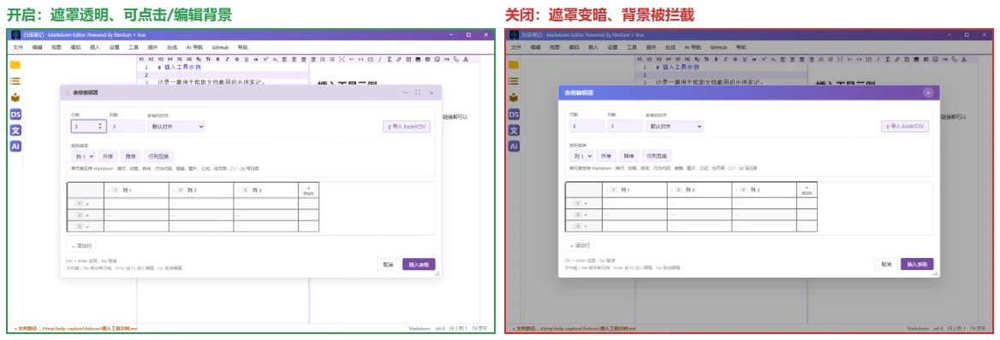
  <figcaption>图 9-1 同一表格工具窗：左侧开启非模态（背景仍可操作），右侧关闭后遮罩变暗并拦截背景。</figcaption>
</figure>

### 9.2 命令面板与快速打开（键盘）

| 快捷键             | 作用                         |
| ------------------ | ---------------------------- |
| `Ctrl + Shift + P` | 命令面板（搜索并执行命令）   |
| `Ctrl + P`         | 快速打开文件（按文件名切换） |
| `Ctrl + Shift + F` | 全工作区搜索（详见第 4 节）  |

面板内通用按键：`↑` / `↓` 循环选择，`Enter` 执行选中命令或打开选中文件，`Esc` 关闭面板，`Tab` / `Shift + Tab` 在面板内循环移动焦点（不会跑到背后的编辑器）。

<figure class="shot">
  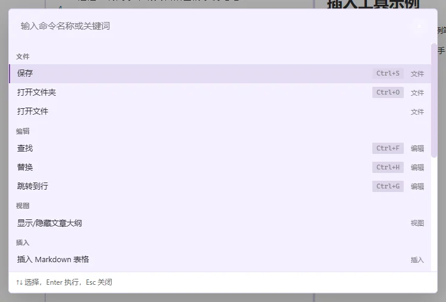
  <figcaption>图 9-2 命令面板：输入即过滤，按功能域分组，右侧显示同款快捷键。</figcaption>
</figure>

- 输入即过滤，中英文关键词均可；命令按功能域分组，右侧显示菜单里同款快捷键 chip。
- 命令面板会包含已开启的可选能力命令（今日日记、快速收件箱、剪藏、识别图片文字等）；对应开关关闭时不出现。
- 无匹配结果时显示空态提示，不会误执行旧选中项。

### 9.3 对话框的宽度、遮罩与键盘

- 宽度按内容分档统一：确认类 360px、表单类 520px、中等 720px、复杂 960px、全宽类 `min(1440px, 96vw)`；较早的对话框保留原有宽度（向下兼容，不影响既有习惯）。
- 遮罩：浅色主题约 32% 黑、深色主题约 48% 黑；圆角、阴影、标题栏高度统一跟随界面风格与密度（见第 7 节）。
- 键盘：`Esc` 关闭最顶层对话框；`Tab` / `Shift + Tab` 在对话框内循环（焦点陷阱）；多个对话框叠加时只有最上层响应 `Esc` / `Tab`，一次按键不会连带关闭多层。
- 标题栏可拖动移动对话框；关闭后焦点归还到打开前的控件。

### 9.4 表格编辑器

> 版本说明：统一表格编辑器自 **1.5.3** 起支持；**1.5.5** 起表格行高、列头、选区与控件高跟随界面密度。

表格对话框同样是非模态工具窗：顶部为**紧凑工具条**，集中行数/列数、统一列对齐、按列排序（升序/降序/行列互换）与导入 Excel(.xlsx)/CSV；「单元格支持 Markdown」与快捷键说明在工具条/底部的 **ⓘ** 中悬停或点击查看。支持拖动列宽、行列重排、任意位置增删；每列对齐用下拉框；单元格支持多行 Markdown 与任务清单；右下角可拖拽调整窗口大小；标题栏右上角支持最小化/最大化（见 9.1）。

## 10. 写作模式纸感版式

> 版本说明：写作模式的纸感版式自 **1.5.5** 起支持；写作模式本身为既有能力。

### 10.1 生效条件

同时满足以下三条才会看到纸感版式：

1. 界面风格为「静默纸感」或「混合」（见第 7 节）；
2. 已在「设置 → 系统设置 → 编写体验」开启并进入写作模式；
3. 在写作控制条上打开「预览」——写作模式默认是纯编辑界面，纸感版式作用于 Markdown **预览正文**。

### 10.2 版式变化（仅预览正文）

| 项目          | 纸感版式                            |
| ------------- | ----------------------------------- |
| 正文字号/行高 | 16px / 1.75（行距更松，长文更易读） |
| 段落间距      | 0.75em                              |
| 标题留白      | 上 1.5em、下 0.5em                  |
| 引用块        | 左侧 3px 强调色条（强调色 30%）     |
| 代码块        | 圆角 6px、内边距 12px               |
| 列表缩进      | 1.25em                              |
| 选中文本      | 使用主题选区色                      |

### 10.3 不改变的部分

- **Monaco 编辑区不受界面风格影响**：编辑区字号、行高与配色仍由「设置 → 编辑器设置」和 57 套 Monaco 主题决定；写作模式自带的「写作排版」也仍只控制编辑器正文的限宽、字号与行高。
- 不改变文件内容、导出结果与打印效果，只影响应用内预览的显示。
- 「高密度工作台」「轻玻璃」风格的内容区不套用纸感版式。
- 退出写作模式即恢复正常预览排版；关闭预览后回到纯编辑界面。

## 11. 写作体验

入口：**系统设置 → 编写体验**，以下能力默认关闭：

- 写作模式：隐藏侧栏/菜单/标题栏，正文限宽；
- 打字机模式、段落聚焦；
- 写作统计、每日目标；
- 排版预设、光标/滚动恢复；
- 选中文本气泡工具栏、Slash 命令；
- 轻量写作风格检查（只提示，不自动改）。

补充：写作模式的预览正文在界面风格为「静默纸感 / 混合」时会套用纸感版式（见第 10 节），这不是独立开关，由界面风格决定；「写作排版」仍控制编辑器正文的限宽、字号与行高。

### 11.1 配置与联动

| 开关          | 作用                        | 推荐搭配                     |
| ------------- | --------------------------- | ---------------------------- |
| 写作模式      | 沉浸布局、限宽              | 打字机 + 段落聚焦 + 写作统计 |
| 打字机        | 光标居中                    | 写作模式                     |
| 段落聚焦      | 高亮当前段                  | 打字机                       |
| 写作统计      | 字数/阅读时间/目标          | 每日目标                     |
| 写作排版      | 字号/行高/排版预设          | 写作模式                     |
| 光标/滚动恢复 | 按文件恢复位置              | 多标签/历史                  |
| 气泡工具栏    | 选中文本快捷操作            | 普通模式/写作模式            |
| Slash 命令    | 行首 `/` 插入命令           | 智能输入                     |
| 风格检查      | 长句/重复/口头禅/填充词提示 | 拼写检查 + 搜索替换          |

### 11.2 工作流

1. 开启写作模式、打字机、段落聚焦、写作统计；
2. 设置每日目标；
3. 正文用智能输入写列表/引用；
4. 用气泡工具栏/Slash 快速插入结构；
5. 用风格检查/拼写检查复盘；
6. 退出写作模式后布局恢复，内容自动保留。

## 12. 系统设置与配置矩阵

入口：**设置 → 系统设置**。左侧共 6 个页签：通用设置、文件设置、外观设置、功能、编写体验、备份与恢复。每页顶部保留一句用途说明；各项开关的详细解释通过标签旁的 **ⓘ**（悬停或点击）查看。另有「设置 → 主题设置」「设置 → 编辑器设置」「设置 → 快捷链接设置」三个独立对话框。

改完后点底部「应用」（保存但不关闭）或「确定」（保存并关闭）生效；点「取消」丢弃本次修改。保存成功后立即生效，无需重启。

各页签要点：通用设置（自动打开上次文件/文件夹、开机自启动、关闭时最小化到托盘、记住窗口位置和大小、允许加载远程图片）；备份与恢复（自动备份开关/间隔/保留数量、立即备份、从备份恢复）。

### 12.1 「功能」页签（可选能力，默认关闭）

| 能力                | 默认 | 关闭时                                                  | 开启后                                                          | 入口/注意                                             |
| ------------------- | ---- | ------------------------------------------------------- | --------------------------------------------------------------- | ----------------------------------------------------- |
| 多标签/会话恢复     | 关   | 单文档编辑；关闭应用后不恢复标签列表                    | 顶部出现标签栏；可切换多篇；重启恢复文件列表与活动标签          | 只恢复路径与活动标签，不恢复未保存正文                |
| 文档历史            | 关   | 不记录历史，菜单/面板不显示历史入口                     | 保存时记录快照；可看历史版本、行级 diff、回滚                   | 快照在 localStorage，容量有限；不是磁盘备份替代品     |
| Markdown lint       | 关   | 不做规则检查，无 lint 面板/格式化入口                   | 检查标题层级、列表/代码围栏空行、行尾空格，可一键格式化         | 不自动改文件；先检查再手动应用                        |
| 拼写检查            | 关   | 不加载系统/浏览器词典，不出现拼写下划线                 | 编辑器内出现拼写提示；可右键处理                                | 中文分词可能误报，可关闭开关                          |
| 智能输入            | 关   | 回车只换行；列表/引用/任务不自动续行                    | 有序列表递增/重编号、引用/嵌套/任务续行、空项退出、标题后补空行 | 普通/写作模式通用；中文输入法组合期不干预             |
| 大纲增强            | 关   | 大纲只识别普通 ATX 标题                                 | 支持 setext 标题、层级缩进、快速过滤                            | 与预览顶部/侧边大纲协作                               |
| 今日日记/快速收件箱 | 关   | 工具菜单与命令面板不注册入口                            | 一键创建/打开 `diary/YYYY-MM-DD.md` 或 `inbox/` 时间戳笔记      | 需要工作区；文件名约定见第 13 节；已存在不覆盖        |
| 剪贴板剪藏          | 关   | 不注册剪藏命令，不读取剪贴板                            | 「剪藏到新笔记 / 插入当前笔记」；HTML/文本转 Markdown           | 只在手动触发时读剪贴板；不启动本地接收端口            |
| PDF 标注与摘录      | 关   | PDF 预览保持只读，无文本层选择/标注 UI                  | 文本选择、当前页标注/高亮、标注列表、摘录插入当前笔记           | 扫描版 PDF 无文本层；标注写同目录 `.annotations.json` |
| 图片 OCR            | 关   | 不加载 OCR worker/语言包，无 OCR 菜单入口               | 识别剪贴板截图文字，结果插入当前笔记或复制                      | 首次需联网下载英文语言包；图片不上传                  |
| 非模态工具对话框    | 开   | 恢复模态：遮罩拦截背景，`Tab` 锁在窗内，点遮罩/Esc 关闭 | 工具窗浮在编辑区上；点击外部不关闭，可继续编辑/滚动背景         | 系统设置 → 功能；插入/编辑工具窗均受此开关控制        |

关闭任一开关时：不注册对应命令/菜单/监听，默认编辑链路零行为变化。开关保存后即时生效。「非模态工具对话框」是唯一默认开启的功能开关。

<figure class="shot">
  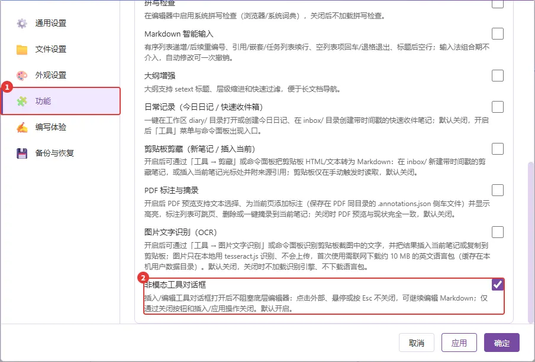
  <figcaption>图 12-1 设置路径：设置 → 系统设置 → 左侧「功能」→ 可选能力底部；红框为非模态开关。</figcaption>
</figure>

<figure class="shot">
  
  <figcaption>图 12-2 「功能」页签：分默认能力与可选能力两组，可选能力逐项开关。</figcaption>
</figure>

<figure class="shot">
  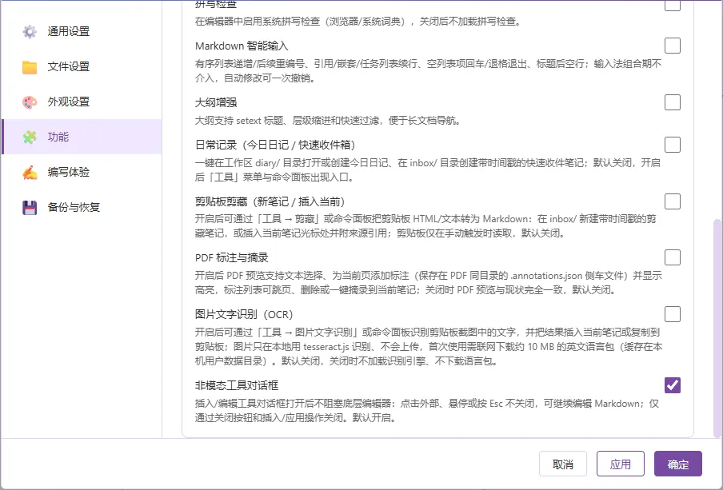
  <figcaption>图 12-3 「功能」页签底部：「非模态工具对话框」默认开启，关闭后恢复模态行为。</figcaption>
</figure>

### 12.2 「编写体验」页签

入口：**设置 → 系统设置 → 编写体验**。9 项开关默认关闭，全部按“当前文件/当前会话”工作；写作模式布局只影响 UI，不改文件内容。

| 开关          | 默认 | 关闭时                                   | 开启后                                       | 入口/注意                                |
| ------------- | ---- | ---------------------------------------- | -------------------------------------------- | ---------------------------------------- |
| 写作模式      | 关   | 正常侧栏/菜单/标题栏，正文全宽           | 隐藏侧栏/菜单/标题栏，正文限宽，进入沉浸写作 | 设置 → 编写体验；`Esc`/退出按钮恢复      |
| 打字机        | 关   | 光标按普通方式滚动，可能停留在屏幕上下方 | 输入时光标尽量保持在屏幕中部                 | 建议与写作模式一起使用                   |
| 段落聚焦      | 关   | 全文正常显示                             | 当前编辑段落突出，其余段落降低视觉权重       | 适合长文校对；可随时关闭                 |
| 写作统计      | 关   | 不显示字数/阅读时间/目标                 | 显示字数、阅读时间与每日目标进度             | 统计按当前文件/会话计算                  |
| 写作排版      | 关   | 编辑器正文使用默认字号/行高/宽度         | 应用写作模式的字号、行高、限宽与排版预设     | 只影响编辑器；预览纸感版式由界面风格决定 |
| 光标/滚动恢复 | 关   | 重新打开文件回到顶部                     | 按文件恢复上次光标位置与滚动位置             | 需要开启多标签时联动更明显               |
| 气泡工具栏    | 关   | 选中文本不出现气泡菜单                   | 选中文本后出现快捷格式/插入气泡              | 普通模式与写作模式都可用                 |
| Slash 命令    | 关   | 行首 `/` 只是普通文本                    | 行首输入 `/` 打开命令菜单，可插入结构        | 与智能输入可组合                         |
| 风格检查      | 关   | 不做任何风格提示                         | 标出长句、重复、口头禅、填充词等建议         | **只提示，不自动改**；与拼写检查互补     |

写作模式预览在「静默纸感 / 混合」界面风格下的纸感版式见第 10 节（不是开关，由界面风格决定）。

### 12.3 「外观设置」页签

> 版本说明：「界面风格」「界面密度」「减少透明效果」三项配置自 **1.5.5** 起支持；其余外观配置沿用既有版本。

| 分组           | 配置项       | 取值                                    | 默认值                 | 说明                                                   |
| -------------- | ------------ | --------------------------------------- | ---------------------- | ------------------------------------------------------ |
| 主题           | 应用主题     | 只读显示                                | `baize`                | 只读展示当前主题；点「打开主题设置」到独立对话框切换   |
| 主题           | 使用系统主题 | 开 / 关                                 | 关                     | 跟随系统深浅色自动切换；手动选主题会自动关闭本开关     |
| 字体           | 系统字体     | 微软雅黑 / 苹方 / Segoe UI / Arial      | 系统字体栈（微软雅黑） | 只影响界面字体，不改编辑器字体                         |
| 字体           | 字体大小     | 12~20                                   | 13                     | 界面字号，不改编辑器字号                               |
| 界面风格与密度 | 界面风格     | 静默纸感 / 轻玻璃 / 高密度工作台 / 混合 | 高密度工作台           | 材质层：透明、模糊、阴影、边框、圆角；详见第 7 节      |
| 界面风格与密度 | 界面密度     | 紧凑 / 默认 / 宽松                      | 默认                   | 尺寸节奏层：行高、控件高、内边距、UI 字号；详见 7.2    |
| 界面风格与密度 | 减少透明效果 | 开 / 关                                 | 关                     | 玻璃风格回退为不透明纸感；同时识别系统「减少透明」偏好 |

- 三项新增配置与其他系统设置一起写入本机系统配置，重启后保持；点「应用/确定」后即时生效，无需重启。
- 主题、风格、密度互不覆盖：主题只给颜色，风格只给材质，密度只给尺寸。
- 玻璃风格的自动降级（深色、高饱和、护眼主题、减少透明）见 7.4，设置里仍显示你选择的风格。

| 开关         | 关闭时                                   | 开启时                                                 |
| ------------ | ---------------------------------------- | ------------------------------------------------------ |
| 使用系统主题 | 使用手动选择的应用主题，不跟随系统深浅色 | 跟随操作系统浅色/深色切换；手动选主题会自动关闭本开关  |
| 减少透明效果 | 轻玻璃风格保留透明度/模糊                | 玻璃风格回退为不透明纸感；同时识别系统「减少透明」偏好 |

### 12.4 编辑器设置（独立对话框）

入口：**设置 → 编辑器设置**。共 4 个页签：基础设置（自动保存与间隔、代码折叠、行号、自动补全）、外观设置（光标样式与宽度、字体大小、行高）、Markdown 设置（实时预览与延迟、代码块/链接高亮）、高级设置（性能、实验性功能）。基础/外观页签保存后立即应用到当前编辑器；Markdown/高级页签中部分选项当前标注「该选项暂未接入实际功能」，以界面提示为准。编辑器设置影响所有 Markdown 文档的编辑区，与应用主题、界面风格/密度独立，Monaco 主题另行切换。

### 12.5 主题设置（独立对话框）

入口：**设置 → 主题设置**。

- 28 套应用主题、57 套 Monaco 主题；
- 应用主题控制侧栏/对话框/预览等 UI，Monaco 主题控制代码区；主题卡片采用紧凑布局，主题说明通过名称旁 **ⓘ** 悬停/点击查看；
- 「编辑器主题」页签支持**独立编辑器主题**开关：默认关闭时编辑区跟随应用主题配色；开启后可选 57 套 Monaco 主题（含含空格/括号的磁盘主题），点选任一编辑器主题会自动开启该开关；再次关闭即恢复跟随应用主题；
- 支持取消回滚；主题切换不修改文档内容；
- 写作模式会叠加自己的排版样式，退出后恢复；
- 与界面风格/密度正交：主题只管颜色，材质与尺寸分别由外观页签的风格/密度决定（见第 7 节）。

### 12.6 「文件」页签与通用开关

入口：**设置 → 系统设置 → 文件 / 通用设置 / 备份与恢复**。默认文件保存路径、启用自动保存与间隔（秒）、最近文件列表数量在这里配置。

| 开关               | 默认           | 关闭时                                                   | 开启后                               | 入口/注意                                          |
| ------------------ | -------------- | -------------------------------------------------------- | ------------------------------------ | -------------------------------------------------- |
| 自动打开上次文件   | 产品默认关     | 启动停在欢迎页，需手动选文件                             | 启动恢复上次打开的文件               | 与“打开上次文件夹”同时开启时以实际启动恢复逻辑为准 |
| 自动打开上次文件夹 | 产品默认关     | 不自动恢复工作区，资源管理器为空                         | 启动恢复上次工作区目录与文件树       | 工作区恢复后才能使用标签/附件/PDF 等功能           |
| 自动保存           | 依配置，默认关 | 只在你按 `Ctrl+S`/保存时写盘；切换文件仍会先保存当前文件 | 按设定间隔自动保存；标题栏脏标记消失 | 自动保存不是备份，误删/改错仍需文档历史或备份      |
| 允许加载远程图片   | 关             | 预览中远程图片替换为占位块，不发起网络请求               | 预览会加载 http/https 图片           | 隐私优先：开启后可能暴露 IP/被跟踪像素统计         |
| 自动备份           | 关             | 不创建自动备份                                           | 按间隔备份到备份目录，按保留数量轮换 | 备份与文档历史互相独立；大工作区注意磁盘占用       |
| 记住窗口位置和大小 | 开             | 每次启动使用默认窗口大小与位置                           | 恢复上次窗口尺寸/位置                | 多显示器变更后可能需手动调整一次                   |
| 关闭时最小化到托盘 | 关             | 点关闭直接走关闭/退出确认                                | 点关闭隐藏到托盘，应用继续运行       | 托盘退出才是真正退出；未保存内容仍会走关闭确认     |
| 开机自启动         | 关             | 系统登录后不自动启动                                     | 系统登录后自动启动应用               | 开发模式未打包时系统接口不可用；需安装版验证       |

编辑器设置（设置 → 编辑器设置）是独立对话框：基础页签控制自动保存/代码折叠/行号/自动补全；外观页签控制光标样式、字体大小、行高；Markdown/高级页签部分选项当前标注“暂未接入实际功能”，以界面提示为准。编辑器设置只影响 Monaco 编辑区，不改变应用主题/界面风格。

| 开关     | 关闭时                       | 开启时                                               |
| -------- | ---------------------------- | ---------------------------------------------------- |
| 自动保存 | 只在你按 `Ctrl+S`/保存时写盘 | 编辑器按设定间隔自动保存（切换文件仍会保存当前文件） |
| 代码折叠 | 不显示代码块折叠控件         | 代码块/区域可折叠，适合长代码笔记                    |
| 行号     | 编辑区不显示行号             | 左侧显示行号，便于跳转和定位                         |
| 自动补全 | 不弹出补全建议               | 输入时显示 Monaco 补全建议（Markdown/代码）          |

### 12.7 配置推荐

- **轻量笔记**：默认能力 + 自动保存 + 智能输入；
- **写作者**：写作模式 + 打字机 + 段落聚焦 + 写作统计 + 风格检查；
- **研究者**：标签 + Wiki 双链 + 反链 + PDF 标注/摘录 + OCR + 附件管理；
- **多项目**：多标签 + 文档历史 + 光标恢复 + 自动保存 + 标签/双链；
- **排障模式**：关闭智能输入/拼写/风格检查，只保留基础编辑，逐一排查。

外观相关的推荐组合（风格/密度）见第 7.5 节与第 22 节。

### 12.8 工作区布局配置

入口：**视图 → 布局配置…**（不需要新增工作区或重启）。

- 内置 3 套布局：写作（隐藏资源管理器）、研究（显示资源管理器）、项目（宽资源管理器）；
- 保存当前布局：把当前「编辑/预览/分屏模式 + 资源管理器显隐/宽度」保存为自定义布局；
- 应用/删除自定义布局；布局只改界面，不修改笔记内容；
- 布局保存在本机 localStorage，卸载/清理应用数据后需重新保存；
- 适合写作、研究、项目管理之间快速切换。

## 13. 日记 / 快速收件箱

> 版本说明：今日日记与快速收件箱自 **1.5.2** 起支持；入口依赖「功能」页签开关。

开关：系统设置 → 功能 →「今日日记 / 快速收件箱」（默认关闭）。

关闭时：工具菜单与命令面板不出现日记/收件箱入口，也不会创建 `diary/`、`inbox/` 目录；开启时：两个入口立即出现，点击后按文件名约定创建或打开文件。入口路径：工具 → 今日日记 / 快速收件箱，或命令面板搜索「日记」「收件箱」。

### 13.1 入口与行为

- 工具菜单/命令面板：今日日记、快速收件箱；
- 今日日记：`diary/YYYY-MM-DD.md`；已存在则直接打开，不覆盖；
- 快速收件箱：`inbox/YYYY-MM-DD-HHmmss.md`；每次创建新文件；
- 目录不存在时主进程递归创建；文件用独占创建，避免并发覆盖；
- 无工作区时明确提示先打开文件夹。

### 13.2 模板变量

`{{date}}`、`{{time}}`、`{{datetime}}`、`{{year}}`、`{{month}}`、`{{day}}`、`{{weekday}}`、`{{title}}`；未知变量原样保留。模板在 shared 纯函数中展开，不执行脚本。

### 13.3 与知识库联动

- 日记/收件箱文件会自动进入工作区索引；
- 可在模板中预置 `tags`/`summary`，创建后标签索引直接可见；
- 收件箱适合先捕获，再用文档属性整理、用 Wiki 链接连接到项目笔记；
- 日记可以反链到项目/人物/主题笔记，形成时间线。

## 14. 剪藏

> 版本说明：剪贴板剪藏自 **1.5.2** 起支持；仅读取剪贴板内容，不启动本地接收端口。

开关：系统设置 → 功能 →「剪贴板剪藏」（默认关闭）。

关闭时：工具菜单与命令面板不出现剪藏命令，应用不会读取剪贴板；开启时：出现「剪藏到新笔记 / 剪藏并插入当前笔记」两个入口，只有手动触发时才读取剪贴板。入口路径：工具 → 剪藏，或命令面板搜索「剪藏」。

### 14.1 操作流程

1. 在浏览器/其他应用复制网页内容（HTML 或纯文本）；
2. 命令面板/工具菜单选择「剪藏到新笔记」或「剪藏并插入当前笔记」；
3. 应用优先读取剪贴板 HTML，清洗后经 Turndown 转 Markdown；
4. 新笔记写入 `inbox/YYYY-MM-DD-HHmmss-clip.md`，带来源/标题/捕获时间；
5. 插入当前笔记时，内容插入活动编辑器光标处（无活动编辑器则提示）。

### 14.2 配置与限制

- HTML 片段、正文大小、标题/来源有上限；超限给出明确提示；
- 只接受 http/https 来源，防止本地/危险协议；
- 不新增本地 HTTP 端口/浏览器扩展；
- 剪贴板读取仅在用户显式触发时发生；拒绝权限时回退纯文本/提示；
- 剪藏后建议用文档属性补标签，用 Wiki 链接连接到主题笔记。

### 14.3 联动示例

- 剪藏到收件箱 → 加标签/摘要 → 与项目笔记双链 → 定期从收件箱清空；
- 剪藏并插入当前笔记 → 用于“资料卡片”式笔记，插入后补来源引用；
- 与附件管理：剪藏内容中的远程图片默认不下载/不加载，需手动保存为本地附件。

## 15. PDF 标注与摘录

> 版本说明：PDF 文本层、标注与摘录自 **1.5.2** 起支持；扫描版 PDF 需先做 OCR 或使用带文本层的版本。

开关：系统设置 → 功能 →「PDF 标注与摘录」（默认关闭）。

关闭时：PDF 预览保持原有只读行为，不渲染文本层/标注按钮，也不生成 sidecar；开启时：PDF 预览出现文本选择与标注工具，可摘录到当前笔记。入口路径：资源管理器打开 PDF → PDF 预览工具栏/标注列表。

### 15.1 操作流程

1. 打开工作区内的 PDF（应用内 PDF 查看器）；
2. 开启开关后出现文本层/标注工具；
3. 选择文本 → 添加标注；标注保存到同名 sidecar：`<pdf>.annotations.json`；
4. 「标注列表」可跳页、删除、查看/编辑备注；
5. 「摘录」将选中文本插入活动 Markdown 光标处，格式为引用块 + 文件名/页码；无编辑器时回退剪贴板并提示。

### 15.2 配置与安全

- sidecar 路径由主进程生成，PDF/侧车双侧 Path Guard；
- 写盘使用临时文件 + 原子 rename；
- 缺失/损坏的 sidecar 容错为空数组并告警，不阻塞 PDF 预览；
- 标注在本地文件，不上传网络；
- 关闭开关时 PDF 预览与普通能力零差异，不注册文本层/标注 UI。

### 15.3 联动

- PDF 摘录 → Markdown 引用块 → 在摘录下补 `[[相关笔记]]` → 反链/知识库；
- 与 OCR 配合：扫描版 PDF 无文本层时，先用截图 OCR 再整理；
- 与附件管理：PDF 作为附件被引用时可审计缺失/重命名。

## 16. 图片文字识别（OCR）

> 版本说明：图片 OCR MVP 自 **1.5.2** 起支持；当前仅处理剪贴板图片与英文语言包。

开关：系统设置 → 功能 →「图片 OCR」（默认关闭）。

关闭时：不注册 OCR 命令、不加载 OCR worker 与语言包，工具菜单/命令面板不出现入口；开启时：出现「识别并插入当前笔记」「识别并复制」两个入口。入口路径：工具 → 图片文字识别，或命令面板搜索「OCR / 图片文字」。

### 16.1 操作流程

1. 复制一张包含文字的截图/图片到剪贴板；
2. 命令面板/工具菜单选择「识别并插入当前笔记」或「识别并复制」；
3. 首次使用会下载 `eng` 语言包（约 2.95 MB，固定 https 源，缓存后可离线）；
4. 识别在本地 wasm/worker 完成，不上传图片；
5. 结果插入活动编辑器光标处，或复制到剪贴板；失败有结构化提示。

### 16.2 配置与限制

- 当前 MVP 仅英文 `eng`；中文 `chi_sim` 为后续；
- 首次识别需联网下载语言包；企业网络受限时可能失败；
- 图片格式/大小有限制（PNG 等，≤20 MiB）；只处理剪贴板图片；
- OCR 引擎与语言包懒加载，不进入首屏；
- 识别结果不写库，需用户插入/复制后自行保存。

### 16.3 联动

- 截图 OCR → 插入笔记 → 用文档属性补来源/标签；
- OCR 文本可被 A2 搜索检索（保存后）；
- 与 PDF 标注配合处理扫描 PDF；
- 与附件管理配合：原始截图可保存为附件并保留引用。

## 17. 插件工具（38 项）操作详解

入口：**插件** 菜单。所有插件工具为本地独立面板，输入/输出以剪贴板或文本框为主；部分工具需用户手动复制结果。

操作步骤：

1. 打开插件菜单，按分类（加解密/编解码/格式转换/文本转换/格式化/小工具/网络计算/对照表）选择工具；
2. 在左侧或上方输入区粘贴/填写内容；需要密钥、长度、格式等参数时先设置参数；
3. 查看右侧/下方输出，按工具按钮复制、转换或生成；
4. 结果如需进笔记，回到编辑器用 `Ctrl+V` 粘贴；不要把密钥、令牌写进笔记正文。
5. 面板顶部工具条左侧为「插件工具」标题，右侧为 **[最小化][最大化][返回编辑器]**：最小化把面板折叠为 44px 工具条（再次点击还原）、最大化让工具内容铺满工作区宽度、返回编辑器回到编辑视图。
6. **快速找工具**：工具条中的搜索框输入名称 / 分类 / 关键词（中英文均可），`↑` / `↓` 选择、`Enter` 打开、`Esc` 清空；工具行右侧星标可**收藏**。点工具条左侧「工具列表」可查看「收藏 → 最近使用 → 全部工具」三个分区（最近使用自动记录最近 5 个工具）。
7. **插件搜索入口**：菜单「插件 → 插件搜索」直接在工作区打开搜索界面（搜索框自动聚焦）——空白时显示**最近使用的 20 个插件**与全部工具，输入关键词后 `↑` / `↓` 选择、`Enter` 或点击即可打开对应工具（同时记录为最近使用）。

开关差异：38 项插件工具不使用系统设置开关，默认始终可用；在线/AI 导航等联网入口需要网络。各工具的输入/输出边界见下表。

### 17.1 加解密（8）

| 工具                 | 输入        | 操作/输出           | 联动                 |
| -------------------- | ----------- | ------------------- | -------------------- |
| UUIDs 生成器         | 数量/格式   | 生成 UUID；复制使用 | 可粘贴到笔记元数据   |
| ULID 生成器          | 数量        | 生成时间有序 ULID   | 适合文档 ID          |
| 令牌生成器           | 长度/字符集 | 生成随机 token      | 不要提交到仓库       |
| 哈希文本             | 任意文本    | MD5/SHA 等摘要      | 校验文件/文本        |
| 加密/解密文本        | 文本+密钥   | 对称加解密          | 密钥不要写入笔记正文 |
| Crypto 加密/解密文本 | 文本+密钥   | Web Crypto 加解密   | 浏览器兼容算法       |
| Hmac 生成器          | 文本+密钥   | HMAC 摘要           | 接口签名调试         |
| RSA 密钥对生成器     | 密钥长度    | 生成公私钥          | 只保存公钥到笔记     |

### 17.2 编解码（5）

| 工具               | 输入        | 操作/输出      | 联动                   |
| ------------------ | ----------- | -------------- | ---------------------- |
| Base64 编解码      | 文本/Base64 | 编码或解码     | 可配合图片 Data URL    |
| URL 编解码         | 文本/URL    | 百分号编码互转 | 调试链接               |
| HTML 实体编解码    | HTML 文本   | 实体转义/还原  | 与剪藏/HTML 查看器配合 |
| Unicode 与中文互转 | 文本        | `\uXXXX` 互转  | 代码/配置排查          |
| 图片转 Base64      | 图片文件    | Data URL       | 插入 HTML/预览         |

### 17.3 格式转换（5）

| 工具       | 输入        | 操作/输出         | 联动              |
| ---------- | ----------- | ----------------- | ----------------- |
| 颜色转换   | HEX/RGB/HSL | 互转并预览        | UI/主题配色       |
| 单位换算   | 数值+单位   | 长度/重量/温度等  | 技术笔记          |
| 人民币大写 | 金额        | 转人民币大写      | 财务笔记          |
| 时间戳转换 | 时间戳/日期 | 互转              | front matter 日期 |
| 进制转换   | 数值+进制   | 二/八/十/十六进制 | 调试/算法         |

### 17.4 文本转换（3）

| 工具         | 输入     | 操作/输出          | 联动                 |
| ------------ | -------- | ------------------ | -------------------- |
| 中文文本工具 | 中文文本 | 标点/全半角/简繁等 | 与写作风格检查互补   |
| 字数统计     | 文本     | 字符/词/行数       | 写作目标参考         |
| 文本比对     | 两段文本 | 差异结果           | 与文档历史/diff 互补 |

### 17.5 格式化（2）

| 工具       | 输入      | 操作/输出        | 联动          |
| ---------- | --------- | ---------------- | ------------- |
| JSON 工具  | JSON 文本 | 格式化/压缩/校验 | 配置/接口调试 |
| XML 格式化 | XML 文本  | 美化/检查        | 配置文件      |

### 17.6 常用小工具（3）

| 工具       | 输入      | 操作/输出     | 联动                     |
| ---------- | --------- | ------------- | ------------------------ |
| 随机生成器 | 类型/范围 | 随机数/字符串 | 测试数据                 |
| 在线计算器 | 表达式    | 计算结果      | 快速核算                 |
| PDF 预览   | 本地 PDF  | 打开预览      | 也可从资源管理器打开 PDF |

### 17.7 网络计算（4）

| 工具              | 输入      | 操作/输出          | 联动               |
| ----------------- | --------- | ------------------ | ------------------ |
| IPv4 子网计算器   | IP+掩码   | 网段/广播/主机范围 | 网络笔记           |
| HTTP 状态码对照表 | 状态码    | 查询含义           | 接口文档           |
| 子网掩码对照表    | 掩码/前缀 | 对照查询           | 网络规划           |
| 正则表达式测试    | 正则+文本 | 匹配结果           | 与搜索正则语法一致 |

### 17.8 常用对照表（8）

ASCII 码、文件扩展名、希腊字母、HTML 实体、数学符号、物理常数、数字大小写、常见字体样式；均为查询型工具，结果可复制到笔记。

### 17.9 插件工具的组合使用

- JSON/XML 格式化 → 复制到代码块笔记；
- 正则测试 → 与全工作区搜索的正则语法互相验证；
- 文本比对 → 与文档历史 diff 分工（历史看版本，比对看任意两段）；
- 哈希/加密 → 生成结果可写入笔记，但不要把密钥/token 写进正文；
- 颜色/单位/进制等工具 → 适合与 Markdown 表格组合成“速查笔记”；
- PDF 预览/OCR/PDF 标注 → 研究场景组合。

## 18. 在线资源与 AI 导航

- 在线工具导航：菜鸟工具、编程狮、在线编解码、在线 IDE、开发者工具等；
- AI 导航：ChatGPT、DeepSeek、Claude、Midjourney、Suno 等分组入口；
- 链接只允许 http/https，由主进程安全封装打开；
- 在线页面不注入 preload、不继承应用权限；不要在在线页面粘贴密钥/隐私内容；
- 与本地笔记的联动：从在线工具复制结果 → 粘贴到 Markdown → 用代码块/表格整理。

## 19. 主题与国际化

- 应用主题 28 套、Monaco 主题 57 套；
- 主题实时切换、可取消回滚；
- 中英双语：系统设置切换语言后菜单/对话框同步；
- 主题/语言不影响 Markdown 内容与知识库索引；
- 主题、界面风格、界面密度三者正交：主题只给颜色，风格给材质（第 7 节），密度给尺寸（7.2），可自由组合；
- 写作模式叠加排版样式，退出恢复原主题布局。

## 20. 帮助、版本与使用指导

- **帮助 → hemy08.github.io**：在线文档；
- **帮助 → 使用指导 → HTML 版**：应用内查看本地 HTML（带侧边导航）；
- **帮助 → 使用指导 → PDF 版**：系统 PDF 阅读器打开（首页目录可点击跳转）；
- **帮助 → 键盘快捷方式**：完整快捷键；
- **帮助 → 版本发布**：查看版本说明；
- **帮助 → 检查更新**：检查更新源；
- **帮助 → 关于**：版本/系统信息。

应用内查看 HTML 版时（**1.5.6** 起），对话框顶部提供「搜索使用指导」输入框，用于在应用内直接定位章节：

- 输入关键词后按章节标题与正文匹配，结果显示章节名与命中摘要；`↑` / `↓` 选择结果，`Enter` 跳到对应章节并临时高亮命中词（约 2.6 秒后自动恢复），`Esc` 清空搜索且不会关闭对话框；
- 搜索结果收起后关键词仍保留，重新聚焦输入框即可再次展开；点击对话框内使用指导页面自带的静态目录也能跳转章节，目录与搜索互不干扰；
- 浏览器打开的 HTML 版与 PDF 版仍使用页面内自带搜索与目录；若对话框顶部提示「使用指导内容不可用」，说明指南未加载成功，可关闭对话框后重试或改看 PDF 版。

## 21. 功能交互矩阵

| 场景       | 组合功能                                   | 操作顺序                              | 注意事项                                     |
| ---------- | ------------------------------------------ | ------------------------------------- | -------------------------------------------- |
| 日常捕获   | 今日日记/收件箱 + 属性 + 标签 + 双链       | 创建 → 补属性 → 加标签 → 链接         | E6 开关开启；文件已存在不覆盖                |
| 网页资料   | 剪藏 + 属性 + 标签 + 链接                  | 打开剪藏笔记 → 补标签 → 链到项目      | 来源字段不要覆盖；远程图片默认不下载         |
| 论文阅读   | PDF 标注/摘录 + 属性 + 双链 + 搜索         | 标注 → 摘录 → 插入笔记 → 加链接       | 扫描 PDF 无文本层时用 OCR                    |
| 截图资料   | OCR + 属性 + 标签 + 附件                   | OCR 插入 → 保存截图附件 → 补标签      | 首次 OCR 需下载语言包                        |
| 写作       | 写作模式 + 智能输入 + 统计/目标 + 风格检查 | 开启 → 目标 → 输入 → 检查             | 各开关独立，默认关闭                         |
| 多文档     | 标签页 + 历史 + 自动保存 + 光标恢复        | 打开多篇 → 自动保存 → 历史回滚        | A1/A3 开关；主进程仍单活动文档               |
| 知识库维护 | 标签 + 反链 + 链接检查 + 重命名            | 标签浏览 → 反链 → 检查 → 重命名       | 重命名只更新 Wiki 链接                       |
| 附件维护   | 附件管理 + 粘贴增强 + 重命名               | 审计 → 移回收站/重命名                | 只回收站，无永久删除                         |
| 导出发布   | 预览 + HTML/PDF/Word 导出                  | 预览确认 → 导出                       | 导出前保存并检查图片/链接                    |
| 外观定制   | 应用主题 + 界面风格 + 界面密度             | 先定主题 → 选风格 → 调密度            | 三者正交；玻璃在深色/高饱和/护眼主题自动降级 |
| 键盘操作   | 菜单栏 + 命令面板 + 工具窗 + 对话框        | Tab 聚焦 → 方向键 → Enter/Esc         | Esc 只关最顶层；工具窗 Esc 需焦点在窗内      |
| 写作排版   | 写作模式 + 纸感版式 + 写作排版 + 打字机    | 风格选纸感/混合 → 开写作模式 → 开预览 | 纸感版式只影响预览正文，不改 Monaco 主题     |

## 22. 推荐配置方案

### 22.1 首次使用

- 默认能力即可（界面风格「高密度工作台」+ 密度「默认」= 升级前观感）；
- 打开工作区，试一篇 Markdown；
- 需要知识库时再开启标签/双链相关（这些能力默认可用，依赖工作区）。

### 22.2 写作者

- 外观：界面风格「静默纸感」或「混合」+ 界面密度「默认/宽松」；
- 编写体验：写作模式、打字机、段落聚焦、写作统计、写作排版、风格检查；
- 功能：智能输入、拼写检查、文档历史；
- 建议每日目标 + 自动保存；写作时打开预览可看到纸感版式（第 10 节）。

### 22.3 研究者

- 功能：PDF 标注、OCR、剪贴板剪藏、文档历史；
- 外观：界面风格「高密度工作台」+ 界面密度「紧凑」，一屏显示更多条目；
- 知识库：标签、Wiki 双链/反链、链接检查、附件管理；
- 目录：`inbox/` 收件箱 + 主题笔记 + `files/` PDF + `images/` 截图；
- 流程：捕获 → 标注/OCR → 摘录 → 双链 → 反链回顾。

### 22.4 多项目/多文档

- 功能：多标签、文档历史、智能输入、大纲增强；
- 编写体验：光标/滚动恢复；
- 外观：界面密度「紧凑」或「默认」；
- 配置：自动保存 + 备份；标签/双链按项目组织。

### 22.5 低配设备/远程桌面

- 外观：界面风格「高密度工作台」或「静默纸感」，并开启「减少透明效果」；
- 不需要玻璃材质时不必切换；玻璃在深色主题自动进入稳健模式（降透明度、关模糊）。

## 23. 安全与隐私

- 主窗口/对话框/隐藏窗口启用 sandbox 与 contextIsolation，生产 CSP 收紧；
- 文件写入经主进程 Path Guard，工作区外路径/符号链接/设备命名空间拒绝；
- 外部链接只允许 http/https；本地 HTML 只允许受信任路径；
- 远程图片默认不加载；
- OCR 图片只在本地 wasm/worker 识别，不上传；
- 日志脱敏，不记录笔记正文与密钥；
- 剪贴板只在用户显式触发时读取；
- 玻璃风格只在悬浮层做小面积背景模糊，不做整窗大面积模糊，不读取屏幕内容；
- 界面风格/密度/减少透明只写入本机配置，不影响笔记内容与网络请求；
- 在线页面无 preload、权限隔离，不要粘贴敏感信息。

## 24. 常见问题

### 24.1 帮助菜单是空的 / 知识库没有数据

先打开工作区文件夹，确认目录内有 `.md`/`.markdown`/`.txt`。标签/反链/链接检查依赖工作区索引。

### 24.2 文件修改后索引没更新

索引约 5 秒缓存；点击「刷新索引」；重命名后等待缓存刷新或手动刷新。

### 24.3 Wiki 链接点击无反应

按住 `Ctrl`/`Cmd` 再点击；普通点击保持编辑。目标缺失时会询问创建。

### 24.4 附件删除能恢复吗

能。只移入系统回收站，请从 Windows 回收站恢复；应用不提供永久删除。

### 24.5 捕获功能菜单不可见

确认系统设置 → 功能中对应开关已开启；E6/E1/E2/E3 默认关闭，保存后即时生效。

### 24.6 OCR 首次失败

首次需下载 `eng` 语言包；检查网络/代理后重试。已缓存后可离线。当前只支持英文。

### 24.7 PDF 标注看不到

确认「PDF 标注与摘录」开关已开启，且打开的是工作区内的 PDF；扫描版 PDF 无文本层，不能选择文本。

### 24.8 剪藏内容不完整

剪贴板可能只有纯文本或权限被拒绝；尝试先复制网页选区再剪藏；超限内容会提示。

### 24.9 导入/导出失败

检查文件是否被占用、目标目录权限；查看状态栏/对话框错误。

### 24.10 文档历史/多标签在哪里

属于可选能力，需在「系统设置 → 功能」开启；默认关闭。

### 24.11 换了界面风格/密度但看起来没变化

先确认点了对话框底部「应用」或「确定」（点「取消」不会保存）。若选的是「轻玻璃」，在深色、高饱和/渐变、护眼主题下或开启「减少透明效果」时会自动降级为纸感材质（见 7.4），属于预期行为，切回浅色中性主题或关闭「减少透明效果」即可恢复玻璃。

### 24.12 菜单栏用键盘打不开 / 看不到焦点

先说一句：也可以直接按 `Alt + 字母` 打开对应顶层菜单（如 `Alt + F` 打开「文件」、`Alt + E` 打开「编辑」，字母表见 8.2）。否则先按一下 `Alt` 激活菜单栏（焦点落到第一个顶层菜单），或先用 `Tab` / `Shift + Tab` 把焦点移到菜单栏，再用方向键、`Enter`、`Esc`、`Home`/`End` 操作（见第 8 节）。激活后按 `Esc` 或再次按 `Alt` 即可退出激活并把焦点交回原来的控件。

### 24.13 写作模式正文的行高为什么变了

界面风格为「静默纸感 / 混合」时，写作模式的预览正文会套用纸感版式（16px / 行高 1.75，见第 10 节）。这是外观行为，不修改文件内容；Monaco 编辑区的字号/行高仍由「编辑器设置」与 Monaco 主题决定，不会随界面风格变化。

### 24.14 工具窗按 Esc 关不掉

非模态工具窗的 `Esc` 只在焦点位于窗内时生效、且一次只关最顶层窗口。先用鼠标点击工具窗内容（或 `Tab` 把焦点移入工具窗）再按 `Esc`；焦点在编辑区时 `Esc` 留给编辑器。也可以直接点右上角关闭按钮，或执行「插入/应用」等显式操作关闭。

## 25. 已知限制

- Wiki 标题锚点只打开文件，不跳到具体标题；
- 全文检索为按需扫描，1.5.x 不建持久全文索引；
- 附件管理器不提供永久删除、只改名不移动；
- HTML ``、reference 式链接、代码块内引用不参与孤儿判定；
- 剪藏不新增本地接收端/浏览器扩展，仅剪贴板/文件导入形态；
- PDF 标注依赖文本层；扫描 PDF 需 OCR/其他方式；
- OCR MVP 仅英文 `eng`，首次需联网下载语言包；
- 发布安装包未接入代码签名，仅提供 Windows x64；
- 插件工具/在线内容以对应服务为准；
- 菜单栏为应用内自绘菜单，`Alt + 字母` 助记符覆盖 12 个顶层菜单（字母见 8.2），但不支持自定义助记符字母或子菜单项助记符；单独按 `Alt` 可激活菜单栏（激活后方向键选择、`Enter` 打开、`Esc`/再次 `Alt` 退出）；
- 轻玻璃为实验性材质：深色主题自动进入稳健模式（降透明度、关模糊），高饱和/护眼主题与「减少透明效果」下回退为纸感材质；
- 纸感版式只作用于写作模式的 Markdown 预览正文，不影响 Monaco 编辑区、文件内容与导出结果；
- 界面密度只改变外壳/菜单/工具窗/表格等控件尺寸，不改变编辑器正文字号与行高。

---

白泽笔记 · 使用指导 · 随安装包分发 · 在线文档 https://hemy08.github.io

## 26. LLM Wiki 工作模式

> **1.5.7 起支持。** LLM Wiki 是一种「原始资料 + 编译知识」的知识管理方式：`raw/` 存放不可变的原始资料，`wiki/` 存放 AI 与用户共同维护的编译态知识，`schema.md` 记录工作区约定。

### 26.1 初始化与工作区模式

- **入口**：文件菜单「初始化 LLM Wiki」，或命令面板搜索「初始化」；也可在 **设置 → 系统设置 → 功能 → 工作区模式** 中选择「LLM Wiki 模式」（切换时会先确认再初始化）。
- 初始化会在工作区根目录创建 `raw/`、`wiki/` 目录与 `schema.md` 模板（已存在时不覆盖）。
- **`raw/` 只读**：对 `raw/` 内文件的新建、保存、重命名、删除会被拒绝并提示；`wiki/` 可正常编辑。
- `raw/` 不参与工作区索引、搜索、反链与图谱（保持资料原始性；需要引用时用 `wiki/` 页面）。
- 切回「传统模式」不会删除已创建的目录，编辑行为恢复为普通 Markdown。

### 26.2 工作台布局（编辑器 / 预览 / AI 面板）

- 切到 LLM Wiki 模式后，工作区布局变为：**左侧编辑区** + **右侧 AI 输入面板**；**顶部菜单栏右侧**有 **视图模式按钮**（循环切换 **编辑 / 预览 / 编辑+预览**，传统模式与 LLM Wiki 模式都显示；在 LLM Wiki 模式下「编辑+预览」为编辑区内部并排、右侧 AI 面板不变）与 **传统模式/LLM Wiki 模式快速切换按钮**（图标，无文字；Windows 原生菜单栏样式下随菜单栏一起隐藏）；编辑区与 AI 面板之间的**分隔条可拖动**调整宽度（**宽度无限制**；双击或面板头部按钮恢复默认；键盘聚焦后可用 ←/→ 微调；宽度会记住）。
- 点 AI 面板的「收起」后，面板不占编辑区空间，入口收进**右侧边栏**（右侧导航栏顶部的 AI 按钮），点击即可重新展开。
- 右侧边栏的 AI 按钮在**传统模式和 LLM Wiki 模式**都显示：传统模式下点击会按与「设置 → 工作区模式」相同的流程（确认 → 初始化 → 切换）进入 LLM Wiki 模式并打开 AI 面板；也可以在顶部菜单栏右侧用图标按钮快速切换。
- 切换视图不会打断编辑（光标与滚动位置保留）；当前视图模式在同一次运行内保持一致，重启后恢复默认「编辑+预览」。
- AI 面板可手动收起（收进右侧边栏）与展开；不再因编辑区最小宽度自动收起。
- 传统模式下布局保持「左编辑 + 右预览」并排，不受影响。

### 26.3 AI 助手配置（本地 / 远程）

- **入口**：**菜单 → 设置 → AI 助手**（独立对话框；模型管理与 MCP 服务配置都在这里）。
- **多模型**：可添加多个模型并随时切换（模型列表支持添加/编辑/删除/设为默认；每个模型可单独「测试连接」；AI 面板顶部下拉选择本次使用的模型）。
- **本地模型**：Ollama（默认 `http://127.0.0.1:11434`）或 LM Studio（默认 `http://127.0.0.1:1234/v1`），隐私友好、可离线。
- **远程 API**：OpenAI 兼容接口（填 Base URL、模型名与 API Key）；密钥使用系统安全存储加密保存（不可用时仅本次会话有效），启用前会提示数据将发送到所配置的服务。
- 配置后可点「测试连接」验证；AI 未启用时相关功能会给出提示，不阻塞正常编辑。

### 26.4 AI 编译（ingest）与 diff 审批

- **入口**：命令面板搜索「AI 编译」/「ingest」。
- 流程：选择或自动扫描 `raw/` 资料 → AI 生成 `wiki/` 页面草案 → 展示**行级 diff**（新增/删除/上下文高亮）→ 点「确认应用」才写入 `wiki/`，取消/关闭不写盘。
- 写入前会再次校验：仅允许写入 `wiki/` 下的 Markdown 文件，`raw/` 只读边界不可突破。

### 26.5 MCP 只读桥（给外部 AI Agent 使用）

- **入口**：**菜单 → 设置 → AI 助手 → MCP 服务**（默认关闭，需手动启用）。
- 启用后仅监听本机回环（`127.0.0.1`），每次启用生成新的访问 token；设置页会显示实际端口、MCP 地址与 token 复制按钮。
- **可配置端口**：默认自动选择（优先 3847），也可指定固定端口（1~65535，下次启用生效）；运行中可点「重置令牌」让旧 token 立即失效。
- 提供 **7 个只读工具**：`search_wiki`、`read_page`、`list_pages`、`read_schema`、`list_tags`、`get_backlinks`、`read_raw`；不提供任何写操作。
- 在支持 MCP 的客户端中把「MCP 地址 + Bearer token」填入即可连接；退出应用或关闭服务后 token 失效，重启应用后需重新启用。

### 26.6 关系图谱与 raw 资料嵌入

- **关系图谱**：视图菜单「关系图谱」或命令面板搜索「图谱」；展示 `wiki/` 页面之间的链接关系（节点=文件、连线=链接），可拖拽/缩放、点击节点跳转文件、点击连线查看来源与位置。
- **嵌入 raw 资料**：命令面板搜索「嵌入 raw 资料」；选择 `raw/` 下的文件（可预览文本/图片），插入标准 Markdown 相对链接到当前文档，插入后预览中可点击打开。
