# 白泽笔记 v1.3.6 架构文档

## 文档信息

| 项目名称 | 白泽笔记 (BaiZe Notes) |
|---------|----------------------|
| 版本号 | v1.3.6（2026-11-19 复核；架构基线为 v1.3.0 2026-11-15，其后版本无破坏性架构变更） |
| 技术栈 | Electron 43.8.10 + Vue 3.5.45 + TypeScript 6.0.3 + Monaco Editor 0.57.0 |
| 项目规模 | 300 个源码文件（206 ts / 81 vue，另 13 css；其中 .ts/.vue 287 个 / 约 91,500 行），80 个 Vue 组件（+ 根组件 App.vue），158 个测试文件 / 2,871 个用例 |
| 文档日期 | 2026年11月19日（v1.3.6 口径复核） |
| 作者 | hemy08 |

> **更新于 2026-11-19（对照 v1.3.6）**：本文件为**当前架构基线**，已校准版本号、技术栈版本、代码规模（287 个 `.ts/.vue` / 约 91,500 行）、IPC 通道数量（92 个 / 17 组）、测试规模（158 文件 / 2,871 用例）、主题数量（28 应用 / 55 Monaco）与 2026-11-15 重大变更（preload 单文件、预览本地化、启动欢迎页、死通道清理、file-operations 拆分等），并补录 2026-11-18 的最近文件菜单、PDF 预览（pdf.js / `FILE.READ_BINARY`）、`FILE.OPEN_IN_BROWSER`、preload 白名单与系统设置补充实现。历史版本见 `docs/架构文档.html`（历史合辑，已标注）。

---

## 目录

1. [概述](#概述)
2. [4+1视图模型](#4+1视图模型)
   - [逻辑视图](#逻辑视图)
   - [实现视图](#实现视图)
   - [进程视图](#进程视图)
   - [部署视图](#部署视图)
   - [用例视图](#用例视图)
3. [3A视图模型](#3a视图模型)
   - [Architecture视图](#architecture视图)
   - [Aspects视图](#aspects视图)
   - [Assets视图](#assets视图)
4. [详细架构图](#详细架构图)
5. [子模块架构](#子模块架构)
6. [2026-11 架构增补（v1.3.6 当前态）](#arch-2026-11)
   - 国际化（i18n）架构
   - 预览本地单跳渲染（PF-02）
   - PlantUML 本地 teaVM 渲染
   - 配置单真源（STORE_BACKED_CONFIGS）
   - 设置系统单真源（编辑器设置 / 系统设置备份恢复）
   - IPC 通道命名规范与治理
   - preload 单文件约束（sandbox 硬性要求）
   - 启动行为与欢迎页（2026-11-15 产品决策）
   - 窗口、对话框与事件总线现状（18 + 9 + 2；24 个事件）
   - 安全边界（P0/P1 加固）
   - 死代码与死通道清理（P2）
7. [架构决策记录](#架构决策记录)

---

## 概述

### 系统简介

白泽笔记是一款基于 Electron + Vue 3 + TypeScript 构建的跨平台桌面笔记应用，专注于提供优雅的 Markdown 编辑体验。应用名称源自中国古代神兽"白泽"，寓意智慧与知识的汇聚。

### 核心特性

- **Monaco Editor 集成**：采用 VS Code 同款编辑器（0.57.0），提供强大的代码编辑能力
- **多主题支持**：内置 **28 种应用主题** + **55 种 Monaco 编辑器主题**（另内置 `vs`），支持浅色/深色与跟随系统切换
- **实时预览**：Markdown 实时渲染，支持 Mermaid、PlantUML、KaTeX 等扩展语法；预览渲染在渲染进程**本地单跳**完成（PF-02，主进程渲染 IPC 4 → 0）
- **国际化（i18n）**：中英双语（zh-CN / en-US，12 个命名空间），主进程 `tMain()` 与渲染层 `t()` 共用 `src/shared/i18n` 词典
- **插件工具集**：内置 **38 个**插件工具组件（加密 8 / 信息 8 / 网络 4 / 编解码 5 / 格式转换 5 / 小工具 3 / 文本 3 / 格式化 2），异步按需加载，非动态第三方插件加载
- **文件管理**：文件树导航（增量刷新 + `fs.watch` 监听）、自动保存、多格式导入导出、9 种编码读写
- **启动与欢迎页**：启动**始终显示欢迎页**（2026-11-15 产品决策），主进程后台恢复上次目录/文件，用户点击最近文件夹或打开文件后进入主界面
- **对话框体系**：18 个 Vue 组件对话框（主窗口内 Teleport）+ 10 个主进程 JSDOM 对话框文件（含共享样式）+ 隐藏窗口（PlantUML 渲染 / PDF 导出）
- **安全边界**：导航拦截 + shell 协议白名单 + preload 通道白名单 + CSP + DOMPurify + iframe sandbox 收窄
- **跨平台**：支持 Windows（当前发布平台）、macOS、Linux

### 技术选型理由

| 技术 | 选型理由 |
|-----|---------|
| Electron 43.8.10 | 最新稳定版，提供完整的桌面应用能力，支持原生 API 调用 |
| Vue 3.5 | Composition API 提供更好的逻辑复用，响应式系统性能优异 |
| TypeScript 6 | 强类型保障代码质量，IDE 支持完善 |
| Monaco Editor 0.57 | VS Code 同款编辑器，语法高亮、智能提示、快捷键生态成熟 |
| electron-vite 6 | 专为 Electron 优化的构建工具，开发体验流畅 |
| electron-store 11 | 简单可靠的持久化存储方案，作为配置单真源 |
| markdown-it 15 | 插件生态丰富，Markdown 渲染扩展性强（KaTeX/Mermaid/PlantUML 均在其上组合） |
| i18n 自研轻量词典 | 中英双语同步翻译（主进程 JSDOM 对话框无法使用 Vue 响应式，故提供同步 `tMain()`） |

---

## 4+1视图模型

### 逻辑视图（Logical View）

逻辑视图描述系统的功能需求和静态结构，从最终用户角度展示系统功能。

#### 功能模块划分

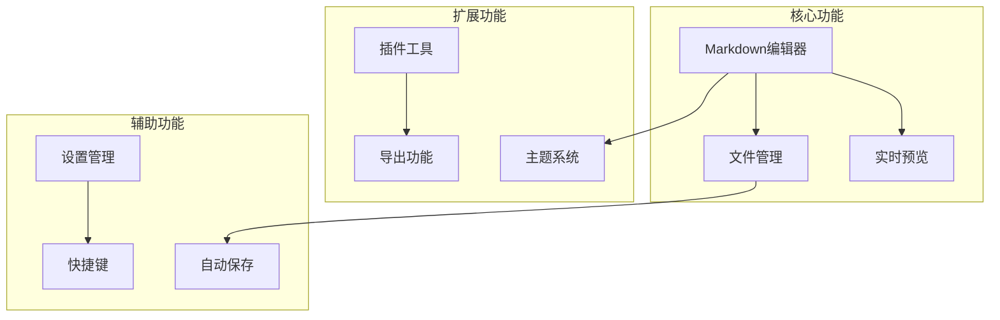

#### 核心类图

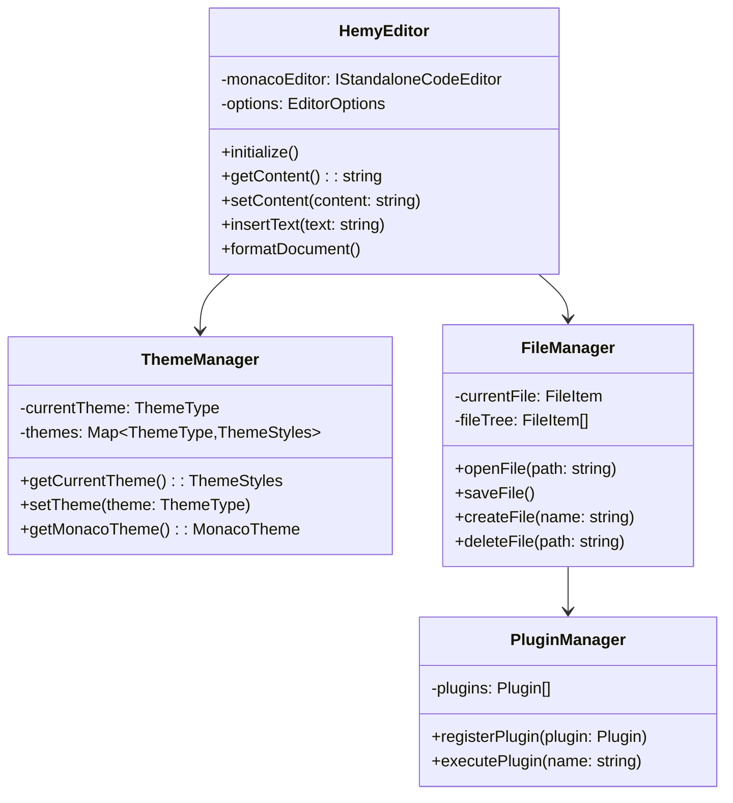

#### 包结构图

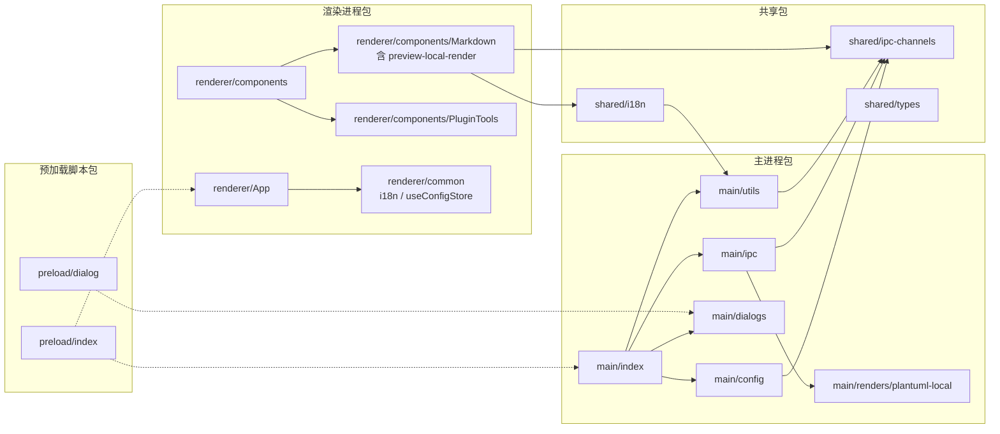

---

### 实现视图（Implementation View）

实现视图描述系统的模块结构、组件组织和依赖关系，从程序员角度展示系统实现。

#### 模块结构图

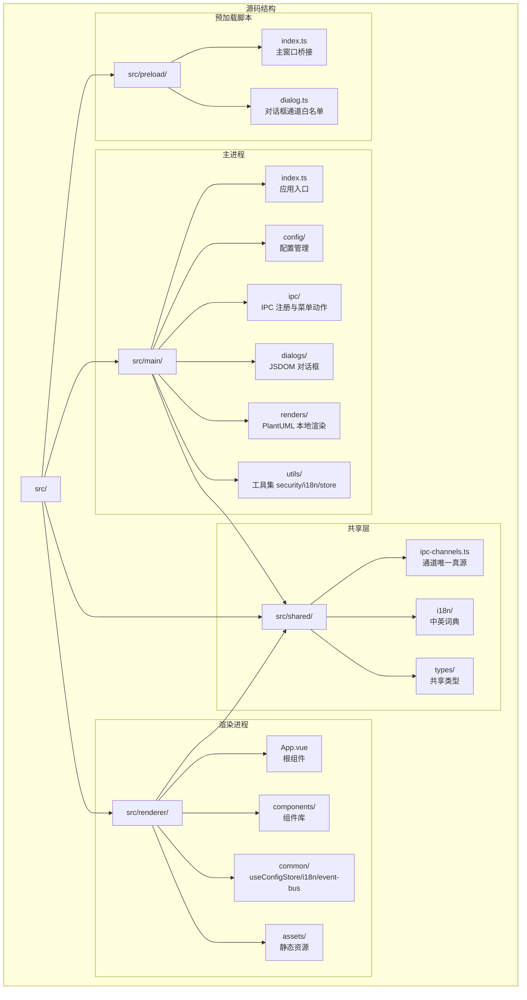

#### 组件依赖图

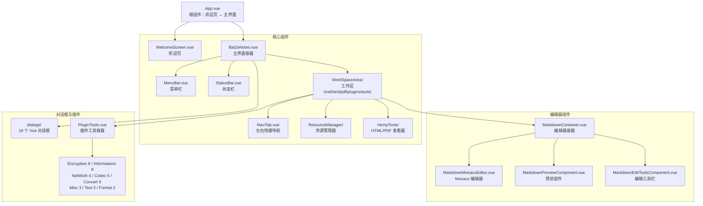

#### 文件统计

| 模块 | TypeScript文件 | Vue组件 | CSS | 小计 |
|-----|--------------|---------|-----|------|
| main/ | 70 | 0 | 0 | 70 文件 / 约 18,400 行 |
| shared/ | 39 | 0 | 0 | 39 文件 / 约 6,200 行 |
| preload/ | 3 | 0 | 0 | 3 文件 / 约 430 行 |
| renderer/ | 94 | 81 | 13 | 188 文件 / 约 69,000 行 |
| **总计** | **206** | **81** | **13** | **300 个文件 / 约 94,100 行（其中 `.ts/.vue` 287 个 / 约 91,500 行）** |

> 统计口径：`src/` 下 `.ts` / `.vue` / `.css` 文件（不含 SVG 图标、`.md`、`.html`；`renderer/` 的 81 个 `.vue` 含根组件 `App.vue`）。另有 `tests/` **158 个测试文件 / 2,871 个用例**（全通过；覆盖率以最新 `npm run test:coverage` 报告为准，历史 v1.3.0 基线为 84.79% / 77.99% / 80.75% / 85.09%）。实测日期 2026-11-19（v1.3.6 基线）。

---

### 进程视图（Process View）

进程视图描述系统的运行时架构、进程通信和并发处理，从系统集成者角度展示系统运行。

#### 运行时架构

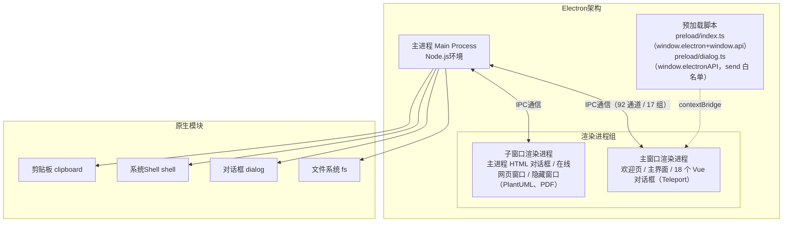

#### IPC通信模型

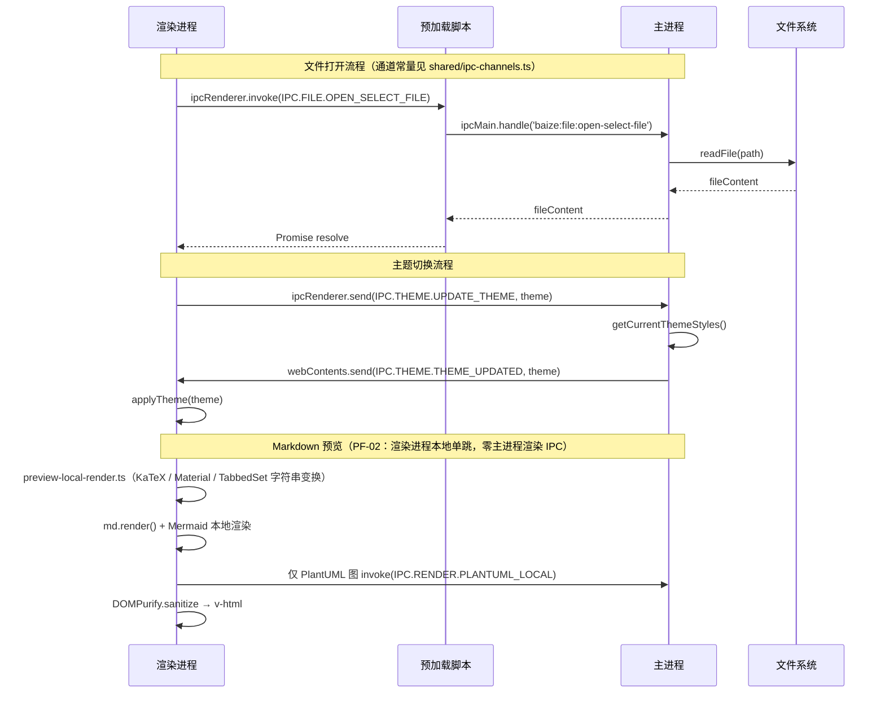

#### 并发处理模型

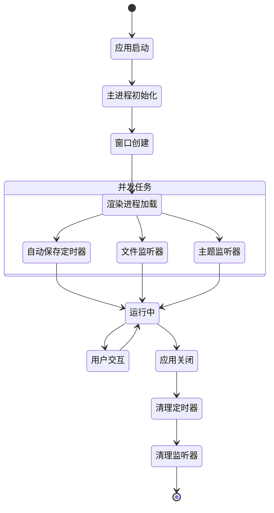

#### 关键IPC通道

> 命名规范：`baize:<domain>:<name>`（三段式、全小写 kebab-case）；当前共 **92 个通道 / 17 个常量组**（域白名单 18 个，实际使用 17 个 domain），唯一真源为 `src/shared/ipc-channels.ts`，禁止在业务代码中写通道字符串字面量。

| 通道常量 | 通道值 | 方向 | 用途 |
|---------|--------|------|------|
| `IPC.FILE.OPEN_SELECT_FILE` | `baize:file:open-select-file` | Renderer → Main（invoke） | 打开文件对话框 |
| `IPC.FILE.SAVE_TO_DISK` | `baize:file:save-content-to-disk` | Renderer → Main | 保存当前文件 |
| `IPC.MENU.ACTION` | `baize:menu:action` | Renderer → Main | 菜单动作处理 |
| `IPC.THEME.UPDATE_THEME` / `THEME_UPDATED` | `baize:theme:update` / `baize:theme:updated` | R→M / M→R | 主题更新与广播 |
| `IPC.RENDER.PLANTUML_LOCAL` | `baize:render:plantuml-local` | Renderer → Main（invoke） | PlantUML 本地 teaVM 渲染（预览链路唯一主进程 IPC） |
| `IPC.WINDOW.TOGGLE_MAXIMIZE` | `baize:window:toggle-maximize` | Renderer → Main | 窗口最大化切换 |
| `IPC.EDITOR.SYSTEM_SETTING_UPDATE` | `baize:setting:updated` | Main → Renderer | 系统设置（含语言）广播 |
| `IPC.EDITOR.FLUSH_CONTENT` / `FLUSH_CONTENT_DONE` | `baize:editor:flush-content` / `-done` | M→R→M | 关闭/退出前落盘协议 |

---

### 部署视图（Deployment View）

部署视图描述系统的物理部署和节点配置，从系统工程师角度展示系统部署。

#### 物理部署图

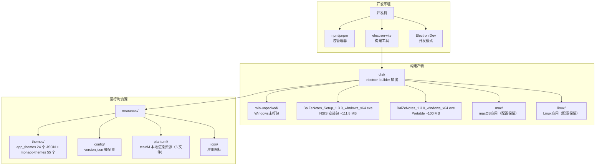

#### 应用打包结构

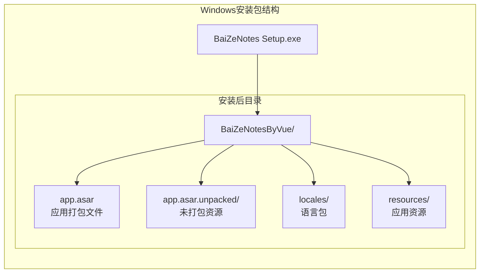

#### 运行环境要求

| 平台 | 最低要求 | 推荐配置 |
|-----|---------|---------|
| Windows（当前发布） | Windows 10 x64, 4GB RAM | Windows 10/11, 8GB RAM |
| macOS（配置保留） | macOS 12, 4GB RAM | macOS 13+, 8GB RAM |
| Linux（配置保留） | glibc 2.31, 4GB RAM | Ubuntu 22.04+, 8GB RAM |
| 运行时 | Node.js ≥ 22（`engines` 声明） | Node.js 24.x |
| 运行资源 | 打包后 app.asar 51.96 MB；NSIS 安装包约 111.8 MB | — |

---

### 用例视图（Use Case View）

用例视图描述系统的用户场景和功能用例，从最终用户角度展示系统功能。

#### 核心用例图

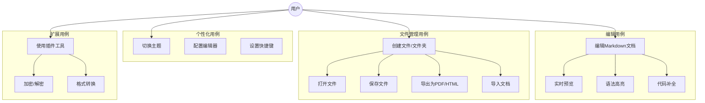

#### 用户场景描述

**场景1：创建并编辑Markdown文档**

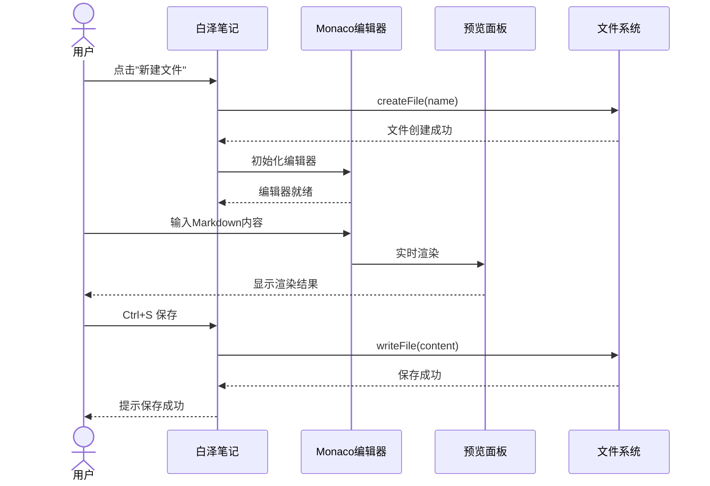

**场景2：切换主题**

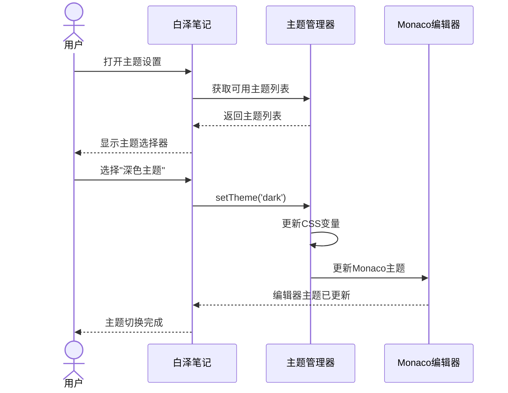

---

## 3A视图模型

### Architecture视图

Architecture视图描述核心架构决策和技术选型。

#### 架构分层

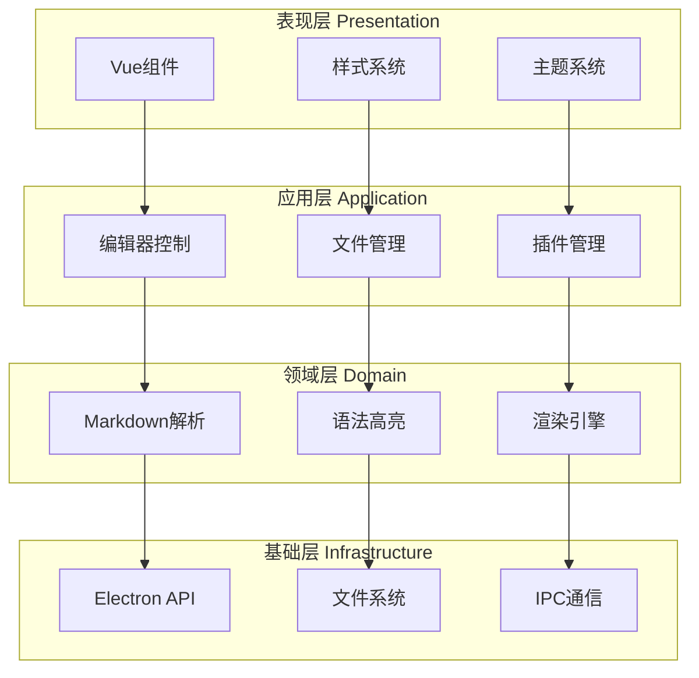

#### 核心技术选型

| 技术领域 | 选型方案 | 备选方案 | 选型理由 |
|---------|---------|---------|---------|
| 桌面框架 | Electron | Tauri, NW.js | 生态成熟，文档完善，Vue集成良好 |
| 前端框架 | Vue 3 | React, Svelte | Composition API，响应式性能优异 |
| 编辑器 | Monaco Editor | CodeMirror, Ace | VS Code同款，功能强大，TypeScript原生支持 |
| 构建工具 | electron-vite | webpack, rollup | 专为Electron优化，HMR快速 |
| 状态管理 | 渲染层自研轻量响应式 store（useConfigStore）+ 主进程 electron-store 配置 | Pinia | 已移除 Vuex（依赖与用法均无）；应用状态简单，useConfigStore 与主进程 config 足够 |
| 持久化 | electron-store | lowdb, sqlite3 | 简单可靠，满足配置存储需求 |
| Markdown渲染 | markdown-it | marked, remarkable | 插件生态丰富，扩展性强 |

#### 架构决策记录（ADR）

**ADR-001: 选择Monaco Editor作为核心编辑器**

- **状态**：已采纳
- **背景**：需要为用户提供专业的Markdown编辑体验
- **决策**：采用Monaco Editor
- **理由**：
  1. VS Code同款编辑器，用户熟悉度高
  2. 原生支持TypeScript，类型安全
  3. 语法高亮、智能提示、快捷键功能完善
  4. 性能优异，可处理大文件
- **影响**：包体积增大（~2MB），但用户体验显著提升

**ADR-002: 采用IPC通信而非remote模块**

- **状态**：已采纳
- **背景**：Electron渲染进程需要访问主进程能力
- **决策**：使用IPC通信，禁用@electron/remote
- **理由**：
  1. remote模块存在安全风险
  2. IPC通信更安全、性能更好
  3. 符合Electron最佳实践
- **影响**：需要手动定义IPC通道，代码量略增

**ADR-003: 主题系统采用CSS变量方案**

- **状态**：已采纳
- **背景**：需要支持多主题切换
- **决策**：使用CSS变量定义主题色
- **理由**：
  1. 运行时动态切换，无需重新加载
  2. 代码简洁，维护方便
  3. 浏览器原生支持，性能优异
- **影响**：IE不支持（但Electron使用Chromium，无此问题）

---

### Aspects视图

Aspects视图描述横切关注点，包括日志、安全、性能、错误处理等。

#### 横切关注点架构

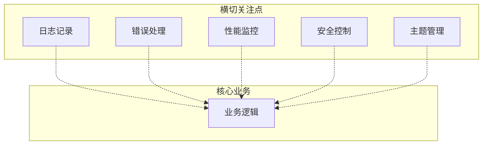

#### 日志系统

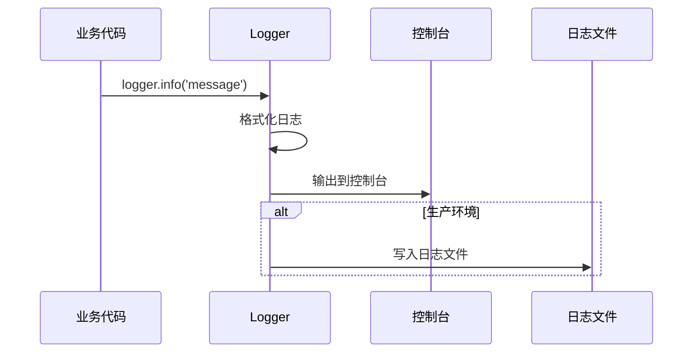

**日志级别**：
- `DEBUG`：开发调试信息
- `INFO`：一般信息
- `WARN`：警告信息
- `ERROR`：错误信息

#### 错误处理策略

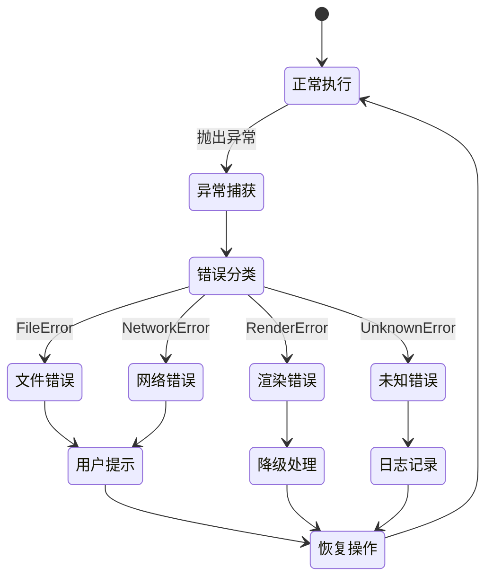

#### 性能优化策略

| 优化点 | 策略 | 效果（实测/说明） |
|-------|------|------|
| 预览渲染 | PF-02 渲染进程本地单跳 + 150ms 防抖 | 主进程渲染 IPC 4 → 0；减少重复渲染 |
| 代码高亮 | 关闭 highlightAuto 全语言探测 | md.render 快 12~155 倍 |
| 公式/主题缓存 | KaTeX LRU 200 条；Monaco 主题按需读取缓存 | 重复内容零/低开销 |
| 目录刷新 | 增量重扫 + 指纹去重 + 文件 mtime/size 签名 | 目录增量刷新 -94.8% |
| 大文件处理 | 预览 >2MB 或 >5 万行降级；Monaco largeFileOptimizations | 避免超大文件卡死 |
| 主题切换 | CSS 变量 + Monaco 主题热更新 | 无闪烁切换 |
| 自动保存 | 定时器 + 脏标记（长度 + sha256 指纹） | 减少 IO、避免双份全文 |
| 打包体积 | 移除 4 个 Monaco 语言 worker、排除 source map | 产物 -14.74MB |

#### 安全机制（2026-11-15 P0/P1 加固后）

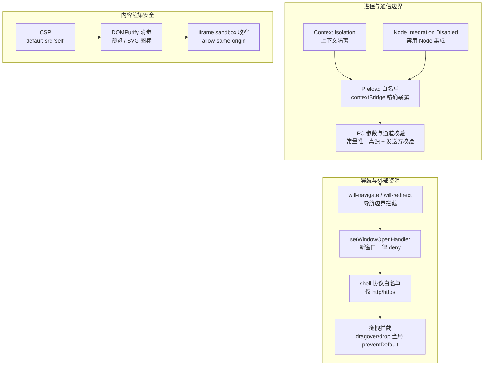

安全边界要点：

- **导航边界**：主窗口拦截 `will-navigate` / `will-redirect`，只放行开发服务器地址与打包后的本地 renderer 页面，其余目标 `preventDefault` 并告警（`src/main/utils/security.ts`）。
- **协议白名单**：`shell.openExternal` 统一经 `openExternalSafely()`，仅放行 http/https；`file:` / `javascript:` / `data:` / 自定义协议一律拒绝。对话框 preload 内做等价零依赖校验。
- **在线网页窗口（C-08）**：不再加载任何 preload，窗口内导航与 `window.open` 全部 deny，外部链接只交系统浏览器。
- **preload 白名单**：对话框 preload 的 `send` 仅放行 2 个回车通道（新建/重命名），未知通道丢弃并告警；主窗口经 `contextBridge` 暴露受限 API。
- **CSP**：渲染页 `default-src 'self'` + 必要放宽（script `'unsafe-eval'` 供 Monaco/Vite、style `'unsafe-inline'` 供 Vue/KaTeX、img data:/https:、worker blob:）。
- **内容消毒**：Markdown 预览经 DOMPurify（svg + mathMl profile）消毒后写 `v-html`；NaviTab 快捷链接 SVG 图标使用 DOMPurify svg profile；其余分支改用文本插值/Vue 自动转义。
- **HTML 查看器**：iframe `sandbox="allow-same-origin"`，移除 `allow-scripts` / `allow-forms` / `allow-popups`，不再执行 HTML 内脚本。
- **数据安全**：Path Guard 路径守卫（文件类 IPC 限定工作区根/受信路径）、sender 校验（`withSenderCheck`）、加密工具 GCM authTag、dirty 标记落盘、编码探测、配置损坏容错重建、保存失败可见提示、远程图片默认不加载。

---

### Assets视图

Assets视图描述可复用资产、组件库和工具集。

#### 组件资产库

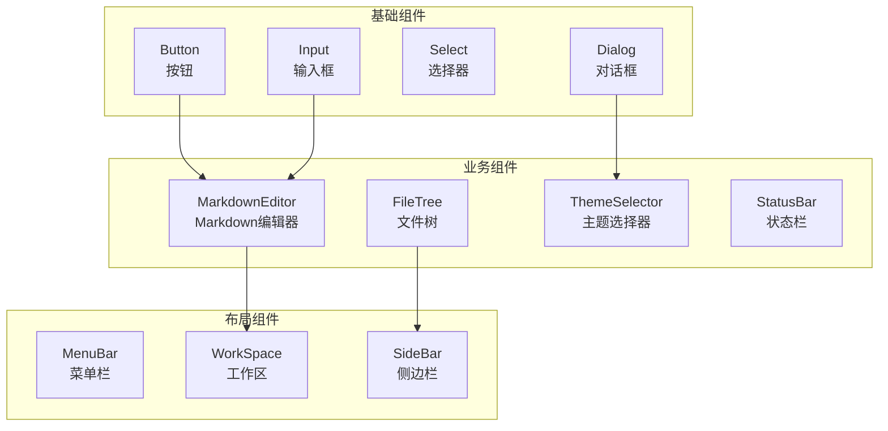

#### 工具集资产

| 工具模块 | 功能 | 复用场景 |
|---------|------|---------|
| `file-utils` | 文件操作工具 | 文件管理、导入导出 |
| `baize-store` / `store-factory` | 持久化存储与 LRU 缓存 | 配置保存、状态持久化 |
| `logger` | 日志工具 | 全局日志记录 |
| `security.ts` | 导航边界与 shell 协议白名单 | 窗口导航、外部链接 |
| `encrypt-decrypt` | 加密解密 | 文件加密、安全存储 |
| `i18n.ts`（主进程）/ `common/i18n.ts`（渲染层） | 翻译函数 `tMain()` / `t()` | 全部界面与提示文案 |
| `theme-config` | 主题配置 | 主题管理、样式切换 |
| `renders/plantuml-local.ts` | PlantUML 本地渲染 | 预览流程图（离线） |
| `preview-local-render.ts` | 预览本地单跳渲染 | Markdown 预览（KaTeX/材料块/标签页） |

#### 插件工具集

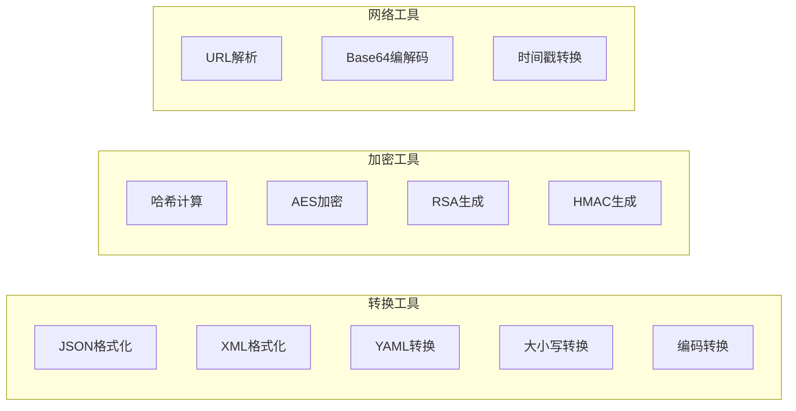

---

## 详细架构图

### 系统上下文图

```mermaid
graph TB
    subgraph 外部实体
        USER[用户]
        FS[文件系统]
        WEB[Web资源]
    end
    
    subgraph 白泽笔记系统
        SYSTEM[白泽笔记应用]
    end
    
    USER -->|编辑/查看| SYSTEM
    SYSTEM <-->|读写文件| FS
    SYSTEM -->|获取资源| WEB
```

### 容器架构图

```mermaid
graph TB
    subgraph 白泽笔记应用
        subgraph Electron容器
            MAIN[主进程容器<br/>Node.js环境]
            RENDERER[渲染进程容器<br/>Chromium环境]
            PRELOAD[预加载脚本<br/>桥接层]
        end
    end
    
    subgraph 外部系统
        FS[文件系统]
        OS[操作系统]
        WEB[网络资源]
    end
    
    MAIN <-->|IPC| RENDERER
    PRELOAD -.->|contextBridge| RENDERER
    
    MAIN -->|Node API| FS
    MAIN -->|Electron API| OS
    RENDERER -->|fetch| WEB
```

### 组件架构图

```mermaid
graph TB
    subgraph 主进程组件
        M1[应用生命周期管理]
        M2[窗口管理器]
        M3[文件管理器]
        M4[主题管理器]
        M5[菜单管理器]
        M6[IPC处理器]
        M7[设置管理器]
    end
    
    subgraph 渲染进程组件
        R1[应用根组件]
        R2[菜单栏组件]
        R3[编辑器组件]
        R4[预览组件]
        R5[文件树组件]
        R6[状态栏组件]
        R7[插件工具组件]
    end
    
    M6 --> M3
    M6 --> M4
    M6 --> M7
    
    R1 --> R2
    R1 --> R3
    R1 --> R4
    R1 --> R5
    R1 --> R6
    R1 --> R7
    
    R3 -.->|IPC| M3
    R4 -.->|IPC| M4
    R5 -.->|IPC| M3
```

### 时序图 - 文件编辑完整流程

```mermaid
sequenceDiagram
    actor User as 用户
    participant App as 应用
    participant Main as 主进程
    participant Editor as 编辑器
    participant Preview as 预览
    participant FS as 文件系统
    
    User->>App: 打开文件
    App->>Main: IPC: baize:file:open-select-file
    Main->>FS: 读取文件
    FS-->>Main: 文件内容
    Main-->>App: 返回内容
    App->>Editor: 设置内容
    Editor-->>Preview: 触发本地渲染（渲染进程内，零 IPC）
    Preview-->>User: 显示预览
    
    loop 编辑循环
        User->>Editor: 输入内容
        Editor->>Preview: 实时本地渲染
        Preview-->>User: 更新预览
    end
    
    User->>App: 保存文件
    App->>Editor: 获取内容
    Editor-->>App: 返回内容
    App->>Main: IPC: baize:file:save-content-to-disk
    Main->>FS: 写入文件
    FS-->>Main: 保存成功
    Main-->>App: 保存确认
    App-->>User: 提示成功
```

### 状态图 - 编辑器状态

```mermaid
stateDiagram-v2
    [*] --> 空闲
    
    空闲 --> 编辑中: 用户输入
    编辑中 --> 空闲: 内容清空
    编辑中 --> 已修改: 内容改变
    编辑中 --> 选中状态: 选中文本
    
    已修改 --> 编辑中: 继续编辑
    已修改 --> 保存中: 触发保存
    已修改 --> 空闲: 撤销修改
    
    保存中 --> 空闲: 保存成功
    保存中 --> 已修改: 保存失败
    
    选中状态 --> 编辑中: 取消选中
    选中状态 --> 编辑中: 插入操作
    
    空闲 --> 预览模式: 切换预览
    预览模式 --> 空闲: 返回编辑
```

### 活动图 - 主题切换流程

```mermaid
flowchart TB
    Start([开始]) --> OpenSettings[打开设置]
    OpenSettings --> SelectTheme[选择主题]
    SelectTheme --> ValidateTheme{验证主题}
    
    ValidateTheme -->|有效| ApplyTheme[应用主题]
    ValidateTheme -->|无效| ShowError[显示错误]
    ShowError --> SelectTheme
    
    ApplyTheme --> UpdateCSS[更新CSS变量]
    UpdateCSS --> UpdateMonaco[更新Monaco主题]
    UpdateMonaco --> SaveConfig[保存配置]
    SaveConfig --> NotifyWindows[通知所有窗口]
    NotifyWindows --> End([结束])
```

---

## 子模块架构

### 主进程架构

主进程是Electron应用的核心，负责窗口管理、文件操作、IPC通信等。

```mermaid
graph TB
    subgraph 主进程模块
        INDEX[index.ts<br/>应用入口]
        
        subgraph 核心模块
            WINDOW[window-manager.ts<br/>窗口管理]
            FILE[utils/file-utils/<br/>文件操作/目录树/编码/导入导出]
            IPC[ipc-listener-manager.ts<br/>IPC管理]
        end
        
        subgraph 功能模块
            CONFIG[config/<br/>配置管理]
            MENUIPC[ipc/menu-*.ts<br/>菜单动作]
            DIALOG[dialogs/<br/>JSDOM 对话框]
            RENDER[renders/plantuml-local.ts<br/>PlantUML 本地渲染]
        end
        
        subgraph 工具模块
            STORE[baize-store.ts / store-factory.ts<br/>存储]
            LOGGER[logger.ts<br/>日志]
            SEC[security.ts<br/>导航与协议白名单]
            I18N[i18n.ts<br/>tMain()]
            ENCRYPT[encrypt-decrypt.ts<br/>加密]
        end
    end
    
    INDEX --> WINDOW
    INDEX --> FILE
    INDEX --> IPC
    
    WINDOW --> CONFIG
    WINDOW --> MENUIPC
    WINDOW --> DIALOG
    MENUIPC --> RENDER
    
    FILE --> STORE
    FILE --> LOGGER
    MENUIPC --> SEC
    DIALOG --> I18N
```

#### 窗口管理器

```mermaid
classDiagram
    class WindowManager {
        -mainWindow: BrowserWindow
        -childWindows: Map~string,BrowserWindow~
        +createMainWindow(): BrowserWindow
        +createChildWindow(options): BrowserWindow
        +closeWindow(id: string)
        +sendMessage(channel, data)
    }
    
    class BrowserWindow {
        +webContents: WebContents
        +loadURL(url)
        +show()
        +close()
    }
    
    WindowManager --> BrowserWindow
```

#### IPC监听管理器

```mermaid
classDiagram
    class IPCListenerManager {
        -listeners: Map~string,Function~
        -stats: Map~string,number~
        +register(channel, handler)
        +unregister(channel)
        +cleanupAll()
        +printStats()
    }
```

### 渲染进程架构

渲染进程负责UI渲染和用户交互。

```mermaid
graph TB
    subgraph 渲染进程模块
        APP[App.vue<br/>根组件]
        
        subgraph 核心组件
            MENU[MenuBar.vue<br/>菜单栏]
            EDITOR[MarkdownContainer.vue<br/>编辑器容器]
            STATUS[StatusBar.vue<br/>状态栏]
        end
        
        subgraph 编辑器模块
            MONACO[MarkdownMonacoEditor.vue<br/>Monaco编辑器]
            PREVIEW[MarkdownPreviewComponent.vue<br/>预览组件]
            TOOLS[MarkdownEditToolsComponent.vue<br/>工具栏]
            PREVIEW_LOCAL[preview-local-render.ts<br/>本地单跳渲染（PF-02）]
            MERMAID[mermaid（动态 import）<br/>Mermaid 按需渲染]
            
            HEMY_EDITOR[hemy-editor.ts<br/>编辑器核心]
            HEMY_RENDER[hemy-editor-render.ts<br/>渲染逻辑]
            HEMY_SHORTCUT[hemy-editor-shortcut.ts<br/>快捷键]
            HEMY_ACTION[hemy-editor-actions.ts<br/>动作处理]
        end
        
        subgraph 工作区模块
            WORKSPACE[WorkSpaceArea/<br/>工作区]
            RESOURCE[ResourceManager/<br/>资源管理]
        end
        
        subgraph 插件模块
            PLUGIN[PluginTools/<br/>插件工具]
            CONVERT[Convert/<br/>转换工具]
            ENCRYPT[Encryption/<br/>加密工具]
        end
    end
    
    APP --> MENU
    APP --> EDITOR
    APP --> STATUS
    APP --> WORKSPACE
    
    EDITOR --> MONACO
    EDITOR --> PREVIEW
    EDITOR --> TOOLS
    
    PREVIEW --> PREVIEW_LOCAL
    PREVIEW --> MERMAID
    MONACO --> HEMY_EDITOR
    HEMY_EDITOR --> HEMY_RENDER
    HEMY_EDITOR --> HEMY_SHORTCUT
    HEMY_EDITOR --> HEMY_ACTION
    
    PLUGIN --> CONVERT
    PLUGIN --> ENCRYPT
```

#### Monaco编辑器集成

```mermaid
classDiagram
    class HemyEditor {
        -editor: IStandaloneCodeEditor
        -options: EditorOptions
        +initialize(container: HTMLElement)
        +getContent(): string
        +setContent(content: string)
        +insertText(text: string)
        +formatDocument()
        +registerLanguage()
        +registerTheme()
    }
    
    class EditorOptions {
        +language: string
        +theme: string
        +wordWrap: string
        +minimap: object
        +fontSize: number
        +lineNumbers: string
    }
    
    HemyEditor --> EditorOptions
```

### 预加载脚本架构

预加载脚本作为主进程和渲染进程之间的安全桥梁。

```mermaid
sequenceDiagram
    participant Main as 主进程
    participant Preload as 预加载脚本
    participant Renderer as 渲染进程
    
    Note over Preload: contextBridge.exposeInMainWorld()
    Preload->>Renderer: 暴露electron API
    Preload->>Renderer: 暴露自定义api
    
    Note over Renderer: 使用暴露的API
    Renderer->>Preload: window.electron.ipcRenderer.invoke()
    Preload->>Main: IPC通信
    Main-->>Preload: 返回结果
    Preload-->>Renderer: Promise resolve
```

### 数据流架构

```mermaid
graph LR
    subgraph 用户交互
        UI[UI事件]
    end
    
    subgraph 组件状态
        STATE[组件状态]
    end
    
    subgraph IPC通信
        IPC[IPC通道]
    end
    
    subgraph 主进程
        MAIN[主进程处理]
    end
    
    subgraph 持久化
        STORE[electron-store]
        FS[文件系统]
    end
    
    UI --> STATE
    STATE --> IPC
    IPC --> MAIN
    MAIN --> STORE
    MAIN --> FS
    
    FS --> MAIN
    STORE --> MAIN
    MAIN --> IPC
    IPC --> STATE
    STATE --> UI
```

### 状态管理架构

项目采用多层次状态管理架构，已彻底移除 Vuex（依赖、导入与用法均为零），以渲染层自研轻量响应式 store（useConfigStore）+ 主进程 config（electron-store）为核心，并结合 EventBus 和 IPC 通信：

```mermaid
graph TB
    subgraph 渲染进程状态
        APP_STATE[App状态<br/>主题、设置（useConfigStore）]
        EDITOR_STATE[编辑器状态<br/>内容、光标]
        FILE_STATE[文件状态<br/>当前文件、文件树]
    end
    
    subgraph 主进程状态
        GLOBAL_STATE[全局状态<br/>BaiZeStore+LRU缓存]
        CONFIG_STATE[配置状态<br/>electron-store]
    end
    
    APP_STATE <-->|IPC| CONFIG_STATE
    EDITOR_STATE -->|自动保存| GLOBAL_STATE
    FILE_STATE <-->|IPC| GLOBAL_STATE
```

---

<a id="arch-2026-11"></a>

## 2026-11 架构增补（v1.3.6 当前态）

> 以下 11 项为 2026-11-15 治理批次新增或收口的架构能力，是本版本架构与历史文档（v1.1.5-beta）差异最大的部分，也是新成员理解当前代码的入口。

### 国际化（i18n）架构

| 层次 | 实现 | 位置 |
|------|------|------|
| 词典 | 12 个命名空间（common / menu / status / workspace / dialogRenderer / dialogMain / mainMsg / editorUi / toolsConvert / toolsNetwork / settings / themeNames），zh-CN 与 en-US 各一套，键集合一致 | `src/shared/i18n/messages/{zh-CN,en-US}/` |
| 翻译器 | `translate(key, locale, params)`：点分键、`{name}` 插值、缺失回退默认语言、再缺失返回键名 | `src/shared/i18n/index.ts` |
| 渲染层 | `t()` 依赖响应式 `currentLocale` ref，切换语言即时重渲染；`initI18n()` 读取系统设置并订阅 `baize:setting:updated` 广播 | `src/renderer/src/common/i18n.ts` |
| 主进程 | `tMain()` 同步翻译（JSDOM 对话框/消息框无法使用 Vue 响应式），语言取自 electron-store 系统设置，设置变更时 `refreshMainLocale()` 失效缓存 | `src/main/utils/i18n.ts` |
| 语言设置 | 系统设置 `language`（zh-CN / en-US），写入后主进程广播、渲染层实时切换 | `src/main/config/system-setting.ts` |

- 防回归：`tests/unit/i18n-dict.test.ts` 校验 12 个命名空间、zh/en 键集合一致、静态引用键存在、en 词典无中文残留（白名单除外）；`i18n-switch` / `shell-i18n` 等用例覆盖切换链路。

### 预览本地单跳渲染（PF-02）

- **旧链路**：渲染层 `send(PRE_RENDER)` → 主进程 HemyRender/Katex/Material/TabbedSet 字符串变换 → `PRE_RENDER_RESULT` → 渲染层 `md.render` → `send(POST_RENDER)` → 主进程后处理 → `POST_RENDER_RESULT`；每轮预览 **4 次主进程 IPC**，且 KaTeX 在主进程同步渲染会阻塞事件循环。
- **新链路**：`src/renderer/src/components/Markdown/preview-local-render.ts`（约 **1,325 行**）承载全部 PRE/POST 字符串变换（KaTeX、Material admonition、TabbedSet、代码块保护、URL 转换、远程图片策略）；随后 mermaid 本地渲染 → `md.render()`（`preview-markdown-it.ts`，关闭 highlightAuto）→ `DOMPurify.sanitize()` → `v-html`，**主进程渲染 IPC = 0**。
- **删除**：`src/main/renders/` 下 4 个渲染器（HemyRender / KatexRender / MaterialRender / TabbedSetRender，共 797 行）与 4 个渲染通道全部移除。
- **保留**：PlantUML 本地渲染 IPC（资源依赖型，见下节）；mermaid 渲染层本地渲染与内容 hash 缓存保持原状。

### PlantUML 本地 teaVM 渲染

- 隐藏 `BrowserWindow` 加载 `resources/plantuml/index.html`（teaVM 版 plantuml.js + viz-global.js 等，6 个文件），通过 `webContents.executeJavaScript` 注入源码、取回 SVG。
- 通道 `IPC.RENDER.PLANTUML_LOCAL = 'baize:render:plantuml-local'`；单队列串行（teaVM 非重入）、同源码 hash LRU 缓存（上限 50）、单图 10s / 窗口加载 20s 超时。
- 资源缺失或渲染失败时返回 `unavailable`，渲染层回退 `markdown-it-plantuml` 远程渲染，离线也不丢功能。
- 实现：`src/main/renders/plantuml-local.ts`（约 **608 行**）；资源定位复用 `app-paths.ts#getPlantumlPath()`，打包经 electron-builder `extraResources` 复制到 `resources/plantuml`。

### 配置单真源（STORE_BACKED_CONFIGS）

- 渲染层经 `window.api.config.read/write` 读写配置；`src/main/config/config-manager.ts` 中的 `STORE_BACKED_CONFIGS` 把 `system` / `theme` / `editor` / `quick-links` 等配置名路由到对应 electron-store 模块，而不是写裸 JSON 文件。
- 效果：渲染层与主进程读取同一份配置（systemSetting.json / theme-config.json / editor-setting.json / quick-link-config.json）；`system` 写入后同步自动保存定时器、界面字体 CSS 并广播 `baize:setting:updated`；`theme` 写入后广播最新主题。
- 其余配置名（如 `recent-folders` / `show-welcome`）仍走裸 JSON 文件。

### 设置系统单真源（编辑器设置 / 系统设置备份恢复）

| 子系统 | 单真源 | 同步机制 |
|------|--------|---------|
| 编辑器设置 | 主进程 `editor-setting.ts`（`editor-setting.json`）——Monaco 初始选项唯一真源 | 编辑器设置对话框保存 → 渲染层 `config.write('editor')` → 主进程映射回 `editorSetting` 落盘 → 广播 `IPC.EDITOR.INIT_SETTING`（`baize:editor:init-setting`）→ 渲染层 Monaco 即时应用 |
| 系统设置 | `system-setting.ts`（`system-setting.json`） | 保存后同步自动保存定时器、字体 CSS（`buildFontCss`）并广播 `IPC.EDITOR.SYSTEM_SETTING_UPDATE`（`baize:setting:updated`，含语言，渲染层 i18n 即时切换） |
| 主题设置 | `theme-config.ts`（`theme-config.json`） | 保存后 `theme-broadcast.ts` 统一广播 `baize:theme:updated`（payload：themeStyles / monacoTheme / separateEditorTheme） |
| 配置备份 | `config-backup.ts` | 系统设置「备份/恢复」经 `backup` 配置名调用 `handleConfigBackupCommand`，备份目录 `config-backups`（默认保留 5 份，最多 20 份） |

- **无消费方配置**：系统设置中 13 项历史遗留、当前无代码消费方的配置项在 UI 上禁用并标注，避免"改了没反应"。
- 防回归：`config-manager.test.ts`、`editor-setting` 相关用例覆盖路由、映射与广播链路。

### IPC 通道命名规范与治理

- **唯一真源**：`src/shared/ipc-channels.ts`；主进程、preload、渲染层所有 `ipcMain.*` / `ipcRenderer.*` / `webContents.send` / `ipcListenerManager` 一律引用常量，禁止字面量。
- **命名规范**：`baize:<domain>:<name>`，三段式全小写 kebab-case；domain 白名单 18 个（当前实际使用 17 个）。
- **规模**：2026-11-15 命名统一时 123 个；死通道清理后 89 个 / 16 组；当前（v1.3.6，2026-11-19 复核）**92 个 / 17 个常量组**——WINDOW 8 / CONFIG 2 / THEME 6 / MENU 1 / EDITOR 5 / FILE 24 / FILE_MANAGER 14 / PLUGIN 6 / RENDER 3 / DIALOG 3 / NAVIGATION 1 / VIEW 4 / MONACO 3 / SETTING 2 / SYSTEM 3 / QUICK_LINKS 3 / EVENTS 4。
- **防回归**：`ipc-channel-naming.test.ts`（格式 / 域名白名单 / 唯一性 / 历史前缀）与 `ipc-channel-constants.test.ts`（零引用常量反向校验）强制执行。

### preload 单文件约束（sandbox 硬性要求）

- **背景**：主窗口与所有对话框均 `sandbox: true`。此前 preload 的 `index` / `dialog` 两个入口共享 `src/shared/ipc-channels.ts`，Rollup 将其提取为 `out/preload/chunks/ipc-channels-*.js`，产物中出现 `require("./chunks/...")`；sandboxed preload 无法 require 相对路径文件，preload 启动即抛错 → `contextBridge` 未执行 → 渲染层 `window.electron` / `window.api` 缺失 → 欢迎页「打开文件/文件夹」与窗口按钮全部无反应（2026-11-15 实机事故）。
- **约束**：`electron.vite.config.ts` 的 preload 配置必须保持 `isolatedEntries: true` + `externalizeDeps: false`（每个入口自包含、第三方依赖内联、禁止共享 chunk）。
- **防回归**：构建后检查 `out/preload/` 仅含单文件入口、无 `chunks/` 目录；相关说明见 [`../../reports/md/01-检查与扫描/全量扫描与审查报告.md`](../../reports/md/01-检查与扫描/全量扫描与审查报告.md) 9.8 节。

### 安全边界（P0/P1 加固）

- **导航拦截**：主窗口 `will-navigate` / `will-redirect` 只放行 dev server 与本地 renderer index；`setWindowOpenHandler` 对新窗口一律 deny，外部链接仅 http/https 交系统浏览器。
- **协议白名单**：统一入口 `openExternalSafely()`（`src/main/utils/security.ts`），所有 `shell.openExternal` 调用点收口；对话框 preload 内做等价零依赖校验。
- **拖拽拦截**：渲染层 `main.ts` 全局捕获阶段拦截 `dragover` / `drop`，阻止拖入远程链接/本地 HTML 触发导航。
- **preload 白名单**：`src/preload/dialog.ts` 的 `send` 仅放行 2 个回车通道；在线网页窗口（C-08）不加载任何 preload。
- **CSP 与内容消毒**：`src/renderer/index.html` 配置 CSP；预览经 DOMPurify 消毒后 `v-html`；NaviTab SVG 图标使用 svg profile；HTML 查看器 sandbox 仅保留 `allow-same-origin`。
- **Path Guard（路径守卫）**：`src/main/utils/security.ts` 提供 `isPathAllowed` / `assertSafePath` / `registerTrustedPath` / `registerTrustedDirectory`；文件类 IPC 只允许工作区根、用户经对话框明确选择并登记的路径、系统临时目录，拒绝盘符根与越界路径。
- **sender 校验**：`src/main/utils/ipc-security.ts` 的 `withSenderCheck` 包装监听器，仅受信主窗口与已登记对话框窗口的 IPC 生效。
- **隐私开关**：远程图片默认不加载（系统设置 `allowRemoteImages`，默认 false）；PlantUML 远程外发（plantuml.com）在 `remote-resource-guard.ts` 的 session 层阻断。
- **更新源**：自动更新源强制 https；生产环境不注册 F12 DevTools 热键。
- 详细清单见 [Aspects 视图 - 安全机制](#aspects视图) 小节。

### 启动行为与欢迎页（2026-11-15 产品决策）

- **决策**：应用启动**始终显示欢迎页**（`App.vue` 中 `showWelcome = true`）。此前「收到主进程恢复数据即自动进入主界面」的逻辑已移除。
- **主进程侧**：`main/index.ts` 的 `ready-to-show` 中在后台执行 `restoreLastOpenedFile()` 恢复上次目录/文件并下发数据事件；渲染层不因这些事件跳过欢迎页，因此欢迎页期间被丢弃的恢复数据不影响后续使用。
- **进入主界面**：用户点击「最近文件夹 / 打开文件 / 打开文件夹」后，主进程重新下发目录树/文件内容并发送 `IPC.FILE.WELCOME_ENTER_MAIN`（`baize:file:welcome-enter-main`）；渲染层隐藏欢迎页、最大化窗口（延迟 100ms）。
- **例外**：`show-welcome` 配置为 `false` 时直进主界面（`App.vue` 挂载时读取）。
- **关闭落盘**：主进程 `close` / `before-quit` 先发送 `IPC.EDITOR.FLUSH_CONTENT` 等待渲染层回执（2s 超时），`appState.isDirty()` 时 `SaveActiveFile()` 后才真正关闭。

### 窗口、对话框与事件总线现状

| 项 | 现状 |
|------|------|
| 主窗口 | 无框（`frame: false`）、900×650、`sandbox: true`、自定义标题栏（拖拽/最小化/最大化/关闭/8 向缩放） |
| Vue 组件对话框 | **18 个**，主窗口内 Teleport 渲染：EditorSetting / SystemSetting / ThemeSetting / FontSelect / MermaidEdit / HelpAbout / HelpContactUs / QuickLinkSetting / TechStack / Admonition / MaterialSyntax / ImportOption / InsertImage / MathText / MdSheet / CreateFileFolder / Message / WebUrl |
| 主进程 HTML 对话框 | **10 个 dialogs 文件**：`dialog-common`、`dialog-defaults`、`dialogs`（菜单事件）、`OpenOnlineWebPages`、`ShowCreateFileFolderDialog`、`ShowReleaseNotesDialog`、`ShowRenameDialog`、`ShowShortcutKeysDialog`、`ShowUpdateLogDialog`、`shared/dialog-shared-css`（JSDOM 模板字符串 + `createDialogHtmlUrl`） |
| 隐藏渲染窗口 | PlantUML 本地渲染隐藏窗；PDF 导出隐藏窗（`export.ts#ToPdf` 加载 data URL → `printToPDF`） |
| 在线网页窗口 | 按需创建，不加载任何 preload，导航/`window.open` 全拒绝，外链仅 http/https 交系统浏览器 |
| 事件总线 | 渲染层 `src/renderer/src/common/event-bus/`：`event-bus.ts`（Map 订阅发布）+ `event-bus-events.ts`（**24 个事件常量**），仅进程内组件通信，不跨进程 |

### 主进程文件工具模块拆分（CQ-7）

- **背景**：`src/main/utils/file-utils.ts` 拆分前约 2,390 行，单文件承担文件操作、目录树、编码、导入导出等多职责，维护与测试成本高。
- **现状**：拆分为 12 个文件（`src/main/utils/file-utils/`）——
  `file-operations.ts`（约 932 行，核心操作）、`directory-tree.ts`（约 1,050 行，目录树/监听/增量刷新）、`file-encoding.ts`（约 358 行，编码探测与读写转换）、`shared.ts`（约 178 行，共享辅助），以及 `path-utils` / `import` / `export` / `image-operations` / `clipboard-operations` / `auto-save` / `dialog-helpers` / `index`。
- **约束**：拆分是纯搬移（零行为变化），原 import 路径经 `index.ts` re-export 保持可用；`appState` / `security` / 编码探测依赖不变。
- **防回归**：`file-operations.test.ts`、`directory-tree`、`file-encoding`、`pf17-directory-reload-io.test.ts` 等既有用例全通过；typecheck 全链 0 诊断。

### 死代码与死通道清理（P2）

| 项 | 清理前 | 清理后 | 变化 |
|---|---|---|---|
| 主进程不可达死文件 | 12 | 0 | -12 文件 / -5,676 行 |
| 渲染层死组件 | 10 | 0 | -10 文件 / -1,800 行 |
| i18n 死命名空间/分组 | editorSettings 全量 + 死分组 | 已删 | -2 文件 / -588 行（另裁 -467 行） |
| 死测试文件 | 12 | 0 | -12 文件 / -2,339 行 / -121 例 |
| IPC 通道常量 | 123 | 89 | -34 |
| 主进程产物 out/main/index.js | 682,502 B | 375,551 B | **-44.97%** |
| 死测试文件 | P2 批次删除 | 0 | -12 文件 / -2,339 行 / -121 例（当前测试规模 158 文件 / 2,871 例） |

> 清理原则：从入口建立调用图证明不可达；删除不可达 JSDOM 对话框与渲染层死组件；死通道按双端引用逐一确认后删除；同步清理 i18n 死词条、preload 白名单与死测试，并补充活跃路径防回归断言。
>
> 补充（v1.3.6 当前基线，2026-11-19 复核）：P2 清理后经多轮测试补测与新增用例，当前测试规模为 **158 个测试文件 / 2,871 个用例（全通过）**；IPC 常量当前 **92 个 / 17 组**。上表「清理前 → 清理后」数字保留 P2 批次当时口径；覆盖率以最新 `npm run test:coverage` 报告为准（历史 v1.3.0 基线为 Statements 84.79% / Branch 77.99% / Functions 80.75% / Lines 85.09%）。

---

## 架构决策记录

> 编号说明：本文档历史上存在两套 ADR 编号——「3A 视图 → Architecture」小节内的 ADR-001~003，以及本节的 ADR-001~005，编号存在重叠。本节为**正式 ADR 清单**（含最新决策），新决策从 ADR-006 起连续编号；引用 ADR 时请以本节标题为准。

### ADR-001: Electron技术栈选型

**状态**：已采纳

**背景**：
需要开发一款跨平台桌面笔记应用，支持Windows、macOS、Linux。

**决策**：
选择Electron作为桌面应用框架，Vue 3作为UI框架，TypeScript作为开发语言。

**理由**：
1. **Electron优势**：
   - 跨平台支持完善
   - 生态成熟，文档丰富
   - 可使用Web技术栈
   - 原生API访问能力强

2. **Vue 3优势**：
   - Composition API提供更好的逻辑复用
   - 响应式系统性能优异
   - TypeScript支持完善
   - 学习曲线平缓

3. **TypeScript优势**：
   - 强类型保障代码质量
   - IDE支持完善
   - 重构能力强

**影响**：
- 包体积较大（~150MB）
- 内存占用较高（~200MB）
- 开发效率显著提升

### ADR-002: Monaco Editor选型

**状态**：已采纳

**背景**：
需要为用户提供专业的Markdown编辑体验，包括语法高亮、智能提示、快捷键等功能。

**决策**：
选择Monaco Editor作为核心编辑器组件。

**理由**：
1. VS Code同款编辑器，用户熟悉度高
2. 原生支持TypeScript，类型安全
3. 语法高亮、智能提示功能强大
4. 快捷键系统完善
5. 性能优异，可处理大文件
6. 可扩展性强，支持自定义语言

**影响**：
- 包体积增加约2MB
- 初始化时间略长
- 编辑体验显著提升

### ADR-003: IPC通信架构

**状态**：已采纳

**背景**：
Electron渲染进程需要访问主进程能力（文件操作、对话框等）。

**决策**：
采用IPC通信模式，禁用@electron/remote模块。

**理由**：
1. **安全性**：remote模块存在安全风险
2. **性能**：IPC通信性能更好
3. **最佳实践**：符合Electron官方推荐
4. **可控性**：通信过程更透明

**实现**：
- 使用`ipcMain.handle`/`ipcRenderer.invoke`处理异步请求
- 使用`ipcMain.on`/`ipcRenderer.send`处理同步消息
- 使用`ipcListenerManager`统一管理监听器

**影响**：
- 需要手动定义IPC通道
- 代码量略增
- 安全性和性能提升

### ADR-004: 主题系统设计

**状态**：已采纳

**背景**：
需要支持多主题切换，包括浅色、深色主题，以及多种配色方案。

**决策**：
采用CSS变量方案实现主题系统。

**理由**：
1. **动态切换**：运行时动态切换，无需重新加载
2. **代码简洁**：通过修改变量值即可切换主题
3. **性能优异**：浏览器原生支持，性能优异
4. **易于扩展**：添加新主题只需定义变量值

**实现**：
- 定义主题配置接口`ThemeStyles`
- 使用CSS变量定义颜色值
- Monaco编辑器主题独立配置
- 主题配置持久化存储

**影响**：
- 主题切换无闪烁
- 代码维护方便
- 不支持IE（Electron使用Chromium，无此问题）

### ADR-005: 文件自动保存策略

**状态**：已采纳

**背景**：
需要防止用户数据丢失，提供自动保存功能。

**决策**：
采用定时器+脏检查的自动保存策略。

**理由**：
1. **减少IO**：只在文件有修改时保存
2. **用户可控**：可配置保存间隔
3. **性能平衡**：避免频繁IO影响性能

**实现**：
- 默认30秒检查一次
- 检查`global.current_active_file.content`是否有修改
- 有修改则调用`SaveActiveFile()`
- 应用关闭时清理定时器

**影响**：
- 数据安全性提升
- 性能影响可控
- 用户无感知

### ADR-006: 国际化采用共享份量词典 + t()/tMain() 双翻译器

**状态**：已采纳（2026-11-15）

**背景**：主进程存在大量 JSDOM 字符串模板对话框，无法使用 Vue 响应式；渲染层需要语言切换后即时重渲染；两套词条容易漂移。

**决策**：在 `src/shared/i18n` 维护 zh-CN / en-US 两套 12 命名空间词典，共享 `translate()`；渲染层封装响应式 `t()`，主进程封装同步 `tMain()`；语言状态存放在系统设置 `language`，经 `baize:setting:updated` 广播同步。

**理由**：
1. 单一词典来源，主进程/渲染层同一 key 输出一致（测试强制键集合一致）；
2. 渲染层用 ref 实现切换即刷新，主进程用缓存 + 失效避免重复读配置；
3. 缺失回退默认语言、再缺失返回 key，便于排查未翻译项。

**影响**：新增/修改文案必须同时补 zh/en；`i18n-dict.test.ts` 成为词典门禁；主进程对话框构建时需确保语言缓存已在设置变更后失效。

### ADR-007: Markdown 预览改为渲染进程本地单跳渲染（PF-02）

**状态**：已采纳（2026-11-15）

**背景**：原预览链路每轮 4 次主进程 IPC，且 KaTeX / 材料块 / 标签页字符串变换在主进程同步执行，阻塞事件循环、放大内存与耗时。

**决策**：将这些纯字符串变换迁移到渲染层 `preview-local-render.ts`，预览链路完全在渲染进程完成（PlantUML 图渲染除外），并删除主进程 4 个渲染器与 4 个渲染通道。

**理由**：
1. 变换无 Node 专属依赖，渲染层已具备 katex/markdown-it/highlight.js；
2. 去掉 IPC 往返与主进程阻塞，预览更快、主进程更稳；
3. 渲染层可复用同一份 DOMPurify 消毒与缓存的 mermaid 渲染。

**影响**：`src/main/renders` 仅保留 PlantUML 本地渲染；渲染层新增约 1,325 行模块（2026-11-15 实测）并配套回归测试；预览链路的调试入口从主进程迁移到渲染进程。

### ADR-008: PlantUML 采用本地 teaVM 离线渲染

**状态**：已采纳（2026-11-15）

**背景**：原 `markdown-it-plantuml` 生成远程 plantuml.com 图片，离线/弱网时图表全部裂图，且每次预览都要联网。

**决策**：使用随包分发的 `resources/plantuml`（teaVM 版 plantuml.js）在隐藏 BrowserWindow 中本地渲染 SVG，经 `baize:render:plantuml-local` 返回渲染层；失败时降级远程渲染。

**理由**：
1. 离线可用，消除外部依赖与隐私外发；
2. 隐藏窗口复用 + 单队列 + hash LRU 缓存控制成本；
3. 资源缺失可降级，不破坏旧行为。

**影响**：打包需复制 `resources/plantuml`；主进程多一个隐藏窗口生命周期（首次渲染创建、应用关闭清理）；单图渲染有 10s 超时兜底。

### ADR-009: 配置读写采用单真源路由（STORE_BACKED_CONFIGS）

**状态**：已采纳（2026-11-15）

**背景**：渲染层曾以裸 JSON 文件读写 system/theme/editor/quick-links 配置，与主进程实际使用的 electron-store 模块双份存储，导致配置不同步。

**决策**：`config-manager.ts` 维护 `STORE_BACKED_CONFIGS` 路由表，渲染层 `config:read/write` 命中这些配置名时直接走主进程 electron-store 模块，并在写入后触发布局/主题等副作用广播。

**理由**：
1. 读写同源，消除"界面改完主进程读不到"类问题；
2. 副作用集中（自动保存定时器、字体 CSS、主题广播）避免散落；
3. 其余配置名仍可走裸 JSON，渐进迁移。

**影响**：新增配置需明确属于 store-backed 还是裸 JSON；`config-manager.test.ts` 覆盖路由与副作用。

### ADR-010: IPC 通道命名规范与唯一真源

**状态**：已采纳（2026-11-15）

**背景**：历史通道存在 `baize-notes:*`、`baize:notes:*`、无前缀等多种命名，且业务代码直接写字符串字面量，无法静态审计。

**决策**：全部通道收敛到 `src/shared/ipc-channels.ts` 常量，统一命名 `baize:<domain>:<name>`；业务代码禁止字面量；删除死通道（123 → 89；当前 92 个 / 17 组，含 2026-11-18 最近文件与 PDF/HTML 预览新增通道）。

**理由**：
1. 单真源可静态审计、可类型提示；
2. 命名三段式便于按 domain 统计与治理；
3. 死通道反向校验防止"只改名不删除"。

**影响**：新增通道必须同时补常量与命名测试；历史报告中的旧通道名仅作存档，不代表当前实现。

### ADR-011: 安全边界采用 fail-closed 纵深防御

**状态**：已采纳（2026-11-15）

**背景**：复查发现远程网页窗口持有 dialog preload、主窗口未拦截导航、`shell.openExternal` 无协议校验、渲染层可被拖拽导航、TOC/SVG/HTML 查看器存在 XSS 面。

**决策**：按"渲染层拦截 → 主进程导航边界 → 新窗口 deny → shell 协议白名单 → preload 通道白名单 → CSP + DOMPurify + sandbox"分层收口，未知目标一律拒绝（fail-closed）。

**理由**：
1. 单点绕过仍有下一层兜底；
2. 所有 `shell.openExternal` 收口到唯一安全函数，便于审计；
3. 内容渲染一律走消毒/转义，缩小 XSS 面。

**影响**：外部链接仅支持 http/https；HTML 查看器不再执行脚本（如需交互需独立窗口/自定义协议隔离）；新增 IPC 与窗口需按边界模式接入。

### ADR-012: 死代码与死通道按可达性证明后清理

**状态**：已采纳（2026-11-15）

**背景**：P2 清理前存在大量不可达 JSDOM 对话框、死组件与 37 个死通道，仍被 preload 白名单、i18n 词条与测试持续维护。

**决策**：从入口建立调用图证明不可达后整链删除（组件 → 通道 → preload 白名单 → i18n 词条 → 死测试），并对保留的活跃路径补充防回归断言。

**理由**：
1. 只删"证明不可达"的代码，避免误删可达但低频路径；
2. 整链删除避免残留引用导致测试红/维护成本；
3. 活跃路径断言防止未来误恢复。

**影响**：P2 共删除 36 个文件 / 10,403 行，主进程产物 -44.97%；共享对话框辅助模块中仍有约 900 行零消费者导出，留待后续批次清理并按同样原则处理。

---

## 附录

### A. 技术栈版本

| 技术 | 版本 | 用途 |
|-----|------|------|
| Electron | 43.8.10 | 桌面应用框架 |
| Vue | 3.5.45 | UI框架 |
| TypeScript | 6.0.3 | 开发语言 |
| Monaco Editor | 0.57.0 | 代码编辑器 |
| Vite | 8.3.8 | 前端构建 |
| electron-vite | 6.0.0 | 构建工具（稳定版） |
| electron-builder | 26.18.0 | 打包工具 |
| electron-store | 11.0.2 | 持久化存储 |
| markdown-it | 15.0.3 | Markdown解析 |
| mermaid | 12.3.0 | 图表渲染 |
| katex | 0.18.4 | 数学公式渲染 |
| DOMPurify | 3.4.17 | HTML/SVG 消毒 |
| Vitest | 4.1.12 | 单元测试（158 个测试文件 / 2,871 用例） |
| ESLint | 9.39.4 | 代码检查（flat config） |

### B. 项目目录结构

```
BaiZeNotesByVue/
├── src/
│   ├── main/                 # 主进程
│   │   ├── index.ts         # 应用入口（窗口/生命周期/导航边界）
│   │   ├── config/          # 配置管理（含 config-manager 单真源）
│   │   ├── constants/       # 常量
│   │   ├── dialogs/         # JSDOM 对话框
│   │   ├── ipc/             # IPC 注册与菜单动作
│   │   ├── renders/         # PlantUML 本地渲染
│   │   └── utils/           # 工具模块（security/i18n/store/app-state）+ file-utils/（12 文件）
│   ├── shared/              # 主进程/渲染层共享
│   │   ├── ipc-channels.ts  # IPC 通道唯一真源（92 个 / 17 组）
│   │   ├── i18n/            # 中英词典（12 个命名空间）
│   │   ├── types/           # 共享类型
│   │   └── constants/       # 共享常量
│   ├── renderer/            # 渲染进程
│   │   ├── index.html       # 渲染页（含 CSP）
│   │   └── src/
│   │       ├── App.vue      # 根组件
│   │       ├── components/  # 组件库（Markdown/dialogs/PluginTools 等）
│   │       ├── composables/ # 组合式函数
│   │       ├── common/      # useConfigStore / i18n / event-bus 等
│   │       ├── styles/      # 样式
│   │       └── assets/      # 静态资源
│   └── preload/             # 预加载脚本
│       ├── index.ts         # 主窗口桥接
│       └── dialog.ts        # 对话框通道白名单
├── resources/               # 应用资源
│   ├── themes/              # monaco-themes/themes（54 个主题 json + themelist 索引，共 55 个 JSON）；应用主题运行时以 theme-config.ts 为准（28 种；旧 app_themes 已删除）
│   ├── plantuml/            # PlantUML teaVM 本地渲染资源
│   ├── icon/                # 应用图标
│   ├── config/              # 配置文件（version.json 构建时生成）
│   └── _unused-assets/      # 未使用资产暂存（已 gitignore）
├── tests/                   # 单元测试（158 文件 / 2,871 用例）
├── docs/                    # 文档（wiki 知识库 + reports 检查报告）
├── build/                   # 构建脚本
├── dist/                    # 打包产物（gitignore）
├── out/                     # 编译产物（gitignore）
├── electron.vite.config.ts  # 构建配置
├── electron-builder.yml     # 打包配置
├── vitest.config.ts         # 测试配置
└── package.json             # 项目配置
```

### C. 参考资料

1. [Electron官方文档](https://www.electronjs.org/docs)
2. [Vue 3官方文档](https://vuejs.org/)
3. [Monaco Editor文档](https://microsoft.github.io/monaco-editor/)
4. [electron-vite文档](https://electron-vite.org/)
5. [4+1视图模型](https://en.wikipedia.org/wiki/4%2B1_view_model)
6. [C4模型](https://c4model.com/)

---

**文档版本**：v2.1（2026-11 架构基线，v1.3.6 口径复核，覆盖 v1.1.5-beta 历史版）  
**最后更新**：2026年11月19日  
**维护者**：hemy08
