# 白泽笔记 v1.3.9 - 设计文档

**文档版本**: v3.1（对照 v1.3.9 校准）
**更新日期**: 2026-11-19
**技术栈**: Electron 43.8.10 + Vue 3.5.45 + TypeScript 6.0.3 + Vite 8.3.8 + electron-vite 6.0.0
**核心编辑器**: Monaco Editor 0.57.0
**项目规模**: 313 个源码文件（229 ts / 84 vue）、83 个业务/壳层 Vue 组件 + 根组件 App.vue、169 个测试文件 / 3,234 个用例

> **更新于 2026-11-19（对照 v1.3.9）**
>
> 本文保留 v1.1.5-beta 时期的设计骨架与设计说明，并按当前实测基线与 `src/` 实际代码校准事实性内容（当前口径见 [报告总索引](../../reports/README.md) 与 [IPC 通信矩阵](../../reports/md/03-专项治理/IPC通信矩阵.md)）。阅读旧版时请注意以下已订正的关键点：
>
> | 主题 | 旧版（v1.1.5-beta） | 当前（v1.3.9） |
> | --- | --- | --- |
> | 版本 / 技术栈 | Electron 38.0.0 + Vue 3.4.27 + TS 6.0.2 + Monaco 0.55.0 | **Electron 43.8.10 + Vue 3.5.45 + TS 6.0.3 + Vite 8.3.8 + Monaco 0.57.0** |
> | 状态管理 | Vuex 4 | **已彻底移除 Vuex**；渲染层 `useConfigStore` + `EventBus`（24 事件）+ 主进程 electron-store |
> | Markdown 预览 | 主进程 `PRE_RENDER` / `POST_RENDER` 两次 IPC 往返（每轮 4 跳） | **渲染进程本地单跳渲染**（PF-02），无 PRE/POST_RENDER IPC；仅 PlantUML 保留 1 个主进程渲染通道 |
> | 应用主题 | 20+ 种 | **28 种**（`src/main/config/theme-config.ts`） |
> | 编辑器主题 | 57 种 | **57 种**（磁盘 54 + 内置 3）Monaco 主题（`resources/themes/monaco-themes/themes`） |
> | Vue 组件 | 65 个 | **80 个业务组件 + 根组件 App.vue**（共 81 个 `.vue`） |
> | 对话框 | 20+ 个（HTML 对话框为主） | **18 个 Vue 组件对话框 + 9 个主进程 HTML 对话框文件** |
> | 插件系统 | 动态插件加载（`Plugin` 生命周期接口） | **未实现动态插件**；实际为 38 个内置工具组件（菜单 → EventBus → 工具容器） |
> | 主色 | 固定 `#0366d6` | **主题化 CSS 变量**；默认主题「白泽紫韵」`--accent-color: #764ba2`（历史规范 #3498db 已不作为固定主色） |
> | 测试 | — | **169 个测试文件 / 3,234 个用例**；覆盖率以最新 `npm run test:coverage` 为准（历史 v1.3.0 基线 84.79% / 77.99% / 80.75% / 85.09%） |
>
> 文中标注「**历史设计草案**」的小节保留原始设计意图，不代表当前实现；实际实现以对应源码文件为准。

---

## 1. 设计概述

### 1.1 设计目标
白泽笔记的设计目标是创建一个功能强大、易于使用、视觉美观的Markdown编辑器。设计遵循"简洁而不简单"的理念，在保持界面清爽的同时，提供丰富的功能和良好的用户体验。本项目基于 Electron 43.8.10 + Vue 3.5.45 + TypeScript 6.0.3 + Vite 8.3.8 技术栈构建，集成 Monaco Editor 0.57.0 作为核心编辑器，提供专业级的代码编辑体验。

### 1.2 设计原则
- **简洁性**: 界面简洁，操作直观
- **一致性**: 设计风格统一，交互模式一致
- **可用性**: 功能易发现，操作易记忆
- **美观性**: 视觉舒适，配色和谐
- **响应性**: 界面流畅，反馈及时

### 1.3 设计范围
本文档涵盖以下设计内容:
- 用户界面设计
- 交互设计
- 视觉设计
- 组件设计
- 数据模型设计
- API设计

## 2. 用户界面设计

### 2.1 整体布局

#### 2.1.1 布局结构

```
┌─────────────────────────────────────────────────────────┐
│  标题栏 (自定义标题栏，支持拖拽、最小化、最大化、关闭)        │
├─────────────────────────────────────────────────────────┤
│  菜单栏 (自定义菜单栏，集成系统菜单功能)                     │
├──────┬──────────────────────────────────────────────────┤
│      │  工具栏 (格式化、插入、切换视图等快捷操作)            │
│ 文   ├──────────────────────────────────────────────────┤
│ 件   │                                                   │
│ 树   │  编辑区 (Monaco Editor 0.57.0)                     │
│      │  - 语法高亮                                        │
│      │  - 实时预览                                        │
│      ├──────────────────────────────────────────────────┤
│      │  预览区 (Markdown实时预览)                         │
├──────┴──────────────────────────────────────────────────┤
│  状态栏 (实时反馈：文件状态、光标位置、字数统计等)            │
└─────────────────────────────────────────────────────────┘
```

#### 2.1.2 布局特点
- **三栏式布局**: 文件树 + 编辑区 + 预览区
- **可调整大小**: 各区域可拖拽调整
- **可折叠**: 文件树和预览区可折叠
- **响应式**: 根据窗口大小自动调整
- **自定义标题栏**: 无边框窗口设计，自定义标题栏支持拖拽移动、双击最大化/还原、8方向窗口调整
- **自定义菜单栏**: 集成系统菜单功能，支持键盘快捷键
- **状态栏实时反馈**: 显示文件状态、光标位置、字数统计、编码格式等信息

### 2.2 组件架构

#### 2.2.1 组件统计
项目包含 **83 个业务/壳层 Vue 组件 + 根组件 `App.vue`**（共 84 个 `.vue` 文件），采用组件化设计理念，实现高复用性和可维护性。

> 组件目录：`components/BaiZeNotes.vue`、`WelcomeScreen.vue`、`MenuBar.vue`、`StatusBar.vue`、`WorkSpaceArea/`、`ResourceManager/`、`Markdown/`（编辑器与预览管线）、`dialogs/`（18 个 Vue 对话框）、`PluginTools/`（38 个工具组件）、`HemyTools/`（HTML/PDF 查看器）。

#### 2.2.2 核心组件分类（当前实际）

- **布局组件**：`BaiZeNotes.vue`（主界面容器：标题栏/菜单/工作区/状态栏/缩放手柄）、`WelcomeScreen.vue`（欢迎页）、`MenuBar.vue`、`StatusBar.vue`
- **工作区组件**：`WorkSpaceArea/WorkSpace.vue`（md/html/pdf/plugins/tools 容器）、`NaviTab.vue`（左右导航）、`ResourceManager/ResourceManager.vue` + `FileTreeNode.vue`（文件树）
- **编辑器组件**：`Markdown/MarkdownMonacoEditor.vue`、`MarkdownEditComponent.vue`、`MarkdownPreviewComponent.vue`、`MarkdownEditToolsComponent.vue`、`MermaidRender.vue`
- **查看器组件**：`HemyTools/HemyTools.vue`、`ShowHtmlView.vue`、`ShowPdfEditor.vue`
- **对话框组件**：18 个 Vue 对话框（`components/dialogs/{complex,help,medium,simple}/`）
- **工具组件**：`PluginTools/`（38 个内置工具）

### 2.3 菜单设计

#### 2.3.1 菜单结构

当前菜单树由 `src/renderer/src/components/MenuBar/menu-config.ts` 定义，共 **12 个顶层菜单 / 319 个可触发菜单项（menuAction 叶子）**，数据字段为 `menuAction`（旧字段 `menu_action` 已于 2026-11-15 全仓改名）；空组经 `pruneEmptySubmenus` 自动剪除（避免"点击无反应"的空条目）。

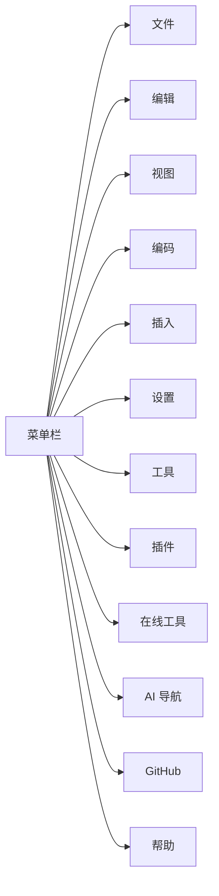

#### 2.3.2 菜单项详细设计（当前实现）

**文件菜单**：

```
文件
├── 新建                        Ctrl+N
├── 打开文件
├── 打开文件夹                  Ctrl+O
├── ---
├── 导入（Word / HTML / JSON / YAML / XML / 文本）
├── 导出（Word / JSON / XML / YAML / HTML / PDF）
├── ---
├── 保存                        Ctrl+S
├── 另存为
├── 从磁盘重新加载              Ctrl+R
├── ---
├── 重启应用                    Ctrl+Shift+R
├── ---
└── 退出                        F4
```

**编辑菜单**：

```
编辑
├── 撤销                        Ctrl+Z
├── 重做                        Ctrl+Y
├── ---
├── 剪切 / 复制 / 粘贴          Ctrl+X / C / V
├── ---
├── 跳转到行                    Ctrl+G
├── 查找                        Ctrl+F
└── 替换                        Ctrl+H
```

**视图菜单**：

```
视图
├── 编辑模式                    F9
├── 预览模式                    F10
├── 编辑预览模式                F11
├── 开发者工具                  F12（仅开发环境注册）
├── ---
├── 资源管理器 / 行号 / 空白字符 / 大纲
├── ---
└── 折叠（全部折叠 / 全部展开 / 1~6 级）
```

**编码菜单**：重新打开编码、切换编码两组，各含 UTF-8 / UTF-16LE / UTF-16BE / GBK / GB2312 / GB18030 / Big5 / Big5-HKSCS / HEX。

**插入菜单**：

```
插入
├── 特殊文本 / 数学公式 / Markdown 表格 / 网页链接
├── 写作模板 / 文本块模板 / 从文件插入
├── ---
├── Material（Admonition + 15 项 mkdocs-material 扩展语法）
├── Mermaid（Part1 / Part2 模板）
└── PlantUML（Part1 / Part2 模板）
```

**设置菜单**：系统设置、主题设置、快捷链接设置、编辑器设置。

**工具菜单**：Mermaid 编辑、KaTeX 公式、表格、图片、绘图（Mermaid / PlantUML 基础框架模板）。

**插件菜单**：加密生成、各类转换器、常用小工具、网络对照表、速查表等分组共 38 项（数据源 `menu-consts.ts`，空组自动剪除）。

**在线工具菜单**：菜鸟工具、W3School、编码、IDE、开发、团队、云 7 组外部站点（仅 http/https 打开）。

**AI 导航菜单**：菜鸟 AI 导航精选 9 组 70 条链接（仅 http/https 打开）。

**GitHub 菜单**：GitHub 相关链接（品牌名保留原文 label）。

**帮助菜单**：版本日志（v1.0.0 ~ v1.3.5，13 个版本）、更新日志、快捷键、使用说明、问题反馈、技术栈、关于、主页、检查更新、联系我们。

#### 2.3.3 菜单动作链路

| 步骤 | 实现 |
| --- | --- |
| 1. 菜单数据 | `menu-config.ts` 生成菜单树（`menuAction` 字段） |
| 2. 渲染层拦截 | `menu-actions.ts` 对 `baize:menu:*` 动作分发：插件/视图/编辑类走 `EventBus` 事件 |
| 3. 主进程处理 | 其余动作经 `IPC.MENU.ACTION`（`baize:menu:action`）交主进程 `src/main/ipc/menu-handle.ts` 动作树（`menu-file` / `menu-edit` / `menu-view` / `menu-help` / `menu-tools`） |


### 2.4 工具栏设计

> 本节为历史设计示意；当前实际工具栏为 `Markdown/MarkdownEditToolsComponent.vue`（格式化/插入/视图切换按钮），并非下图的分组结构，也不含"文件树/全屏"按钮。

#### 2.4.1 工具栏布局

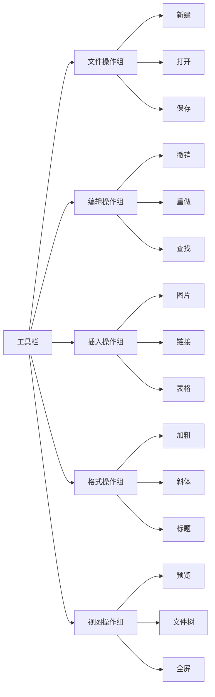

#### 2.4.2 工具栏图标设计（历史设计稿）

| 功能 | 图标 | 快捷键 | 提示文本 |
|------|------|--------|----------|
| 新建文件 | 📄 | Ctrl+N | 新建Markdown文件 |
| 打开文件 | 📂 | Ctrl+O | 打开文件 |
| 保存文件 | 💾 | Ctrl+S | 保存当前文件 |
| 撤销 | ↩️ | Ctrl+Z | 撤销上一步操作 |
| 重做 | ↪️ | Ctrl+Y | 重做上一步操作 |
| 加粗 | **B** | Ctrl+B | 加粗选中文字 |
| 斜体 | *I* | Ctrl+I | 斜体选中文字 |
| 插入链接 | 🔗 | Ctrl+K | 插入超链接 |
| 插入图片 | 🖼️ | Ctrl+Shift+I | 插入图片 |
| 插入代码 | `</>` | Ctrl+Alt+C | 插入代码块 |
| 切换预览 | 👁️ | Ctrl+Shift+V | 切换预览显示 |

### 2.5 文件树设计

#### 2.5.1 文件树结构

文件树数据由主进程 `directory-tree.ts` 生成（`FileItem`：`name / path / type / isDirectory / fileExtension / children`），经 `IPC.FS.FILE_SYSTEM_DATA` 下发；渲染层 `ResourceManager/resource-manager.ts` 转为 `FileSysItem`（增加 `isExpanded` 等前端态）。

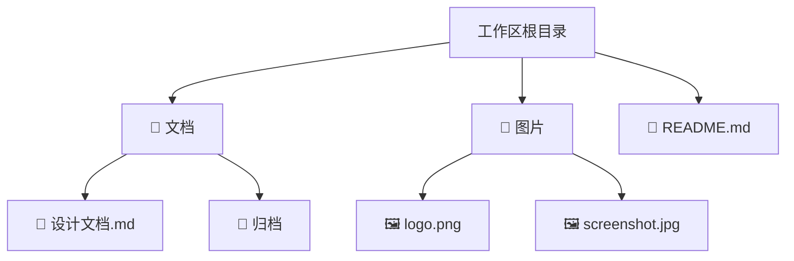

**实现要点**：增量重扫 + 稳定节点 id（按路径）+ 整树 JSON 指纹去重；刷新时按路径合并「展开态」，保持用户展开状态；`fs.watch` 递归监听（排除 `node_modules` / `.git` 等）。

#### 2.5.2 文件树交互设计（当前实现）

**右键菜单**（`resource-manager.ts` 实际注册项）：

```
文件/文件夹通用:
├── 新建
│   ├── 文件
│   ├── 文件夹
│   ├── Markdown 文件
│   ├── 导入 Word
│   └── 导入 HTML
├── ---
├── 复制
│   ├── 复制文件
│   ├── 复制名称
│   ├── 复制真实路径
│   ├── 复制相对路径
│   ├── 复制图片链接
│   └── 复制文件链接
├── 剪切 / 粘贴 / 删除
├── ---
├── 导出到文件（Word / JSON / XML / YAML / HTML / PDF）
├── 重命名
├── 在资源管理器中打开
└── 从磁盘重新加载
```

> 说明：旧版文档中的「属性」菜单项当前不存在；「导出到文件」会先确保导出的是右键节点文件（必要时先打开该文件），避免误导出当前活动文件的错误行为。

**拖拽操作**：

- **当前不支持从外部拖入文件/拖拽移动**：渲染层 `main.ts` 在捕获阶段全局 `preventDefault` 了 `dragover`/`drop`（P0 安全：防止拖入远程链接/HTML 触发导航）。文件移动通过右键剪切/粘贴完成。
- 窗口拖拽移动/缩放由标题栏与 8 向缩放手柄实现（`BaiZeNotes.vue`）。

### 2.6 编辑器设计

#### 2.6.1 编辑器布局

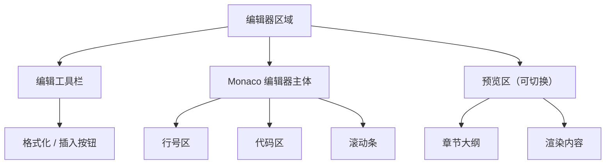

> 说明：当前实现**无多标签页**（单文档编辑），**迷你地图默认关闭**（`minimap.enabled: false`，可在编辑器设置开启）；编辑工具栏来自 `MarkdownEditToolsComponent.vue`，预览/大纲来自 `MarkdownPreviewComponent.vue`。

#### 2.6.2 编辑器功能设计

**核心编辑器**: Monaco Editor 0.57.0（`src/renderer/src/components/Markdown/editor-options.ts` 与主进程 `editor-setting.ts` 为唯一初始选项来源）

**基础功能**:
- 语法高亮（Markdown 语言 + 代码块 highlight.js，仅显式声明语言）
- 行号显示（可开关）
- 代码折叠（标题层级 + 围栏代码块；`foldingMaximumRegions: 5000`）
- 快速插入（Emoji / 特殊符号 / 写作模板 / 文本块）
- 括号匹配与缩进辅助（`bracketPairColorization`、`renderIndentGuides`）
- 实时预览（编辑 / 预览 / 分屏三模式，F9 / F10 / F11）

**高级功能**:
- 多光标编辑（`multiCursorModifier: 'alt'`）
- 代码片段（`snippetSuggestions: 'inline'`）
- 查找替换（Monaco 原生，`find.loop: true`、`autoFindInSelection: 'multiline'`）
- 大文件保护（`largeFileOptimizations: true`、`maxTokenizationLineLength: 10000`）
- 光标平滑动画、滚动条定制、Unicode 高亮关闭等

**Monaco 编辑器关键初始选项（节选，实际见 `editor-options.ts`）**:
```typescript
{
  language: 'markdown',
  wordWrap: 'on',
  minimap: { enabled: false, renderCharacters: false, maxColumn: 120 },
  tabSize: 4,
  fontFamily: 'Hack',
  fontSize: 15,
  lineNumbers: 'on',
  renderWhitespace: 'all',
  folding: true,
  foldingStrategy: 'auto',
  largeFileOptimizations: true,
  maxTokenizationLineLength: 10000,
  renderLineHighlight: 'all',
  scrollBeyondLastLine: false,
  smoothScrolling: true,
  multiCursorModifier: 'alt',
  bracketPairColorization: { enabled: true }
}
```

> 编辑器设置对话框（EditorSettingDialog）的全部选项经 `editor-option-maps.ts` 映射到主进程 `editor-setting.ts` 单真源，保存后广播 `INIT_SETTING` 即时生效。

### 2.7 预览区设计

#### 2.7.1 预览区布局

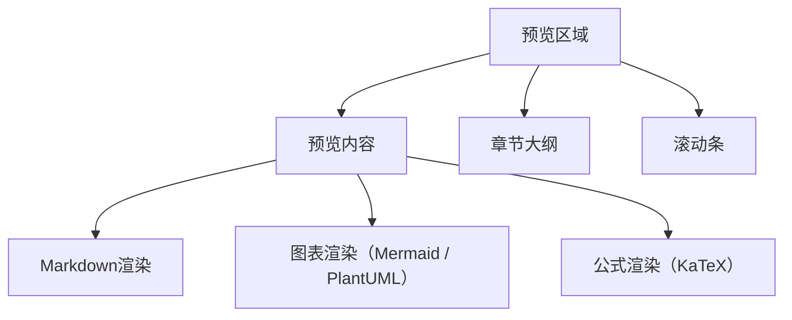

**渲染管线（PF-02 本地单跳，2026-11-15 重构）**：内容变化 150ms 防抖 → `HemyRenderPreLocal()`（KaTeX / Admonition / TabbedSet / URL 转换）→ PlantUML 本地 IPC + Mermaid 本地渲染 → `md.render()` → `HemyRenderPostLocal()` → `DOMPurify.sanitize()` → 远程图片策略 → `v-html`。主进程 Markdown 渲染 IPC 为 0；大文档（>2MB 或 >5 万行）自动降级。

#### 2.7.2 预览样式设计

**Markdown样式**:
```css
/* 标题样式 */
h1 { font-size: 2em; border-bottom: 1px solid #eaecef; }
h2 { font-size: 1.5em; border-bottom: 1px solid #eaecef; }
h3 { font-size: 1.25em; }

/* 代码块样式 */
pre {
  background-color: #f6f8fa;
  border-radius: 3px;
  padding: 16px;
  overflow: auto;
}

code {
  background-color: rgba(27,31,35,.05);
  border-radius: 3px;
  font-size: 85%;
  padding: .2em .4em;
}

/* 引用样式 */
blockquote {
  border-left: 4px solid #dfe2e5;
  color: #6a737d;
  padding: 0 1em;
}

/* 表格样式 */
table {
  border-collapse: collapse;
  width: 100%;
}

th, td {
  border: 1px solid #dfe2e5;
  padding: 6px 13px;
}

th {
  background-color: #f6f8fa;
  font-weight: 600;
}
```

### 2.8 状态栏设计

#### 2.8.1 状态栏布局（实际）

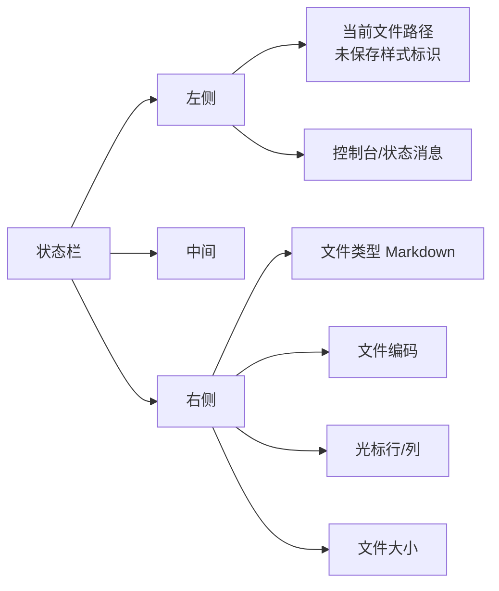

#### 2.8.2 状态栏信息（`StatusBar.vue` 实际实现）

| 位置 | 信息项 | 说明 |
|------|--------|------|
| 左侧 | 当前文件路径 | 过长时省略前缀（保留末 37 字符）；未保存时以样式标识（`unsaved` / `saved`） |
| 中间 | 控制台/状态消息 | `baize:status-bar:update` 推送的消息，错误/警告/普通三态 |
| 右侧 | 文件类型 | 固定显示 Markdown |
| 右侧 | 文件编码 | 由主进程状态通道下发（默认 utf-8） |
| 右侧 | 光标位置 | 行/列，`EventBus.STATUS_BAR_CURSOR_POSITION` 更新 |
| 右侧 | 文件大小 | 格式化显示（KB/MB） |

> 旧版文档中的「字数统计」「✓ 已保存」文本项当前未在状态栏显示（保存状态通过文件路径样式体现）。

## 3. 交互设计

### 3.1 核心交互流程

#### 3.1.1 文件打开流程

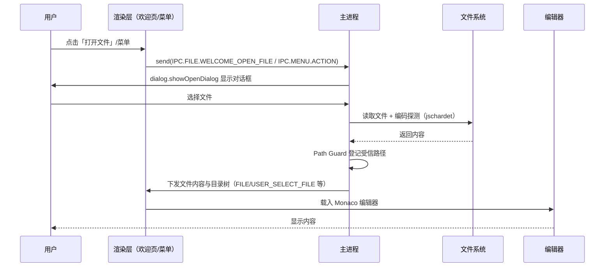

#### 3.1.2 文档保存流程

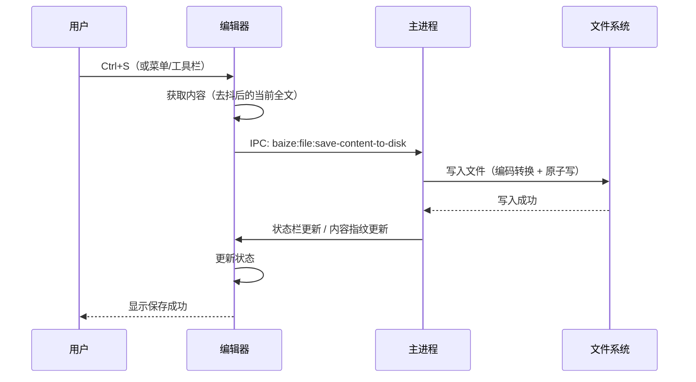

#### 3.1.3 Markdown 渲染流程（2026-11-15 本地单跳重构后）

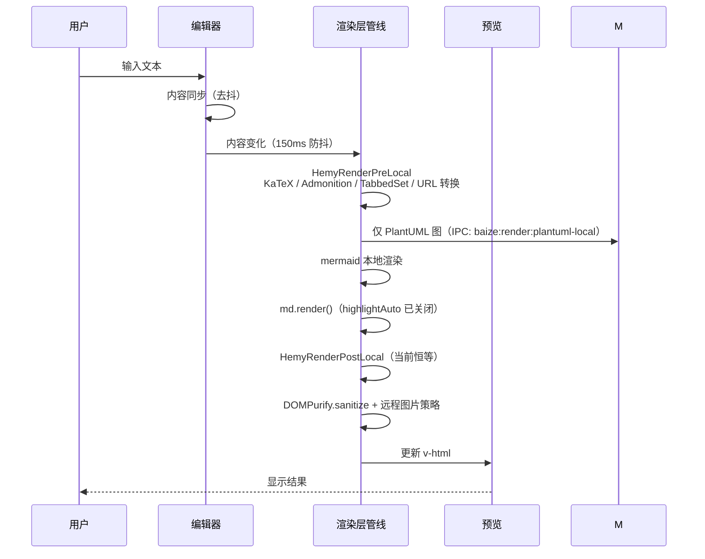

> 旧链路（已删除）：渲染层 `PRE_RENDER` → 主进程字符串变换 → `PRE_RENDER_RESULT` → 渲染层 `md.render` → `POST_RENDER` → 主进程后处理 → `POST_RENDER_RESULT`（每轮 4 次主进程 IPC，且 KaTeX 在主进程同步渲染阻塞事件循环）。

### 3.2 快捷键设计

**设计理念**: 提供丰富的快捷键支持，提升用户操作效率，支持键盘优先的操作模式。

#### 3.2.1 全局快捷键（主进程 `short-key-register.ts` 注册）

| 快捷键 | 功能 | 说明 |
|--------|------|------|
| F9 | 编辑模式 | 仅编辑器视图 |
| F10 | 预览模式 | 仅预览视图 |
| F11 | 编辑预览模式 | 分屏 |
| F12 | 开发者工具 | **仅开发环境注册**，生产禁用 |
| Ctrl+N | 新建文件/文件夹 | 打开「创建文件/文件夹」对话框 |
| Ctrl+O | 打开文件夹 | 目录选择对话框 |
| Ctrl+S | 保存文件 | 渲染层监听 + Monaco 命令 |
| Ctrl+R | 从磁盘重新加载 | 含脏状态保护 |
| Ctrl+Shift+R | 重启应用 | `app.relaunch()` + `quit()` |
| F4 | 退出应用 | 退出前 flush 落盘 |

#### 3.2.2 编辑器快捷键（Monaco 内建 + Markdown 扩展）

| 快捷键 | 功能 | 说明 |
|--------|------|------|
| Ctrl+Z / Ctrl+Y | 撤销 / 重做 | Monaco 内建 |
| Ctrl+X / C / V | 剪切 / 复制 / 粘贴 | Monaco 内建 |
| Ctrl+F / Ctrl+H | 查找 / 替换 | Monaco 查找控件 |
| Ctrl+G | 跳转到行 | Monaco 跳转 |
| Ctrl+B / Ctrl+I 等 | 加粗 / 斜体等 Markdown 格式 | 编辑器快捷键绑定（`hemy-editor-shortcut.ts`） |
| Ctrl+Home / Ctrl+End | 文档开头 / 结尾 | Monaco 内建 |

> 说明：旧版文档中的 Ctrl+W 关闭标签、Ctrl+Tab 切换标签、Ctrl+Shift+V 切换预览、Ctrl+Shift+I 插入图片等组合当前**未绑定**（本应用为单文档编辑，无多标签页）。

#### 3.2.3 菜单标注快捷键（菜单显示，动作与菜单项一致）

| 菜单项 | 快捷键 |
|--------|--------|
| 文件 → 新建 | Ctrl+N |
| 文件 → 打开文件夹 | Ctrl+O |
| 文件 → 保存 | Ctrl+S |
| 文件 → 从磁盘重新加载 | Ctrl+R |
| 文件 → 重启应用 | Ctrl+Shift+R |
| 文件 → 退出 | F4 |
| 编辑 → 撤销 / 重做 | Ctrl+Z / Ctrl+Y |
| 编辑 → 跳转到行 / 查找 / 替换 | Ctrl+G / Ctrl+F / Ctrl+H |
| 视图 → 编辑 / 预览 / 编辑预览 / 开发者工具 | F9 / F10 / F11 / F12 |

### 3.3 对话框设计

**当前对话框体系（v1.3.9）**：

| 类型 | 数量 | 实现方式 |
| --- | --- | --- |
| Vue 组件对话框 | **18 个** | 主窗口内 Teleport 渲染，`src/renderer/src/components/dialogs/`（complex / help / medium / simple 四档） |
| 主进程 HTML 对话框 | **9 个 dialogs 文件** | JSDOM 模板字符串 + `dialog-defaults.ts#createDialogHtmlUrl`，用于新建/重命名/发布说明/更新日志/快捷键说明等 |
| 隐藏渲染窗口 | 2 类 | PlantUML 渲染隐藏窗、PDF 导出隐藏窗 |
| 在线网页窗口 | 按需 | 无 preload，导航与 `window.open` 全拒绝 |

> 以下 3.3.x 为历史设计示意（保留设计意图），实际界面字段以实现文件为准（见上表路径）。

#### 3.3.1 系统设置对话框（`SystemSettingDialog.vue`）

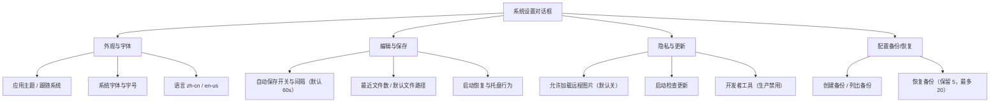

**对话框规格**：Vue 组件对话框，主窗口内 Teleport；**实测 900×650px**；布局为左侧导航 + 右侧内容；无独立窗口边框（复用主窗口标题栏拖拽逻辑）。系统设置数据真源为 `system-setting.ts`，保存后广播 `baize:setting:updated`。

#### 3.3.2 插入图片对话框（`InsertImageDialog.vue`）

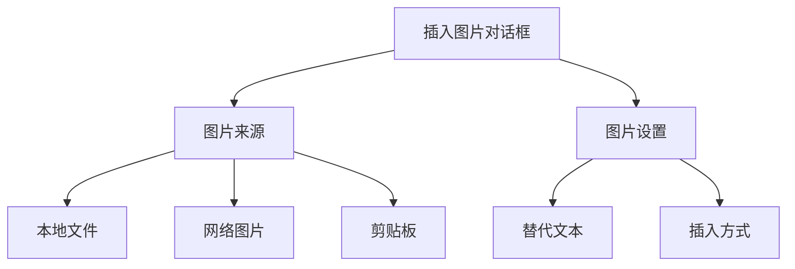

**对话框规格**：Vue 组件对话框，**实测宽 600px**（随内容自适应高度）；支持粘贴图片（`image-operations.ts`）与本地文件选择。

#### 3.3.3 Mermaid 编辑对话框（`MermaidEditDialog.vue`）

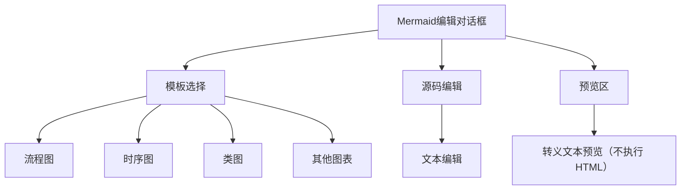

**对话框规格**：Vue 组件对话框，**实测宽 1400px**（大屏编辑布局）；预览区使用转义文本展示（CQ-2/AS-3 修复：不再对用户输入 `v-html`，避免 DOM XSS）；确认后通过 EventBus 插入 Mermaid 模板。

### 3.4 反馈设计

#### 3.4.1 操作反馈

**成功反馈**:
- 保存成功: 状态栏显示 "✓ 已保存"
- 导出成功: 弹出成功提示，显示文件位置
- 操作完成: 短暂的高亮提示

**错误反馈**:
- 文件打开失败: 弹出错误对话框，显示错误原因
- 保存失败: 弹出错误对话框，提供重试选项
- 网络错误: 显示离线提示

**进度反馈**:
- 文件加载: 显示加载动画
- 图表渲染: 显示渲染进度
- 导出操作: 显示进度条

#### 3.4.2 视觉反馈

**悬停效果**:
```css
/* 按钮悬停 */
.button:hover {
  background-color: #e1e4e8;
  transition: background-color 0.2s;
}

/* 文件项悬停 */
.file-item:hover {
  background-color: #f6f8fa;
  cursor: pointer;
}
```

**选中效果**:
```css
/* 标签选中 */
.tab.active {
  border-bottom: 2px solid #0366d6;
  color: #0366d6;
}

/* 文件选中 */
.file-item.selected {
  background-color: #0366d6;
  color: white;
}
```

**禁用状态**:
```css
/* 按钮禁用 */
.button:disabled {
  opacity: 0.5;
  cursor: not-allowed;
}
```

## 4. 视觉设计

### 4.1 主题系统

#### 4.1.1 主题架构

**应用主题**: **28 种**（`src/main/config/theme-config.ts` 的 `themes` 记录 + `ThemeType` 枚举）
- 白泽系列：白泽紫韵（默认）、白泽神兽、白泽清晰、白泽文字、白泽星空、白泽数据浅色/深色、白泽镜像浅色/深色、白泽图标
- 基础浅色：暖白温馨、清新简约、薰衣草梦、珊瑚暖阳、薄荷清风、日落余晖、玫瑰花园
- 基础深色：深邃夜空、极简深黑、深海蔚蓝、森林秘境
- 护眼系列：护眼绿洲、护眼米黄、护眼淡蓝、护眼樱粉、护眼琥珀、护眼青瓷、护眼丁香
- 支持亮色/暗色切换、跟随系统（`useSystemTheme`）、主题实时切换无需重启

**编辑器主题**: **57 种** Monaco 主题（磁盘 54 + 内置 3；`resources/themes/monaco-themes/themes/*.json`，由 `theme-registry.ts` 动态扫描 + 按需读取）
- 基于 Monaco Editor 主题系统
- 支持自定义语法高亮配色
- 应用主题和编辑器主题独立配置（`separateEditorTheme`）

#### 4.1.2 主题切换设计

```typescript
// 主题配置接口（实际定义见 src/main/config/theme-config.ts）
interface ThemeConfig {
  currentTheme: ThemeType        // 应用主题（28 种之一）
  separateEditorTheme: boolean   // 是否启用独立编辑器主题
  editorTheme?: MonacoThemeType  // Monaco 主题名（57 种之一）
}

// 主题切换流程（实际实现）
// 1. 渲染层 send(IPC.THEME.UPDATE_THEME, themeType, monacoTheme, separate)
// 2. 主进程 config-manager 落盘 theme-config.json
// 3. 主进程 theme-broadcast.ts 广播 IPC.THEME.THEME_UPDATED
//    payload: { themeStyles, monacoTheme, separateEditorTheme }
// 4. 所有窗口更新 CSS 变量与 Monaco 主题
```

### 4.2 色彩系统

#### 4.2.1 主题化 CSS 变量（默认主题「白泽紫韵」`baize`）

> 说明：v1.3.0 的色彩**不再使用固定十六进制主色**。旧规范中的 `#0366d6`（GitHub 蓝）与 `#3498db`（早期主色）均已被主题化 CSS 变量取代，由当前应用主题（28 种）注入。下表为默认主题 `baize` 的实际取值（`src/main/config/theme-config.ts`）：

| CSS 变量 | 默认值（baize） | 用途 |
|----------|----------------|------|
| `--bg-color` / `--theme-background-color` | `#f5f0ff` | 页面背景 |
| `--card-bg` | `#ffffff` | 卡片/对话框背景 |
| `--text-color` | `#2d2d2d` | 主文字 |
| `--secondary-text-color` | `#666666` | 次要文字 |
| `--border-color` | `#e0d4f0` | 边框/分割线 |
| `--accent-color` | `#764ba2` | 强调色（按钮、链接、激活态） |
| `--hover-bg` | `#f0e8ff` | 悬停背景 |
| `--title-bar-gradient` | `linear-gradient(135deg, #667eea 0%, #764ba2 100%)` | 标题栏渐变 |

#### 4.2.2 色彩应用

| 元素 | 颜色来源 | 用途 |
|------|----------|------|
| 主按钮背景 | `var(--accent-color)` / `var(--button-bg)` | 主要操作按钮 |
| 主按钮文字 | `var(--button-text-color)` | 主要操作按钮文字 |
| 链接/激活态 | `var(--accent-color)` | 超链接、选中态 |
| 成功提示 | 状态栏语义色（绿） | 成功状态 |
| 错误提示 | 状态栏语义色（红） | 错误状态 |
| 警告提示 | 状态栏语义色（橙） | 警告状态 |
| 边框/背景/文字 | 见 4.2.1 变量表 | 全局 |

### 4.3 字体系统

#### 4.3.1 字体家族

**界面字体**（系统设置 `fontFamily`，注入 `--system-font-family`；默认）：
```css
font-family: 'Microsoft YaHei', 'Segoe UI', sans-serif;
```

**代码字体**：Monaco 编辑器默认 `Hack`（可在编辑器设置中修改 `fontFamily`）。
```css
font-family: Hack, Consolas, Monaco, monospace;
```

#### 4.3.2 字体大小

系统字体基准由系统设置 `fontSize`（默认 13px）注入 `--system-font-size`，界面字号以相对值派生：

| 元素 | 大小 | 用途 |
|------|------|------|
| 系统基准 | `var(--system-font-size)`（默认 13px） | 全局基准 |
| 提示文字 | `calc(var(--system-font-size) - 2px)` | 辅助说明 |
| 区域标题 | `calc(var(--system-font-size) + 4px)` | 大标题 |
| 编辑器正文字号 | 编辑器设置 `fontSize`（默认 15px） | Monaco 编辑区 |
| 代码字体 | 编辑器设置 `fontFamily`（默认 Hack） | 代码/编辑区 |

### 4.4 图标系统

#### 4.4.1 图标来源
- **主要来源**: 内置 SVG 图标（`components/*/icons`、`hemy-editor-quick-access-svgs.ts`；NaviTab 快捷链接 SVG 经 DOMPurify svg profile 消毒）
- **次要来源**: Emoji 表情（`hemy-quick-access-emojis*.ts`）
- **未集成**: Font Awesome / Material Icons（历史候选，当前未使用）

#### 4.4.2 图标规格

| 尺寸 | 用途 | 示例 |
|------|------|------|
| 16px | 菜单图标、状态图标 | 菜单/状态栏 SVG |
| 20px | 工具栏图标 | 编辑工具栏 |
| 24px | 标题栏 Logo、对话框图标 | 应用 Logo |
| 256/512px | 应用图标（打包） | `resources/icon/*.ico` |

### 4.5 间距系统

#### 4.5.1 间距规范

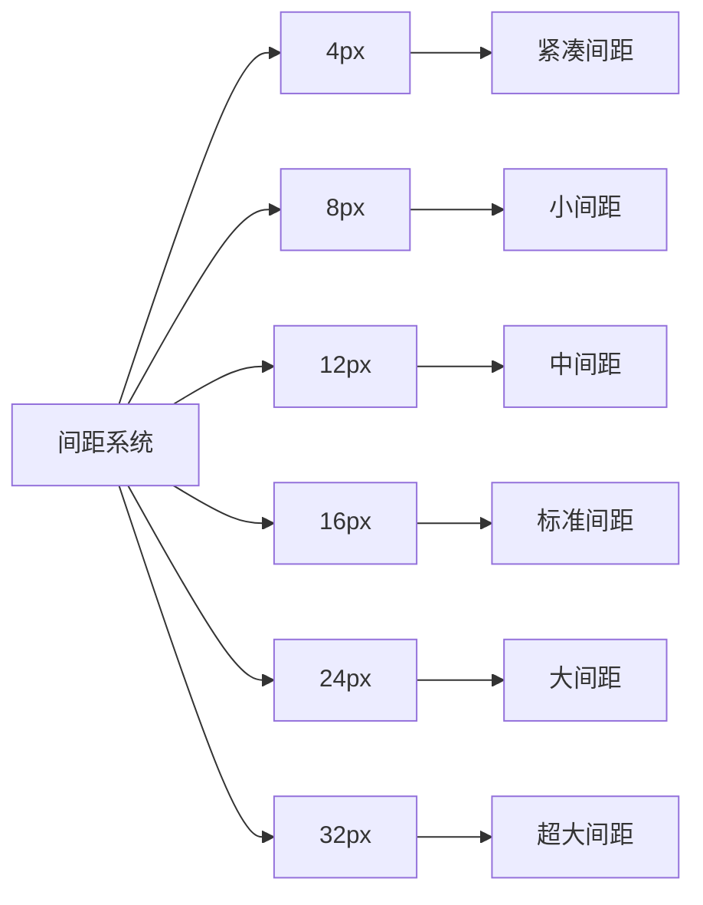

#### 4.4.2 间距应用

| 元素 | 间距 | 说明 |
|------|------|------|
| 按钮内边距 | 8px 16px | 上下8px，左右16px |
| 输入框内边距 | 8px 12px | 上下8px，左右12px |
| 卡片内边距 | 16px | 四边16px |
| 列表项间距 | 8px | 项与项之间 |
| 模块间距 | 24px | 模块与模块之间 |

### 4.6 阴影系统

```css
/* 轻微阴影 - 卡片、下拉菜单 */
box-shadow: 0 1px 3px rgba(0,0,0,0.12), 0 1px 2px rgba(0,0,0,0.24);

/* 中等阴影 - 对话框、浮动面板 */
box-shadow: 0 3px 6px rgba(0,0,0,0.16), 0 3px 6px rgba(0,0,0,0.23);

/* 强烈阴影 - 模态框 */
box-shadow: 0 10px 20px rgba(0,0,0,0.19), 0 6px 6px rgba(0,0,0,0.23);
```

## 5. 组件设计

> **说明**：本章保留项目早期（v1.1.x）的组件设计草案（接口/枚举/CSS 片段），用于呈现设计意图；**这些接口并非当前代码的真实定义**。实际组件与类型请以源码为准，映射关系如下：

| 设计章节 | 实际实现文件 |
| --- | --- |
| 基础组件（按钮/输入框/下拉） | 无独立基础组件库；各组件内联样式 + CSS 变量（`src/renderer/src/styles/`） |
| 文件树组件 | `src/renderer/src/components/ResourceManager/ResourceManager.vue`、`FileTreeNode.vue`、`resource-manager.ts` |
| 标签页组件 | **当前无多标签页**（单文档编辑）；工作区容器为 `WorkSpaceArea/WorkSpace.vue` + `NaviTab.vue` |
| Markdown 编辑器组件 | `Markdown/MarkdownMonacoEditor.vue`、`MarkdownEditComponent.vue` |
| Markdown 预览组件 | `Markdown/MarkdownPreviewComponent.vue` + `preview-local-render.ts` |
| 分割面板/工作区 | `WorkSpaceArea/WorkSpace.vue`（左右 NaviTab + 资源管理器 + 编辑区） |
| 状态栏 | `src/renderer/src/components/StatusBar.vue` |

### 5.1 基础组件

#### 5.1.1 按钮组件

**按钮类型**:
```typescript
enum ButtonType {
  Primary = 'primary',    // 主要按钮
  Default = 'default',    // 默认按钮
  Dashed = 'dashed',      // 虚线按钮
  Text = 'text',          // 文本按钮
  Link = 'link'           // 链接按钮
}

enum ButtonSize {
  Small = 'small',        // 小按钮
  Middle = 'middle',      // 中按钮
  Large = 'large'         // 大按钮
}
```

**按钮样式**:
```css
/* 主要按钮 */
.btn-primary {
  background-color: #0366d6;
  color: #ffffff;
  border: 1px solid #0366d6;
  padding: 8px 16px;
  border-radius: 4px;
  cursor: pointer;
}

.btn-primary:hover {
  background-color: #0257c5;
}

/* 默认按钮 */
.btn-default {
  background-color: #ffffff;
  color: #24292e;
  border: 1px solid #e1e4e8;
  padding: 8px 16px;
  border-radius: 4px;
  cursor: pointer;
}

.btn-default:hover {
  background-color: #f6f8fa;
}
```

#### 5.1.2 输入框组件

**输入框类型**:
```typescript
enum InputType {
  Text = 'text',          // 文本输入
  Password = 'password',  // 密码输入
  Number = 'number',      // 数字输入
  TextArea = 'textarea'   // 多行文本
}

enum InputSize {
  Small = 'small',        // 小输入框
  Middle = 'middle',      // 中输入框
  Large = 'large'         // 大输入框
}
```

**输入框样式**:
```css
.input {
  width: 100%;
  padding: 8px 12px;
  border: 1px solid #e1e4e8;
  border-radius: 4px;
  font-size: 14px;
  line-height: 1.5;
  color: #24292e;
  background-color: #ffffff;
}

.input:focus {
  border-color: #0366d6;
  outline: none;
  box-shadow: 0 0 0 3px rgba(3, 102, 214, 0.1);
}

.input:disabled {
  background-color: #f6f8fa;
  cursor: not-allowed;
}
```

#### 5.1.3 下拉选择组件

**下拉选择接口**:
```typescript
interface SelectOption {
  label: string
  value: string | number
  disabled?: boolean
}

interface SelectProps {
  options: SelectOption[]
  value?: string | number
  placeholder?: string
  disabled?: boolean
  clearable?: boolean
  searchable?: boolean
  onChange?: (value: string | number) => void
}
```

### 5.2 业务组件

#### 5.2.1 文件树组件

**文件树节点接口**:
```typescript
interface FileTreeNode {
  id: string
  name: string
  path: string
  isFile: boolean
  isExpanded?: boolean
  isSelected?: boolean
  children?: FileTreeNode[]
  icon?: string
}

interface FileTreeProps {
  rootPath: string
  onFileSelect?: (node: FileTreeNode) => void
  onFileCreate?: (parentPath: string, name: string) => void
  onFileDelete?: (path: string) => void
  onFileRename?: (path: string, newName: string) => void
}
```

**文件树样式**:
```css
.file-tree {
  font-size: 14px;
  user-select: none;
}

.file-tree-node {
  padding: 4px 8px;
  cursor: pointer;
  display: flex;
  align-items: center;
}

.file-tree-node:hover {
  background-color: #f6f8fa;
}

.file-tree-node.selected {
  background-color: #0366d6;
  color: #ffffff;
}

.file-tree-icon {
  margin-right: 6px;
  width: 16px;
  height: 16px;
}
```

#### 5.2.2 标签页组件

**标签页接口**:
```typescript
interface Tab {
  id: string
  title: string
  path: string
  isModified: boolean
  icon?: string
}

interface TabBarProps {
  tabs: Tab[]
  activeTabId: string
  onTabSelect: (id: string) => void
  onTabClose: (id: string) => void
  onTabReorder: (tabs: Tab[]) => void
}
```

**标签页样式**:
```css
.tab-bar {
  display: flex;
  background-color: #f6f8fa;
  border-bottom: 1px solid #e1e4e8;
  height: 35px;
  overflow-x: auto;
}

.tab {
  padding: 8px 16px;
  border-right: 1px solid #e1e4e8;
  cursor: pointer;
  display: flex;
  align-items: center;
  min-width: 120px;
  max-width: 200px;
}

.tab.active {
  background-color: #ffffff;
  border-bottom: 2px solid #0366d6;
}

.tab.modified::after {
  content: '●';
  color: #0366d6;
  margin-left: 4px;
}

.tab-close {
  margin-left: auto;
  opacity: 0;
}

.tab:hover .tab-close {
  opacity: 1;
}
```

#### 5.2.3 Markdown编辑器组件

**编辑器接口**:
```typescript
interface MarkdownEditorProps {
  value: string
  onChange?: (value: string) => void
  onSave?: (value: string) => void
  theme?: 'vs' | 'vs-dark'
  fontSize?: number
  language?: string
}

interface MarkdownEditorActions {
  insertText: (text: string) => void
  getSelectedText: () => string
  setSelection: (start: number, end: number) => void
  formatText: (format: 'bold' | 'italic' | 'code') => void
  undo: () => void
  redo: () => void
}
```

#### 5.2.4 Markdown预览组件

**预览接口**:
```typescript
interface MarkdownPreviewProps {
  content: string
  theme?: 'light' | 'dark'
  syncScroll?: boolean
  onLinkClick?: (url: string) => void
}

interface MarkdownPreviewState {
  renderedHTML: string
  mermaidCharts: Map<string, string>
  plantumlCharts: Map<string, string>
  mathFormulas: Map<string, string>
}
```

### 5.3 布局组件

#### 5.3.1 分割面板组件

**分割面板接口**:
```typescript
interface SplitPaneProps {
  direction: 'horizontal' | 'vertical'
  initialSize?: number
  minSize?: number
  maxSize?: number
  leftPane: React.ReactNode
  rightPane: React.ReactNode
  onResize?: (size: number) => void
}
```

#### 5.3.2 工作区组件

**工作区接口**:
```typescript
interface WorkSpaceProps {
  layout: 'three-column' | 'two-column' | 'one-column'
  showFileTree: boolean
  showPreview: boolean
  onLayoutChange?: (layout: string) => void
}

interface WorkSpaceState {
  fileTreeWidth: number
  previewWidth: number
  activeFile: string | null
  openFiles: string[]
}
```

## 6. 数据模型设计

> v1.3.9 的跨进程数据模型以 `src/shared/types/` 为唯一真源（10 个类型文件），主进程运行态状态在 `src/main/utils/app-state.ts`，配置模型在 `src/main/config/*-setting.ts`。以下为实际结构（旧版文档中的 `FileModel` / `FolderModel` / `AppState` 类为历史设计草案）。

### 6.1 文件模型（`src/shared/types/file.ts`）

```typescript
export interface FileItem {
  name: string
  path: string
  type: 'file' | 'folder'
  isDirectory: boolean
  fileExtension?: string
  children: FileItem[]        // 目录树子项
}

export interface FileProperties {   // 跨进程：渲染层 → 主进程
  name: string
  path: string
  type: 'file' | 'folder'
  content?: string                  // 打开文件后由主进程回填
  encoding?: string                 // D-4 编码探测结果
}
```

> 渲染层文件树节点为 `ResourceManager/resource-manager.ts` 的 `FileSysItem`（主进程 `FileItem` 序列化结果 + 前端展开态等扩展字段）。

### 6.2 编辑器模型

编辑器运行态不落库（组件内维护），配置模型为：

| 模型 | 定义位置 | 说明 |
| --- | --- | --- |
| `EditorSetting` | `src/main/config/editor-setting.ts` | Monaco 全部选项的唯一真源（`editor-setting.json`），约 100+ 字段：wordWrap / minimap / lineNumbers / fontSize / fontFamily / tabSize / folding / renderWhitespace / cursor* / scroll* 等 |
| 渲染层 `EditorConfig` | `src/renderer/src/common/useConfigStore.ts` | 渲染层回填字段集合（与 `editor-option-maps.ts` 双向映射） |
| 光标/选区/内容长度 | `StatusBar` + `EventBus`（`STATUS_BAR_CURSOR_POSITION`、`STATUS_BAR_CONTEXT_LENGTH`） | 运行态，不持久化 |
| 内容指针 | `appState`（主进程） | 当前文件内容 + 长度/sha256 指纹（PF-14，替代双份全文） |

### 6.3 应用状态模型（`src/main/utils/app-state.ts` 的 `AppState` 单例）

```typescript
class AppState {
  private _mainWindow: BrowserWindow | null      // 主窗口引用（经 getLiveMainWindow/sendToMainWindow 安全访问）
  private _rootPath: string                      // 当前工作区根目录
  private _currentActiveFile: {                  // 当前活动文件
    name: string; path: string; type: string
    content?: string; encoding?: string
  } | null
  private _mdFileTree: FileItem[] | null         // 当前目录树
  private _dirty: boolean                        // 脏标记
  private _lastSavedContentLength: number        // 最近保存/加载内容长度
  private _lastSavedContentHash: string | null   // 最近保存/加载内容 sha256 指纹
  private _activeFileDiskStamp: { path: string; mtimeMs: number; size: number } | null
  private _savingFile: boolean                   // 保存中标志（防并发保存）
  // 剪贴板复制/剪切来源、自动保存间隔等运行态
}
```

**配置模型**（electron-store，跨进程共享）：

```typescript
interface SystemSetting {          // system-setting.json：语言/字体/自动保存/远程图片/备份/窗口行为等
  language: string                 // 'zh-cn' | 'en-us'
  fontFamily: string
  fontSize: number                 // 默认 13
  autoSaveEnabled: boolean         // 默认 true
  autoSaveInterval: number         // 默认 60（秒）
  allowRemoteImages: boolean       // 默认 false（隐私）
  enableAutoBackup: boolean
  backupInterval: number
  backupCount: number
  // …（最近文件数、默认路径、窗口行为、主题跟随系统等）
}

interface ThemeConfig {            // theme-config.json
  currentTheme: ThemeType          // 28 种应用主题
  separateEditorTheme: boolean
  editorTheme?: string             // 57 种 Monaco 主题
}

interface QuickLinksConfig {       // quick-link-config.json
  quickLinks: QuickLinkItem[]      // id / name / type('url'|'exe') / path / iconType / iconValue / enabled
}
```

## 7. API设计

> **说明**：v1.3.9 的接口真实形态是 **preload 暴露面 + IPC 通道常量**，不是 class 形式的主进程/渲染进程 API。IPC 通道唯一真源为 `src/shared/ipc-channels.ts`（91 个 / 17 组，命名 `baize:<domain>:<name>`）。

### 7.1 preload 暴露 API

| 全局对象 | 来源 | 成员（摘要） |
| --- | --- | --- |
| `window.electron` | `src/preload/index.ts` | **受限 `ipcRenderer`**：`send` / `invoke`（白名单 58 个通道）、`on` / `once`（白名单 25 个通道）、`removeListener` / `removeAllListeners`；另含 `webFrame` / `webUtils` / `process`。`sendTo` / `sendSync` / `sendToHost` / `postMessage` **不暴露** |
| `window.api` | `src/preload/index.ts` | `config.read(name)` / `config.write(name, data)`、`app` 信息 |
| `window.electronAPI` | `src/preload/dialog.ts`（HTML 对话框专用） | `send(channel, ...args)`（仅白名单 2 个通道）、`closeDialog()`、`openExternal(url)`（仅 http/https） |

### 7.2 IPC 通道分组（91 个 / 17 组）

| 常量组 | 数量 | 典型通道 |
| --- | --- | --- |
| `WINDOW` | 8 | `baize:window:minimize` / `maximize` / `close` / `toggle-maximize` / `get-bounds` / `is-maximized` / `move` / `set-size` |
| `CONFIG` | 2 | `baize:config:read` / `baize:config:write` |
| `THEME` | 6 | `baize:theme:update` / `theme:updated` / `theme:load-monaco` / `theme:get-current-styles` / `theme:get-all` / `theme:get-all-monaco` |
| `MENU` | 1 | `baize:menu:action` |
| `EDITOR` | 5 | `baize:editor:get-setting` / `init-setting` / `update-options` / `flush-content` / `flush-content-done` |
| `FILE` | 24 | `baize:file:open-select-file` / `save-content-to-disk` / `welcome-enter-main` / `read-binary` / `open-in-browser` 等 |
| `FILE_MANAGER` | 14 | 文件管理操作（新建/重命名/删除/复制/粘贴等） |
| `PLUGIN` | 6 | `baize:plugin:rsa-generate` / `rsa-result` / `hash-text` / `hmac-text` / `crypto-encrypt` / `crypto-decrypt` |
| `RENDER` | 3 | `baize:render:plantuml-local` / 插入图片等（Markdown 预览已无主进程渲染通道） |
| `DIALOG` | 3 | `baize:dialog:open-vue` / `create-file-folder-enter` / `rename-file-folder-enter` |
| `NAVIGATION` | 1 | `baize:navigation:open-exe`（EXE 扩展名白名单 + 确认） |
| `VIEW` | 4 | `baize:view:edit-mode` / `preview-mode` / `edit-preview-mode` / `toggle-resource-manager` |
| `MONACO` | 3 | `baize:monaco:insert-text-block` / `insert-after-cursor` / `undo-redo` |
| `SETTING` | 2 | `baize:setting:updated` / `auto-save-changed` |
| `SYSTEM` | 3 | `baize:system:open-external-link` / `get-info` / `app-version` |
| `QUICK_LINKS` | 3 | `baize:quick-links:get` / `save` / `updated` |
| `EVENTS` | 4 | 状态栏更新等事件推送 |

### 7.3 已删除的旧接口（2026-11-15）

| 旧接口 | 状态 | 替代 |
| --- | --- | --- |
| `pre-render-monaco-editor-content` / `post-render-monaco-editor-content` | **已删除**（PF-02） | 渲染层 `preview-local-render.ts#HemyRenderPreLocal/HemyRenderPostLocal` |
| `baize-notes:open-select-file` / `read-file` / `save-file` / `delete-file` / `rename-file` | 已废弃（历史命名） | 现行 `IPC.FILE.*` / `IPC.FILE_MANAGER.*` 常量 |
| `window.electronAPI.broadcastTheme` | 已删除（C-03） | 主进程 `theme-broadcast.ts` 唯一广播实现 |
| `OPEN_PLUGIN_TOOL` 通道与主进程 pluginsMenuHandlers | 已删除（P2） | 渲染层两跳：`menu-actions.ts` → `EventBus.PLUGIN_TOOL_SHOW` → `PluginTools.vue` |

### 7.4 渲染层内部 API（示意）

渲染层组件通过 `EventBus`（24 个事件）与 `window.electron.ipcRenderer` 协作，不对外暴露 class API：

| 能力 | 实现 |
| --- | --- |
| 编辑器内容/选区 | Monaco API 封装（`MarkdownMonacoEditor.vue` 暴露方法/事件） |
| 插入/替换文本 | `EventBus`：`MONACO_INSERT_TEXT` / `MONACO_REPLACE_TEXT` |
| 章节大纲 | `EventBus`：`MONACO_GET_CHAPTERS` / `MONACO_CHAPTERS` |
| 视图切换 | `VIEW` 组 IPC + `EventBus.WORKSPACE_SHOW` |
| 查找/跳转/折叠 | `EventBus`：`EDITOR_TRIGGER_FIND` / `EDITOR_JUMP_LINE` / `EDITOR_TOGGLE_FOLD` |

## 8. 性能设计

### 8.1 性能优化策略

**当前实际实现（2026-11-19，详见 `src/` 与 `../../reports/`）**：

| 优化点 | 实际实现 | 效果（实测） |
| --- | --- | --- |
| 预览渲染链路 | PF-02 渲染进程本地单跳（`preview-local-render.ts`），主进程渲染 IPC 4 → 0 | 移除 IPC 往返与主进程阻塞 |
| 预览防抖 | `MarkdownPreviewComponent.vue` 150ms 防抖 | 减少重复渲染 |
| 代码高亮 | `preview-markdown-it.ts` 关闭 `highlightAuto` 全语言探测，仅显式语言高亮 | md.render 快 12~155 倍（16KiB 文档 232.8ms → 1.5ms） |
| 公式缓存 | KaTeX LRU 缓存上限 200 条（`KATEX_CACHE_MAX_ENTRIES`） | 重复公式零渲染开销 |
| 大文档保护 | 预览：>2MB 或 >5 万行自动降级；Monaco：`largeFileOptimizations` + `maxTokenizationLineLength: 10000` + `foldingMaximumRegions: 5000` | 避免超大文件卡死 |
| 目录刷新 | 增量重扫 + 稳定 id + 整树 JSON 指纹去重 + 当前文件 mtime/size 签名对比 | 目录增量刷新耗时 -94.8%；未变化文件不重读 |
| 目录监听 | `fs.watch` 递归监听（排除 node_modules/.git），退出时 `CleanupDirectoryWatch()` | 减少无效事件 |
| 内容同步 | 击键去抖 + 内容指纹（sha256）去重；拖拽 IPC rAF 合帧 | 减少 IPC 负载与双份全文内存 |
| Monaco 体积 | 移除 4 个语言 worker（仅保留 editor worker），monaco 裸包名精确别名到 `editor.api` | 产物 -14.74MB |
| 首屏 | 首屏静态导入优化；主题/编辑器设置初始化合并下发 | 减少启动闪烁 |
| 内存 | `appState` 用「长度 + sha256」替代全文快照（PF-14）；目录树用指纹替代整树 JSON 常驻 | 主进程常驻内存 O(n) → O(1) |

> 以下 8.1.1 ~ 8.2 为实现细节/历史设计草案：其中「并行渲染（Web Worker 分片）」「对象池 / EditorInstancePool」「内存监控 setInterval」「虚拟滚动」在当前代码中**未实现**，保留作为后续优化方向。

#### 8.1.1 大文件优化

```typescript
// 大文件处理策略
interface LargeFileStrategy {
  // 文件大小阈值 (10MB)
  threshold: 10 * 1024 * 1024

  // 分块加载
  chunkSize: 1024 * 1024  // 1MB per chunk

  // 虚拟滚动
  virtualScroll: {
    enabled: true
    bufferSize: 100  // 缓冲行数
  }

  // 延迟渲染
  lazyRender: {
    enabled: true
    debounce: 300  // 防抖延迟(ms)
  }
}

// 大文件加载流程
async function loadLargeFile(filePath: string) {
  const fileSize = await getFileSize(filePath)

  if (fileSize > strategy.threshold) {
    // 使用分块加载
    return loadInChunks(filePath, strategy.chunkSize)
  } else {
    // 正常加载
    return loadFile(filePath)
  }
}
```

#### 8.1.2 LRU缓存系统

```typescript
// LRU缓存实现
class LRUCache<K, V> {
  private capacity: number
  private cache: Map<K, V>
  private accessOrder: K[]

  constructor(capacity: number) {
    this.capacity = capacity
    this.cache = new Map()
    this.accessOrder = []
  }

  get(key: K): V | undefined {
    if (this.cache.has(key)) {
      // 更新访问顺序
      this.updateAccessOrder(key)
      return this.cache.get(key)
    }
    return undefined
  }

  set(key: K, value: V): void {
    if (this.cache.size >= this.capacity) {
      // 淘汰最久未使用的项
      const oldest = this.accessOrder.shift()
      this.cache.delete(oldest!)
    }

    this.cache.set(key, value)
    this.accessOrder.push(key)
  }
}

// 应用场景
const fileContentCache = new LRUCache<string, string>(50)  // 缓存50个文件
const renderedHTMLCache = new LRUCache<string, string>(100)  // 缓存100个渲染结果
```

#### 8.1.3 并行渲染

```typescript
// 并行渲染策略
async function parallelRender(content: string) {
  // 将内容分割为多个部分
  const sections = splitContent(content)

  // 使用Web Worker并行渲染
  const workers = [
    new Worker('markdown-renderer.js'),
    new Worker('mermaid-renderer.js'),
    new Worker('katex-renderer.js')
  ]

  // 并行处理
  const results = await Promise.all([
    workers[0].render(sections.markdown),
    workers[1].render(sections.diagrams),
    workers[2].render(sections.formulas)
  ])

  // 合并结果
  return mergeResults(results)
}
```

#### 8.1.4 内存管理

```typescript
// 内存监控和管理
class MemoryManager {
  private threshold: number = 500 * 1024 * 1024  // 500MB

  // 监控内存使用
  monitor() {
    setInterval(() => {
      const usage = process.memoryUsage()

      if (usage.heapUsed > this.threshold) {
        // 触发清理
        this.cleanup()
      }
    }, 60000)  // 每分钟检查一次
  }

  // 清理策略
  cleanup() {
    // 1. 清理缓存
    fileContentCache.clear()
    renderedHTMLCache.clear()

    // 2. 关闭不活跃的标签页
    closeInactiveTabs()

    // 3. 触发垃圾回收
    if (global.gc) {
      global.gc()
    }
  }
}
```

#### 8.1.5 启动优化

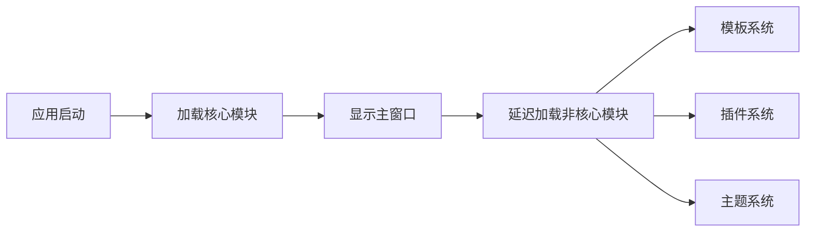

**优化措施**:
- 代码分割: 按功能模块分割代码
- 延迟加载: 非核心功能延迟加载
- 预加载: 预加载常用资源
- 缓存: 缓存编译结果

#### 8.1.6 运行时优化

**编辑器优化**:
```typescript
// 防抖处理
const debouncedRender = debounce((content: string) => {
  renderMarkdown(content)
}, 300)

// 增量更新
function updatePreview(changes: TextChange[]) {
  // 只更新变化的部分
  // 而不是重新渲染整个文档
}

// Web Worker
const worker = new Worker('markdown-renderer.js')
worker.postMessage({ content })
worker.onmessage = (e) => {
  updatePreview(e.data)
}
```

**文件树优化**:
```typescript
// 虚拟滚动
function renderVisibleNodes(scrollTop: number, viewportHeight: number) {
  // 只渲染可见区域的节点
  // 减少DOM节点数量
}

// 懒加载
async function loadNodeChildren(node: FileTreeNode) {
  // 展开时才加载子节点
  // 而不是一次性加载所有节点
}
```

### 8.2 内存管理优化

```typescript
// 对象池
class EditorInstancePool {
  private pool: Editor[] = []

  acquire(): Editor {
    return this.pool.pop() || new Editor()
  }

  release(editor: Editor) {
    editor.reset()
    this.pool.push(editor)
  }
}

// 及时释放
function closeTab(tabId: string) {
  const editor = editors.get(tabId)
  if (editor) {
    editor.dispose()
    editors.delete(tabId)
  }
}

// 内存监控
setInterval(() => {
  const usage = process.memoryUsage()
  if (usage.heapUsed > 500 * 1024 * 1024) { // 500MB
    // 触发垃圾回收或警告
  }
}, 60000) // 每分钟检查一次
```

## 9. 安全设计

### 9.1 安全措施

**当前实际实现（2026-11-15 加固后）**：

| 措施 | 实现位置 |
| --- | --- |
| 进程隔离 | 主窗口/对话框均 `nodeIntegration: false`、`contextIsolation: true`、`sandbox: true`（`main/index.ts`、`dialog-defaults.ts`） |
| preload 最小暴露 | 主窗口 `window.electron` / `window.api`；对话框 `window.electronAPI.send` 仅 2 个回车通道白名单 |
| IPC 发送方校验 | `src/main/utils/ipc-security.ts` 的 `withSenderCheck` / `isTrustedSender`，非受信发送方丢弃 |
| Path Guard | `src/main/utils/security.ts` 的 `isPathAllowed` / `assertSafePath` / `registerTrustedPath` / `isSafeWorkspaceRoot`；文件读写限制在工作区根、对话框登记路径、临时目录 |
| 配置校验 | `config-schema.ts` 白名单配置名 + 字段校验（字体/字号/语言等）；配置损坏自动备份重建 |
| 导航与协议 | `will-navigate`/`will-redirect` 白名单；`setWindowOpenHandler` 一律 deny；`openExternalSafely()` 仅 http/https |
| 内容消毒 | 预览 DOMPurify（svg + mathMl profile）；NaviTab SVG 用 svg profile；HTML 查看器 iframe 仅 `allow-same-origin` |
| CSP | `src/renderer/index.html`：`default-src 'self'` + script `'unsafe-eval'`（Monaco/Vite）、style `'unsafe-inline'`、img `data: https:`、worker `blob:` |
| 远程图片隐私 | 系统设置 `allowRemoteImages` 默认 false；`ApplyRemoteImagePolicy()` 拦截远程图片 |
| 远程资源外发 | `remote-resource-guard.ts` 在 session 层阻断 plantuml.com 等外发 |
| 外部程序 | OPEN_EXE 通道：扩展名白名单 + 用户确认；`shell.openExternal`/`openPath` 统一校验 |
| 更新安全 | 更新源强制 https；F12 DevTools 仅开发环境注册 |
| 加密 | GCM 认证加密：加密返回 authTag、解密校验 authTag（AS-13） |

> 以下 9.1.x 代码片段为设计示意（语义与当前实现一致，具体以源码为准）。

#### 9.1.1 进程隔离

```typescript
// 主进程
const mainWindow = new BrowserWindow({
  webPreferences: {
    nodeIntegration: false,      // 禁用Node集成
    contextIsolation: true,      // 启用上下文隔离
    sandbox: true,               // 启用沙箱
    preload: path.join(__dirname, 'preload.js')
  }
})
```

#### 9.1.2 IPC安全

```typescript
// 预加载脚本
const { contextBridge, ipcRenderer } = require('electron')

// 只暴露必要的API
contextBridge.exposeInMainWorld('electron', {
  openFile: () => ipcRenderer.invoke('open-file'),
  saveFile: (content) => ipcRenderer.invoke('save-file', content)
})

// 主进程验证
ipcMain.handle('save-file', (event, content) => {
  // 验证来源
  if (!isTrustedSender(event.senderFrame)) {
    throw new Error('Untrusted sender')
  }

  // 验证数据
  if (!isValidContent(content)) {
    throw new Error('Invalid content')
  }

  // 执行操作
  return saveFile(content)
})
```

#### 9.1.3 文件路径验证

```typescript
function validateFilePath(filePath: string): boolean {
  // 防止路径遍历攻击
  const normalizedPath = path.normalize(filePath)
  const allowedDirectory = getAllowedDirectory()

  if (!normalizedPath.startsWith(allowedDirectory)) {
    throw new Error('Access denied: path outside allowed directory')
  }

  return true
}
```

## 10. 可访问性设计

### 10.1 键盘导航

- 所有功能可通过键盘访问
- Tab键顺序合理
- 快捷键清晰明确
- 焦点管理正确

### 10.2 屏幕阅读器支持

- 语义化HTML标签
- ARIA标签完整
- 图片alt文本
- 状态变化通知

### 10.3 视觉辅助

- 高对比度模式支持
- 字体大小可调整
- 颜色不作为唯一信息传达方式
- 焦点指示清晰

## 11. 国际化设计

### 11.1 语言支持（实际实现）

项目采用**共享词典 + 双翻译器**方案（ADR-006），非 i18next 等第三方库：

| 层次 | 实现 | 位置 |
| --- | --- | --- |
| 词典 | **12 个命名空间**：common / menu / status / workspace / dialogRenderer / dialogMain / mainMsg / editorUi / toolsConvert / toolsNetwork / settings / themeNames；zh-CN 与 en-US 键集合一致（`i18n-dict.test.ts` 强制） | `src/shared/i18n/messages/{zh-CN,en-US}/` |
| 翻译器 | `translate(key, locale, params)`：点分键、`{name}` 插值、缺失回退默认语言、再缺失返回键名 | `src/shared/i18n/index.ts` |
| 渲染层 | `t()` 绑定响应式 `currentLocale`，切换语言即时重渲染；`initI18n()` 读取系统设置并订阅 `baize:setting:updated` | `src/renderer/src/common/i18n.ts` |
| 主进程 | `tMain()` 同步翻译（JSDOM 对话框/消息框无法用 Vue 响应式），语言取自系统设置，设置变更时失效缓存 | `src/main/utils/i18n.ts` |
| 语言设置 | 系统设置 `language`（`zh-cn` / `en-us`），保存后主进程广播，渲染层实时切换 | `src/main/config/system-setting.ts` |

**约定**：新增/修改文案必须同时补 zh/en；菜单数据只存 `labelKey`（由 `MenuBar.vue` 渲染时翻译），品牌名等不翻译文案保留 `label`。

### 11.2 日期时间格式

使用 `Intl.DateTimeFormat` 按当前 locale 格式化（如 PDF 导出页脚 `Exported from BaiZeNotes at ...` 使用 `toLocaleString('zh-CN')`）。

## 12. 测试设计

### 12.1 单元测试（实际规模）

| 项 | 值 |
| --- | --- |
| 测试框架 | Vitest 4.1.12（`vitest.config.ts`） |
| 测试目录 | `tests/unit/`，**169 个测试文件 / 3,234 个用例，全通过** |
| 环境 | `environment: 'node'`，Vue 组件测试在文件头 `// @vitest-environment jsdom` |
| 覆盖率 | Statements **84.79%** / Branch **77.99%** / Functions **80.75%** / Lines **85.09%** |
| 覆盖率红线 | 80 / 75 / 73 / 80（statements / branches / functions / lines） |
| Mock 策略 | `restoreMocks: true`（用例级恢复 spy）；`clearMocks: false`（保留模块级调用记录） |
| 临时目录清理 | `globalSetup` 统一清理 `%TEMP%/baize-*` |

**测试分层**：主进程模块（config / ipc / dialogs / utils / file-utils）、渲染层逻辑（Markdown 渲染管线 / 事件总线 / composables）、Vue 组件（`tests/unit/vue*` 目录，jsdom）与跨进程契约（IPC 通道常量、i18n 词典、类型）。

### 12.2 集成测试

通过 `@vue/test-utils` mount 组件 + mock `window.electron.ipcRenderer`，验证渲染层与 IPC 的交互（组件 → IPC 调用参数 → 状态变化），覆盖预览渲染、对话框、插件工具、主题切换等链路。

### 12.3 E2E 测试

Playwright 骨架（`npm run test:e2e`，需桌面环境且先 `npm run build`），覆盖应用启动、打开文件、编辑与保存等冒烟路径。

## 13. 部署设计

### 13.1 构建流程（实际脚本）

```
npm run build
├─> npm run generate-version        # build/generate-version-config.js → resources/config/version.json
├─> electron-vite build             # out/build/main、out/build/preload（单文件）、out/build/renderer
└─> electron-builder --dir          # out/build/dist/win-unpacked
```

产物：`out/build/`（编译产物 + 打包产物：NSIS 安装包 / Portable / win-unpacked）；历史安装包归档在
`out/archive/dist/`。当前版本 1.3.9 实测：app.asar ≈50.11 MiB、NSIS ≈118.41 MiB、Portable ≈107.46 MiB。

### 13.2 自动更新

基于 electron-updater（6.8.9），更新源强制 https：

- 启动时（`checkUpdateOnStart` 可配置）与手动「帮助 → 检查更新」触发检查
- `update-available` / `update-downloaded` / `error` 事件驱动 UI 提示
- 下载完成后由用户确认重启安装；发布元数据 `latest.yml`

## 14. 附录

### 14.1 设计资源

**图标资源**:
- [Feather Icons](https://feathericons.com/)
- [Material Design Icons](https://materialdesignicons.com/)
- [Font Awesome](https://fontawesome.com/)

**设计工具**:
- Figma - UI设计
- Sketch - UI设计
- Adobe XD - UI设计
- Zeplin - 设计协作

**参考设计**:
- VS Code - 编辑器设计
- Typora - Markdown编辑器设计
- Notion - 笔记应用设计

### 14.2 设计检查清单

**界面设计**:
- [ ] 布局合理，层次清晰
- [ ] 色彩和谐，对比度合适
- [ ] 字体大小适中，易于阅读
- [ ] 图标清晰，含义明确
- [ ] 间距统一，对齐整齐

**交互设计**:
- [ ] 操作流程顺畅
- [ ] 反馈及时明确
- [ ] 快捷键合理
- [ ] 错误处理完善
- [ ] 帮助文档齐全

**可用性**:
- [ ] 学习曲线平缓
- [ ] 操作效率高
- [ ] 容错性好
- [ ] 可访问性佳
- [ ] 国际化支持

### 14.3 更新历史

- **2026-11-19**（本版，对照 v1.3.9）：统计口径复核——IPC **91 通道 / 17 组**（第 5 批删除 `SYSTEM.OPEN_EXTERNAL_LINK`）、preload 白名单 send/invoke **60** + on/once **25**、测试 **171 文件 / 3,265 用例**、插件工具 **38 个**、Vue 组件 **81 个**（80 业务 + `App.vue`）、Vue 对话框 **18 个**、事件总线 **24 个**、源码 **313 个 `.ts/.vue` / 约 83,700 行**、菜单 **12 个顶层 / 319 个可触发项**；§7 API 章节按受限 ipcRenderer 与 17 组通道表更新（当前口径见 [报告总索引](../../reports/README.md)）。
- **2026-11-15**（对照 v1.3.0）：校准技术栈（Electron 43.8.10 / Vue 3.5.45 / TS 6.0.3 / Vite 8.3.8 / Monaco 0.57.0）；菜单设计更新为 11 个顶层菜单与 `menuAction` 字段；快捷键按 `menu-config.ts` + `short-key-register.ts` 实际绑定更新；对话框更新为 17 个 Vue 对话框 + 9 个主进程 HTML 对话框文件；主题更新为 24 应用主题 + 55 Monaco 主题；色彩/字体改为主题化 CSS 变量；删除 PRE/POST_RENDER 与 Vuex 相关接口，改为 preload + 89 个 IPC 通道（16 组）；性能/安全/测试/部署章节按实际实现更新；插件系统改为内置 26 个工具组件的真实设计。
- **2026-04-30**: 更新至 v1.1.5-beta 版本，更新技术栈信息（Electron 38.0.0 + Vue 3.4.27 + TypeScript 6.0.2），集成 Monaco Editor 0.55.0，新增主题系统设计（20+应用主题 + 55编辑器主题），完善性能优化设计（大文件优化、LRU缓存、并行渲染、内存管理），更新组件架构（61个Vue组件）
- **2024-09-13**: 创建初始版本设计文档

---

## 15. 插件系统设计

### 15.1 插件架构（当前实现：内置工具集，非动态插件）

> **重要订正**：旧版文档描述的动态插件体系（`Plugin` 生命周期接口、`PluginManager` 动态加载、`40+` 插件）**从未实现**。当前 v1.3.9 的"插件工具"是**编译期内置的工具组件集合**，无需加载/卸载，也不支持第三方插件。

| 项 | 现状 |
| --- | --- |
| 工具数量 | **38 个**（加密 8 / 信息 8 / 网络 4 / 编解码 5 / 格式转换 5 / 小工具 3 / 文本 3 / 格式化 2） |
| 组件位置 | `src/renderer/src/components/PluginTools/`（`PluginTools.vue` 容器 + 各分组目录，工具组件按需异步加载） |
| 菜单数据 | `src/renderer/src/components/MenuBar/menu-consts.ts` → `menu-config.ts` 的插件菜单（38 项，与注册表双向一致） |
| 触发链路 | 菜单动作 `baize:menu:plugins:*` → `menu-actions.ts` 拦截 → `EventBus.$emit(EVENT_BUS.PLUGIN_TOOL_SHOW, action)` → `PluginTools.vue` 切换展示组件（**渲染层两跳，无主进程 IPC**） |
| 扩展方式 | 新增工具 = 新增 `.vue` 组件 + 在工具注册表/菜单常量注册 + 补 i18n 文案；无动态 install/activate 流程 |

### 15.2 工具清单（实际）

| 分组 | 工具 |
| --- | --- |
| 加密（8） | CryptoEncDec、EncryptDecrypt、HashText、HmacGenerator、RSAGenerator、TokenGenerator、ULIDGenerator、UUIDSGenerator |
| 信息（8） | ASCIIComparison、FileNameExtension、GreeceLetter、HTMLSpecialChar、NumericCase、NormalFontStyle、FormulaSymbol、PhysicalSymbolic |
| 网络（4） | Ipv4SubnetCalc、HttpStatusCode（网络对照）、SubnetMaskMapTable、RegexTester |
| 编解码（5） | Base64Codec、UrlCodec、HtmlCodec、UnicodeConvert、ImageBase64 |
| 格式转换（5） | ColorConvert、UnitConvert、RmbCase、TimestampConvert、BaseConvert |
| 小工具（3） | RandomGenerator、Calculator、PDF 预览（ShowPdfEditor） |
| 文本（3） | ChineseTextTool、WordCount、TextDiff |
| 格式化（2） | JsonTool、XmlFormatter |

### 15.3 扩展流程（替代旧 PluginManager 设计）

1. 在 `PluginTools/<分组>/` 新建工具组件（Vue 3 `<script setup>`）。
2. 在 `menu-consts.ts` 对应映射表添加菜单项（`menuAction: 'baize:menu:plugins:<group>:<tool>'`）与 i18n `labelKey`。
3. 在 `PluginTools.vue` 的工具注册/分支中登记组件。
4. 补 `zh-CN` / `en-US` 文案；运行 `npm test`（含菜单一致性测试）与 `npm run typecheck`。

---

# 附录 A：快速链接配置功能设计（历史设计稿，功能已实现）

> **更新于 2026-11-19（对照 v1.3.9）**：本附录为 2024-03 的原始设计稿，功能现已实现：
>
> | 设计项 | 当前实现 |
> | --- | --- |
> | 对话框 | Vue 组件 `src/renderer/src/components/dialogs/help/QuickLinkSettingDialog.vue`（主窗口内 Teleport，非独立 HTML 窗口） |
> | 数据真源 | 主进程 `src/main/config/quick-link-config.ts`（electron-store `quick-link-config.json`，字段 `id / name / type('url'|'exe') / path / iconType / iconValue / enabled`） |
> | 读写通道 | `IPC.QUICK_LINKS.GET` / `SAVE` / `UPDATED`（`baize:quick-links:get|save|updated`）；保存后主进程广播、NaviTab 刷新 |
> | 本地程序 | 走 `IPC.NAVIGATION.OPEN_EXE`（`baize:navigation:open-exe`）：EXE 扩展名白名单 + 用户确认 |
> | 图标 | SVG 代码经 DOMPurify svg profile 消毒；也支持图片 URL / Emoji |
> | 配色/尺寸 | 设计稿中的 `#0366d6` 等固定色已由主题 CSS 变量取代，实际尺寸以组件 CSS 为准 |

## 更新历史
- **2026-11-19**: 同步复核至 v1.3.6（文档统计口径统一）
- **2026-11-15**: 标注为历史设计稿并补充当前实现对照（v1.3.0）
- **2024-03-08**: 新增快速链接配置功能设计说明

## 新增功能设计

### 快速链接配置功能设计

#### 1. 用户界面设计

##### 1.1 配置对话框设计

**窗口规格**:
- 宽度: 900px
- 高度: 600px
- 标题: "快速链接设置"
- 可调整大小: 是
- 模态: 是

**布局设计**:
```
┌─────────────────────────────────────────┐
│  快速链接设置                             │
├─────────────────────────────────────────┤
│  [➕ 添加链接] [🔄 重置为默认] [💾 保存配置] │
├─────────────────────────────────────────┤
│  ┌─────────────────────────────────────┐│
│  │ [图标] QQ                           ││
│  │        D:\Tencent\QQ\QQ.exe         ││
│  │        [⬆️][⬇️][✏️ 编辑][🗑️ 删除]    ││
│  ├─────────────────────────────────────┤│
│  │ [图标] 文心一言                      ││
│  │        https://yiyan.baidu.com/     ││
│  │        [⬆️][⬇️][✏️ 编辑][🗑️ 删除]    ││
│  └─────────────────────────────────────┘│
└─────────────────────────────────────────┘
```

##### 1.2 编辑表单设计

**表单字段**:
- 名称 (必填): 文本输入框
- 类型 (必填): 下拉选择 (网页链接/本地程序)
- 路径 (必填): 文本输入框
- 图标类型 (必填): 下拉选择 (SVG代码/图片URL/Emoji)
- 图标内容 (必填): 文本域
- 启用 (可选): 复选框

**表单布局**:
```
┌─────────────────────────────────┐
│  添加快速链接                     │
├─────────────────────────────────┤
│  名称 *                          │
│  [___________________________]   │
│                                  │
│  类型 *                          │
│  [网页链接 ▼]                     │
│                                  │
│  路径 *                          │
│  [___________________________]   │
│                                  │
│  图标类型 *                       │
│  [SVG代码 ▼]                      │
│                                  │
│  图标内容 *                       │
│  [                           ]   │
│  [                           ]   │
│  [___________________________]   │
│                                  │
│  [✓] 启用                        │
│                                  │
│         [取消] [保存]             │
└─────────────────────────────────┘
```

#### 2. 交互设计

##### 2.1 配置管理流程

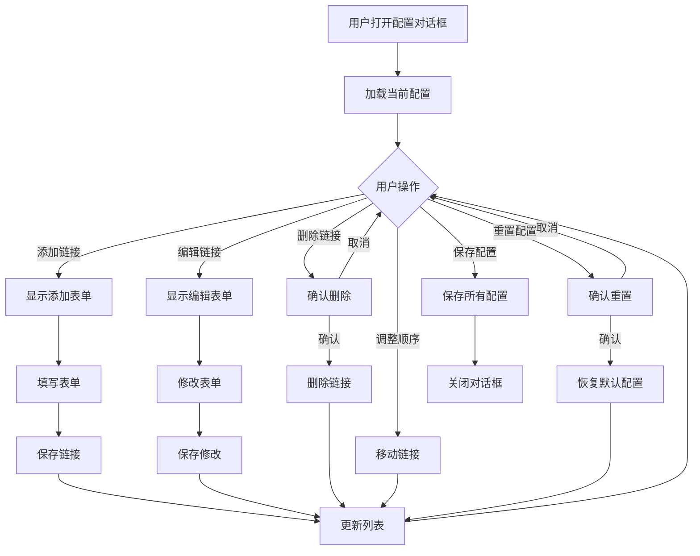

##### 2.2 表单验证规则

**名称验证**:
- 必填项
- 长度: 1-50字符
- 不能包含特殊字符

**路径验证**:
- 必填项
- URL类型: 必须是有效的URL格式
- EXE类型: 必须是有效的文件路径

**图标内容验证**:
- 必填项
- SVG类型: 必须是有效的SVG代码
- 图片URL类型: 必须是有效的URL
- Emoji类型: 必须是有效的Emoji字符

##### 2.3 操作反馈

**成功反馈**:
- 保存成功: 显示Toast提示 "保存成功!"
- 添加成功: 列表自动刷新,显示新添加的项
- 删除成功: 列表自动刷新,移除对应项

**错误反馈**:
- 表单验证失败: 显示错误提示,高亮错误字段
- 保存失败: 显示错误对话框,提供重试选项

**确认对话框**:
- 删除操作: "确定要删除这个快速链接吗?"
- 重置操作: "确定要重置为默认配置吗? 这将丢失所有自定义配置!"

#### 3. 视觉设计

##### 3.1 色彩方案

**主色调**:
- 主按钮背景: #0366d6
- 主按钮文字: #ffffff
- 危险按钮背景: #d73a49
- 危险按钮文字: #ffffff

**辅助色**:
- 边框: #e1e4e8
- 背景: #f6f8fa
- 文字: #24292e
- 次要文字: #586069

**状态色**:
- 成功: #28a745
- 错误: #d73a49
- 警告: #f66
- 信息: #0366d6

##### 3.2 字体规范

**字体家族**:
```css
font-family: -apple-system, BlinkMacSystemFont, "Segoe UI", Roboto, "Helvetica Neue", Arial, sans-serif;
```

**字体大小**:
- 标题: 20px
- 正文: 14px
- 小字: 12px
- 代码: 14px (monospace)

##### 3.3 间距规范

- 容器内边距: 20px
- 表单组间距: 16px
- 按钮间距: 10px
- 列表项间距: 12px
- 列表项内边距: 12px

##### 3.4 阴影效果

**对话框阴影**:
```css
box-shadow: 0 2px 8px rgba(0,0,0,0.1);
```

**模态遮罩**:
```css
background: rgba(0,0,0,0.5);
```

#### 4. 组件设计

##### 4.1 链接列表项组件

**结构**:
```html
<div class="link-item">
    <div class="link-icon">
        <!-- 图标内容 -->
    </div>
    <div class="link-info">
        <div class="link-name">链接名称</div>
        <div class="link-path">链接路径</div>
    </div>
    <div class="link-actions">
        <button>⬆️</button>
        <button>⬇️</button>
        <button>✏️ 编辑</button>
        <button>🗑️ 删除</button>
    </div>
</div>
```

**样式**:
```css
.link-item {
    display: flex;
    align-items: center;
    padding: 12px;
    border-bottom: 1px solid #e1e4e8;
}

.link-item:hover {
    background: #f6f8fa;
}

.link-item.disabled {
    opacity: 0.5;
}
```

##### 4.2 表单组件

**输入框**:
```css
input[type="text"], select, textarea {
    width: 100%;
    padding: 8px 12px;
    border: 1px solid #e1e4e8;
    border-radius: 4px;
    font-size: 14px;
}

input:focus, select:focus, textarea:focus {
    border-color: #0366d6;
    outline: none;
    box-shadow: 0 0 0 3px rgba(3, 102, 214, 0.1);
}
```

**按钮**:
```css
button {
    padding: 8px 16px;
    border: 1px solid #d1d5da;
    border-radius: 4px;
    background: white;
    cursor: pointer;
    font-size: 14px;
}

button:hover {
    background: #f6f8fa;
    border-color: #0366d6;
}

button.primary {
    background: #0366d6;
    color: white;
    border-color: #0366d6;
}

button.danger {
    background: #d73a49;
    color: white;
    border-color: #d73a49;
}
```

#### 5. 响应式设计

**窗口大小调整**:
- 最小宽度: 600px
- 最小高度: 400px
- 列表区域自动滚动

**表单适配**:
- 表单宽度固定500px
- 居中显示
- 超出高度自动滚动

#### 6. 可访问性设计

**键盘导航**:
- Tab键: 在表单元素间切换
- Enter键: 提交表单
- Esc键: 关闭对话框

**屏幕阅读器支持**:
- 所有表单元素都有label
- 按钮都有明确的文字说明
- 图标有alt属性

**焦点管理**:
- 对话框打开时自动聚焦第一个输入框
- 表单验证失败时聚焦错误字段
- 关闭对话框时恢复焦点

#### 7. 性能优化

**渲染优化**:
- 使用虚拟滚动处理大量链接
- 图标懒加载
- 防抖处理用户输入

**内存优化**:
- 及时清理DOM元素
- 避免内存泄漏
- 合理使用事件监听

#### 8. 安全设计

**输入验证**:
- 防止XSS攻击
- 路径验证
- URL验证

**数据安全**:
- 配置文件权限控制
- 敏感信息加密
- 数据备份机制

---

# CSS实现规范 (原UI样式规范文档)

> **更新于 2026-11-19（对照 v1.3.9）**：本文档的 CSS 变量体系（`--system-font-*` / `--bg-color` / `--card-bg` / `--text-color` / `--accent-color` / `--hover-bg` / `--title-bar-gradient` / `--spacing-*`）与当前代码一致，由主题系统（28 种应用主题）在运行时注入；固定色值示例已改为变量引用。新增说明：对话框尺寸以组件 CSS 实测为准（下表已更新）。

# 白泽笔记 UI样式规范文档

## 目录
- [概述](#概述)
- [字体系统](#字体系统)
- [颜色系统](#颜色系统)
- [布局规范](#布局规范)
- [组件样式](#组件样式)
- [对话框样式](#对话框样式)
- [配置页面样式](#配置页面样式)

---

## 概述

本文档定义了白泽笔记应用的UI样式规范，确保所有界面元素保持一致的视觉风格和交互体验。

### 设计原则
- **一致性**：所有界面元素使用统一的样式规范
- **可访问性**：支持系统字体配置，确保良好的可读性
- **响应式**：使用相对单位和CSS变量，便于主题切换
- **交互性**：提供清晰的视觉反馈和流畅的过渡动画

---

## 字体系统

### 字体变量定义
```css
:root {
    --system-font-family: 'Microsoft YaHei', 'Segoe UI', sans-serif;
    --system-font-size: 13px;

    /* 相对字体大小 */
    --font-size-xs: calc(var(--system-font-size) - 2px);  /* 11px - 提示文字 */
    --font-size-sm: calc(var(--system-font-size) - 1px);  /* 12px */
    --font-size-base: var(--system-font-size);            /* 13px - 基础大小 */
    --font-size-lg: calc(var(--system-font-size) + 1px);  /* 14px - 标题、图标 */
    --font-size-xl: calc(var(--system-font-size) + 2px);  /* 15px - 大按钮 */
    --font-size-2xl: calc(var(--system-font-size) + 4px); /* 17px - 大标题 */
}
```

### 字体使用规范
| 元素 | 字体大小 | 字重 | 说明 |
|------|---------|------|------|
| 正文内容 | var(--font-size-base) | normal | 基础文字大小 |
| 提示文字 | var(--font-size-xs) | normal | 辅助说明文字 |
| 配置项标签 | var(--font-size-base) | 500 | 配置项名称 |
| 区域标题 | var(--font-size-2xl) | 600 | 大标题 |
| 分组标题 | var(--font-size-lg) | 600 | 小标题 |
| 侧边栏菜单 | var(--font-size-base) | 500 | 导航菜单 |

---

## 颜色系统

### 主题颜色变量
```css
:root {
    --bg-color: #f5f5f5;           /* 背景色 */
    --card-bg: #ffffff;            /* 卡片背景色 */
    --text-color: #333333;         /* 主文字颜色 */
    --secondary-text-color: #666666; /* 次要文字颜色 */
    --border-color: #e0e0e0;       /* 边框颜色 */
    --accent-color: #764ba2;       /* 强调色 */
    --hover-bg: #f0e8ff;           /* 悬停背景色 */
    --title-bar-gradient: linear-gradient(135deg, #667eea 0%, #764ba2 100%);
}
```

### 颜色使用规范
- **主文字**：`var(--text-color)` - 用于主要内容和标签
- **次要文字**：`var(--secondary-text-color)` - 用于提示和说明
- **强调色**：`var(--accent-color)` - 用于激活状态、链接、按钮
- **边框**：`var(--border-color)` - 用于分割线和边框
- **悬停**：`var(--hover-bg)` - 用于鼠标悬停状态

---

## 布局规范

### 间距系统
```css
/* 基础间距单位：4px */
--spacing-xs: 4px;
--spacing-sm: 8px;
--spacing-md: 12px;
--spacing-lg: 16px;
--spacing-xl: 20px;
--spacing-2xl: 24px;
```

### 常用间距
| 场景 | 间距值 | 说明 |
|------|--------|------|
| 配置项行间距 | 8px | 配置项之间的垂直间距 |
| 配置项内边距 | 2px 0 | 配置项的上下内边距 |
| 配置项容器间距 | 8px | 容器内元素间距 |
| 配置项分组间距 | 12px | 分组之间的间距 |
| 内容区域内边距 | 16px 20px | 内容区域的padding |
| 侧边栏宽度 | 30% | 对话框宽度的30% |

---

## 组件样式

### 输入框 (Input)

#### 数字输入框
```css
.number-input {
    width: 100px;                  /* 固定宽度 */
    padding: 6px 10px;             /* 内边距 */
    border: 1px solid var(--border-color);
    border-radius: 6px;            /* 圆角 */
    background: var(--bg-color);
    color: var(--text-color);
    font-size: var(--font-size-base);
    transition: all 0.2s ease;     /* 过渡动画 */
}

.number-input:focus {
    outline: none;
    border-color: var(--accent-color);
    box-shadow: 0 0 0 3px rgba(var(--accent-color-rgb), 0.1);
}
```

#### 文本输入框
```css
.setting-input {
    width: 200px;                  /* 固定宽度 */
    padding: 6px 10px;
    border: 1px solid var(--border-color);
    border-radius: 6px;
    background: var(--bg-color);
    color: var(--text-color);
    font-size: var(--font-size-base);
    transition: all 0.2s ease;
}

.setting-input:focus {
    outline: none;
    border-color: var(--accent-color);
    box-shadow: 0 0 0 3px rgba(var(--accent-color-rgb), 0.1);
}
```

### 下拉列表 (Select)

```css
.setting-select {
    width: 200px;                  /* 固定宽度 */
    padding: 6px 10px;
    border: 1px solid var(--border-color);
    border-radius: 6px;
    background: var(--bg-color);
    color: var(--text-color);
    font-size: var(--font-size-base);
    cursor: pointer;               /* 指针光标 */
    transition: all 0.2s ease;
}

.setting-select:focus {
    outline: none;
    border-color: var(--accent-color);
    box-shadow: 0 0 0 3px rgba(var(--accent-color-rgb), 0.1);
}
```

### 复选框 (Checkbox)

```css
.setting-checkbox {
    display: flex;
    align-items: center;
    gap: 8px;
}

.setting-checkbox input[type="checkbox"] {
    width: 16px;
    height: 16px;
    cursor: pointer;
    accent-color: var(--accent-color);
    border-radius: 4px;
}

.setting-checkbox label {
    font-size: var(--font-size-base);
    cursor: pointer;
    color: var(--text-color);
}
```

### 按钮 (Button)

```css
.btn {
    padding: 8px 20px;
    font-size: var(--font-size-base);
    border: 1px solid var(--border-color);
    border-radius: 6px;
    background: var(--card-bg);
    color: var(--text-color);
    cursor: pointer;
    transition: all 0.2s ease;
    font-weight: 500;
}

.btn:hover {
    background: var(--hover-bg);
    border-color: var(--accent-color);
    transform: translateY(-1px);
    box-shadow: 0 2px 8px rgba(0, 0, 0, 0.1);
}

.btn-primary {
    background: var(--accent-color);
    color: var(--card-bg);
    border-color: var(--accent-color);
}
```

---

## 对话框样式

### 对话框尺寸（v1.3.0 实测）
| 对话框类型 | 宽度 | 高度 | 说明 |
|-----------|------|------|---------|
| 编辑器设置（EditorSettingDialog） | 900px | 700px | 左侧导航 + 右侧选项 |
| 系统设置（SystemSettingDialog） | 900px | 650px | 左侧导航 + 右侧内容 |
| Mermaid 编辑（MermaidEditDialog） | 1400px | 自适应 | 大屏编辑布局 |
| 快捷链接设置（QuickLinkSettingDialog） | 800px | 自适应 | 列表 + 表单 |
| 插入图片（InsertImageDialog） | 600px | 自适应 | 图片来源 + 设置 |
| 日志/关于/技术栈 | 750~900px | 自适应 | 纯展示 |

> 尺寸统计口径：各 Vue 对话框根容器 CSS 的 `width/height` 实测值（2026-11-15）。

### 标题栏
```css
.title-bar {
    height: 48px;
    padding: 0 24px;
    background: var(--title-bar-gradient);
    color: white;
    display: flex;
    justify-content: space-between;
    align-items: center;
    box-shadow: 0 2px 8px rgba(0, 0, 0, 0.1);
}

.title-text {
    font-size: var(--font-size-lg);
    font-weight: 600;
    letter-spacing: 0.3px;
}

.close-btn {
    background: rgba(255, 255, 255, 0.15);
    border: none;
    color: white;
    font-size: var(--font-size-xl);
    width: 32px;
    height: 32px;
    border-radius: 6px;
    cursor: pointer;
    transition: all 0.2s ease;
}

.close-btn:hover {
    background: rgba(255, 255, 255, 0.25);
    transform: scale(1.05);
}
```

### 侧边栏
```css
.sidebar {
    width: 30%;                    /* 对话框宽度的30% */
    background: var(--card-bg);
    border-right: 1px solid var(--border-color);
    padding: 16px 0;
    overflow-y: auto;
}

.sidebar-item {
    padding: 12px 24px;
    cursor: pointer;
    font-size: var(--font-size-base);
    transition: all 0.2s ease;
    color: var(--text-color);
    display: flex;
    align-items: center;
    border-left: 3px solid transparent;
    margin: 2px 0;
}

.sidebar-item:hover {
    background: var(--hover-bg);
}

.sidebar-item.active {
    background: var(--hover-bg);
    border-left-color: var(--accent-color);
    color: var(--accent-color);
    font-weight: 500;
}
```

### 内容区域
```css
.content-area {
    flex: 1;
    padding: 16px 20px;
    overflow-y: auto;
    background: var(--card-bg);
}
```

---

## 配置页面样式

### 配置项布局
```css
.setting-group {
    display: grid;
    grid-template-columns: 180px 1fr;  /* 标签宽度180px */
    align-items: center;
    gap: 8px;
    width: 100%;
    padding: 2px 0;
}

.setting-label {
    font-size: var(--font-size-base);
    color: var(--text-color);
    text-align: right;
    padding-right: 8px;
    font-weight: 500;
}

.setting-value {
    display: flex;
    align-items: center;
    gap: 8px;
}
```

### 配置项容器
```css
.settings-grid {
    display: flex;
    flex-direction: column;
    gap: 8px;
}

.settings-group-container {
    margin-bottom: 12px;
    padding: 10px;
    background: var(--bg-color);
    border-radius: 8px;
    border: 1px solid var(--border-color);
}

.settings-group-title {
    font-size: var(--font-size-lg);
    font-weight: 600;
    color: var(--text-color);
    margin-bottom: 10px;
    padding-bottom: 6px;
    border-bottom: 1px solid var(--border-color);
    letter-spacing: 0.2px;
}
```

### 区域标题
```css
.section-title {
    font-size: var(--font-size-2xl);
    font-weight: 600;
    margin-bottom: 16px;
    padding-bottom: 8px;
    border-bottom: 2px solid var(--border-color);
    color: var(--text-color);
    letter-spacing: 0.3px;
}
```

### 底部按钮栏
```css
.button-group {
    flex-shrink: 0;
    display: flex;
    justify-content: flex-end;
    gap: 10px;
    padding: 12px 20px;
    background: var(--card-bg);
    border-top: 1px solid var(--border-color);
}
```

---

## 宽度规范总结

### 输入控件宽度
| 控件类型 | 宽度 | 使用场景 |
|---------|------|---------|
| 数字输入框 | 100px | 输入数值、像素值、时间等 |
| 下拉列表 | 200px | 选择选项、样式等 |
| 文本输入框 | 200px | 输入文本、路径等 |

### 布局宽度
| 元素 | 宽度 | 说明 |
|------|------|------|
| 配置项标签 | 180px | grid布局的第一列 |
| 侧边栏 | 30% | 对话框宽度的30% |
| 内容区域 | 70% | 对话框宽度的70% |

---

## 交互状态

### Focus状态
所有可交互元素在获得焦点时：
- 移除默认outline
- 边框颜色变为强调色
- 添加3px的外阴影（rgba格式的强调色，透明度0.1）

### Hover状态
- 按钮：背景色变化 + 轻微上移(translateY(-1px)) + 阴影
- 菜单项：背景色变化
- 关闭按钮：背景色变化 + 缩放(scale(1.05))

### 过渡动画
```css
transition: all 0.2s ease;
```

---

## 最佳实践

### 1. 使用CSS变量
- 优先使用预定义的CSS变量
- 避免硬编码颜色值和字体大小
- 使用相对字体大小变量

### 2. 保持一致性
- 相同类型的控件使用相同的样式
- 统一使用圆角6px
- 统一使用过渡动画

### 3. 可访问性
- 确保足够的对比度
- 提供清晰的focus状态
- 使用合适的字体大小

### 4. 性能优化
- 使用transform代替top/left
- 使用opacity代替visibility
- 合理使用will-change

### 5. 配置项布局规范
- **必须使用 `settings-grid` 容器**包裹配置项，容器有 `gap: 8px` 的间距
- **禁止使用 `setting-row`**，统一使用 `setting-group`
- 所有标签、标题等字体必须使用 `var(--system-font-family)` 和 `var(--system-font-size)` 变量

---

## 更新日志

### v1.3.6 (2026-11-19，统计口径复核)
- 统计口径统一：IPC 91 通道 / 17 组、preload 白名单 60 + 25、测试 171 文件 / 3,265 用例、插件工具 38 个、Vue 组件 81 个、Vue 对话框 18 个、事件总线 24 个、源码 313 个 `.ts/.vue` / 约 83,700 行、菜单 12 个顶层 / 319 个可触发项
- §7 API 章节按受限 `ipcRenderer`（send/invoke 58 + on/once 25 白名单）与 17 组通道表更新；§15 插件系统更新为 38 个内置工具的真实清单

### v1.3.0 (2026-11-15)
- 全文档对照 v1.3.0 代码校准：技术栈 / 组件数 / 菜单 / 快捷键 / 对话框 / 主题 / 色彩 / API / 性能 / 安全 / i18n / 测试 / 部署
- 色彩与字体改为主题化 CSS 变量（主色由当前应用主题 `--accent-color` 决定）
- 对话框尺寸按组件 CSS 实测更新
- 删除 PRE/POST_RENDER、Vuex、动态插件等过时设计；标注历史设计草案章节

### v1.1.0 (2024-01-XX)
- 更新侧边栏宽度为30%
- 更新配置项行间距为8px
- 规范化配置项布局，使用settings-grid容器
- 禁止使用setting-row，统一使用setting-group
- 强制使用系统字体变量

### v1.0.0 (2024-01-XX)
- 初始版本
- 定义基础字体系统
- 定义颜色系统
- 定义组件样式规范
- 统一配置页面样式
- 优化行间距和布局

---

## 参考资源

- [Material Design](https://material.io/design)
- [Ant Design](https://ant.design/docs/spec/introduce)
- [Element UI](https://element.eleme.io/#/zh-CN/component/installation)
- [VS Code Design](https://code.visualstudio.com/api/references/vscode-api)

---

**文档版本**：v3.1（2026-11-19，对照项目 v1.3.9）
**维护者**：hemy08
**事实基线**：当前实测（v1.3.9，2026-11-19）——[报告总索引](../../reports/README.md) / [IPC 通信矩阵](../../reports/md/03-专项治理/IPC通信矩阵.md)

